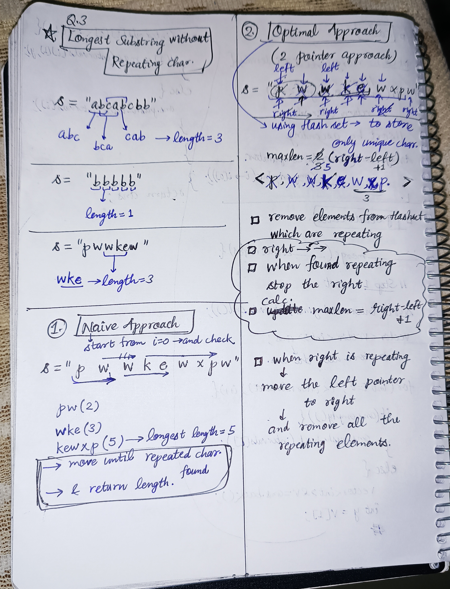

<h2><a href="https://leetcode.com/problems/longest-substring-without-repeating-characters">3. Longest Substring Without Repeating Characters</a></h2><h3>Medium</h3><hr><p>Given a string <code>s</code>, find the length of the <strong>longest</strong> <span data-keyword="substring-nonempty"><strong>substring</strong></span> without duplicate characters.</p>

<p>&nbsp;</p>
<p><strong class="example">Example 1:</strong></p>

<pre>
<strong>Input:</strong> s = &quot;abcabcbb&quot;
<strong>Output:</strong> 3
<strong>Explanation:</strong> The answer is &quot;abc&quot;, with the length of 3. Note that <code>&quot;bca&quot;</code> and <code>&quot;cab&quot;</code> are also correct answers.
</pre>

<p><strong class="example">Example 2:</strong></p>

<pre>
<strong>Input:</strong> s = &quot;bbbbb&quot;
<strong>Output:</strong> 1
<strong>Explanation:</strong> The answer is &quot;b&quot;, with the length of 1.
</pre>

<p><strong class="example">Example 3:</strong></p>

<pre>
<strong>Input:</strong> s = &quot;pwwkew&quot;
<strong>Output:</strong> 3
<strong>Explanation:</strong> The answer is &quot;wke&quot;, with the length of 3.
Notice that the answer must be a substring, &quot;pwke&quot; is a subsequence and not a substring.
</pre>

<p>&nbsp;</p>
<p><strong>Constraints:</strong></p>

<ul>
	<li><code>0 &lt;= s.length &lt;= 10<sup>5</sup></code></li>
	<li><code>s</code> consists of English letters, digits, symbols and spaces.</li>
</ul>


<!-- AUTO-GENERATED-SOLUTION-START -->
---

## 🧠 Visual Solution & Intuition



---

## 💡 Approach

```text
Approach : Sliding Window + HashSet
```

---

## 💻 C++ Solution

[View Original C++ File](./0003-longest-substring-without-repeating-characters.cpp)

```cpp
class Solution {
public:
    //Approach : Sliding Window + HashSet

    
    int lengthOfLongestSubstring(string s) {
        
        //Step-1: Initialize variables
        int n = s.length();

        int left = 0;

        int maxLength = 0;

        unordered_set<char> currWindow;

        //Step-2: Expand the sliding window using right
        for(int right = 0; right < n; right++){

            //Step-3: Remove Duplicates
            while(currWindow.count(s[right])){

                currWindow.erase(s[left]);// Remove the leftmost character from the set
                left++;//move the left pointer to shorten the window size

            }

            //Step-4: Add current character to window
            currWindow.insert(s[right]);

            //Step-5: Update maxLength
            maxLength = max(maxLength, right - left + 1);
        }


        //Step-6 : Return the answer
        return maxLength;
    }
};
```

<!-- AUTO-GENERATED-SOLUTION-END -->
