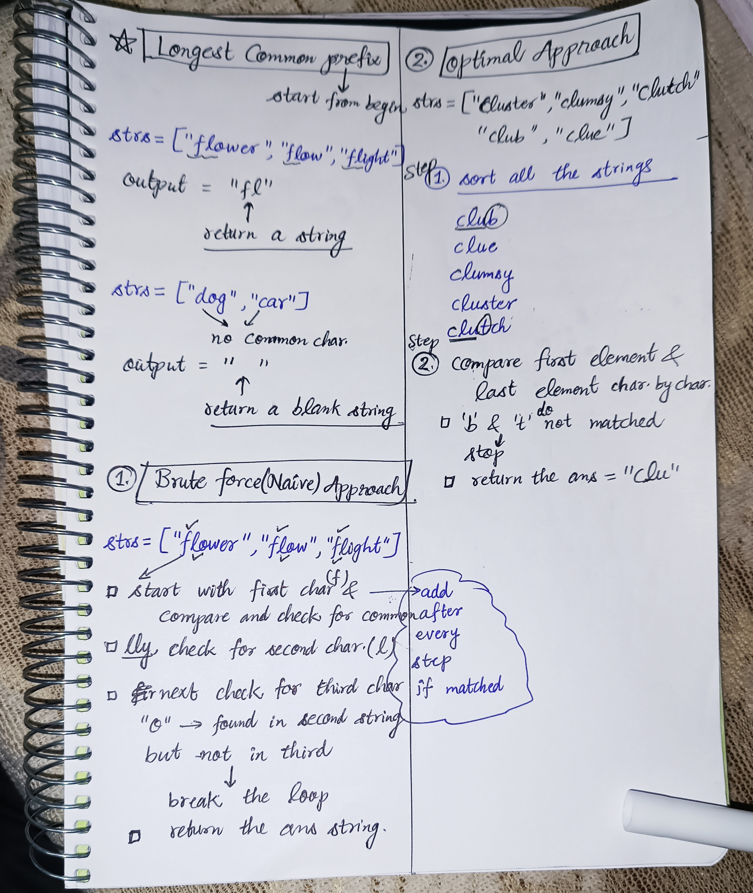

<h2><a href="https://leetcode.com/problems/longest-common-prefix">14. Longest Common Prefix</a></h2><h3>Easy</h3><hr><p>Write a function to find the longest common prefix string amongst an array of strings.</p>

<p>If there is no common prefix, return an empty string <code>&quot;&quot;</code>.</p>

<p>&nbsp;</p>
<p><strong class="example">Example 1:</strong></p>

<pre>
<strong>Input:</strong> strs = [&quot;flower&quot;,&quot;flow&quot;,&quot;flight&quot;]
<strong>Output:</strong> &quot;fl&quot;
</pre>

<p><strong class="example">Example 2:</strong></p>

<pre>
<strong>Input:</strong> strs = [&quot;dog&quot;,&quot;racecar&quot;,&quot;car&quot;]
<strong>Output:</strong> &quot;&quot;
<strong>Explanation:</strong> There is no common prefix among the input strings.
</pre>

<p>&nbsp;</p>
<p><strong>Constraints:</strong></p>

<ul>
	<li><code>1 &lt;= strs.length &lt;= 200</code></li>
	<li><code>0 &lt;= strs[i].length &lt;= 200</code></li>
	<li><code>strs[i]</code> consists of only lowercase English letters if it is non-empty.</li>
</ul>


<!-- AUTO-GENERATED-SOLUTION-START -->
---

## 🧠 Visual Solution & Intuition



---

## ⏱️ Complexity Analysis

```text
Time Complexity = O(nlogn) = O(nlogn) for sorting + O(n) for traversing
Space Complexity = O(1) => no extra data structure used.
```

---

## 💻 C++ Solution

[View Original C++ File](./0014-longest-common-prefix.cpp)

```cpp
class Solution {
public:
    //Time Complexity = O(nlogn) = O(nlogn) for sorting + O(n) for traversing
    //Space Complexity = O(1) => no extra data structure used.
    
    string longestCommonPrefix(vector<string>& strs) {
        string result = "" ; //make an empty string to store the results

        //edge case : if no char matched return empty string
        if(strs.empty()) return "" ;

        //Step 1 : sort the strings
        sort(strs.begin(), strs.end()) ;

        //Step 2 : compare first and last 
        string first = strs.front() ;
        string last = strs.back() ;

        for(int i=0 ; i<first.length() ; i++){
            if(i >= first.length() || first[i] != last[i])
               break ; //when char. not matched stop comparing

            result += first[i] ; //add matched chars. in result string   
        }

        return result ; //very important to return the ans.

    }
};
```

<!-- AUTO-GENERATED-SOLUTION-END -->
