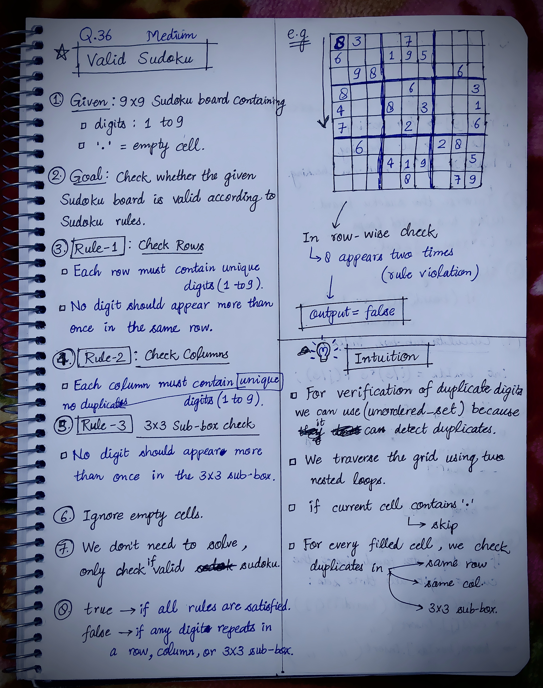
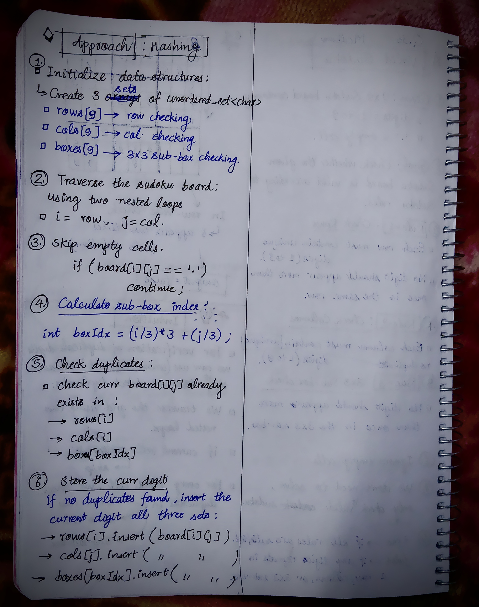

<h2><a href="https://leetcode.com/problems/valid-sudoku">36. Valid Sudoku</a></h2><h3>Medium</h3><hr><p>Determine if a&nbsp;<code>9 x 9</code> Sudoku board&nbsp;is valid.&nbsp;Only the filled cells need to be validated&nbsp;<strong>according to the following rules</strong>:</p>

<ol>
	<li>Each row&nbsp;must contain the&nbsp;digits&nbsp;<code>1-9</code> without repetition.</li>
	<li>Each column must contain the digits&nbsp;<code>1-9</code>&nbsp;without repetition.</li>
	<li>Each of the nine&nbsp;<code>3 x 3</code> sub-boxes of the grid must contain the digits&nbsp;<code>1-9</code>&nbsp;without repetition.</li>
</ol>

<p><strong>Note:</strong></p>

<ul>
	<li>A Sudoku board (partially filled) could be valid but is not necessarily solvable.</li>
	<li>Only the filled cells need to be validated according to the mentioned&nbsp;rules.</li>
</ul>

<p>&nbsp;</p>
<p><strong class="example">Example 1:</strong></p>

<pre>
<strong>Input:</strong> board = 
[[&quot;5&quot;,&quot;3&quot;,&quot;.&quot;,&quot;.&quot;,&quot;7&quot;,&quot;.&quot;,&quot;.&quot;,&quot;.&quot;,&quot;.&quot;]
,[&quot;6&quot;,&quot;.&quot;,&quot;.&quot;,&quot;1&quot;,&quot;9&quot;,&quot;5&quot;,&quot;.&quot;,&quot;.&quot;,&quot;.&quot;]
,[&quot;.&quot;,&quot;9&quot;,&quot;8&quot;,&quot;.&quot;,&quot;.&quot;,&quot;.&quot;,&quot;.&quot;,&quot;6&quot;,&quot;.&quot;]
,[&quot;8&quot;,&quot;.&quot;,&quot;.&quot;,&quot;.&quot;,&quot;6&quot;,&quot;.&quot;,&quot;.&quot;,&quot;.&quot;,&quot;3&quot;]
,[&quot;4&quot;,&quot;.&quot;,&quot;.&quot;,&quot;8&quot;,&quot;.&quot;,&quot;3&quot;,&quot;.&quot;,&quot;.&quot;,&quot;1&quot;]
,[&quot;7&quot;,&quot;.&quot;,&quot;.&quot;,&quot;.&quot;,&quot;2&quot;,&quot;.&quot;,&quot;.&quot;,&quot;.&quot;,&quot;6&quot;]
,[&quot;.&quot;,&quot;6&quot;,&quot;.&quot;,&quot;.&quot;,&quot;.&quot;,&quot;.&quot;,&quot;2&quot;,&quot;8&quot;,&quot;.&quot;]
,[&quot;.&quot;,&quot;.&quot;,&quot;.&quot;,&quot;4&quot;,&quot;1&quot;,&quot;9&quot;,&quot;.&quot;,&quot;.&quot;,&quot;5&quot;]
,[&quot;.&quot;,&quot;.&quot;,&quot;.&quot;,&quot;.&quot;,&quot;8&quot;,&quot;.&quot;,&quot;.&quot;,&quot;7&quot;,&quot;9&quot;]]
<strong>Output:</strong> true
</pre>

<p><strong class="example">Example 2:</strong></p>

<pre>
<strong>Input:</strong> board = 
[[&quot;8&quot;,&quot;3&quot;,&quot;.&quot;,&quot;.&quot;,&quot;7&quot;,&quot;.&quot;,&quot;.&quot;,&quot;.&quot;,&quot;.&quot;]
,[&quot;6&quot;,&quot;.&quot;,&quot;.&quot;,&quot;1&quot;,&quot;9&quot;,&quot;5&quot;,&quot;.&quot;,&quot;.&quot;,&quot;.&quot;]
,[&quot;.&quot;,&quot;9&quot;,&quot;8&quot;,&quot;.&quot;,&quot;.&quot;,&quot;.&quot;,&quot;.&quot;,&quot;6&quot;,&quot;.&quot;]
,[&quot;8&quot;,&quot;.&quot;,&quot;.&quot;,&quot;.&quot;,&quot;6&quot;,&quot;.&quot;,&quot;.&quot;,&quot;.&quot;,&quot;3&quot;]
,[&quot;4&quot;,&quot;.&quot;,&quot;.&quot;,&quot;8&quot;,&quot;.&quot;,&quot;3&quot;,&quot;.&quot;,&quot;.&quot;,&quot;1&quot;]
,[&quot;7&quot;,&quot;.&quot;,&quot;.&quot;,&quot;.&quot;,&quot;2&quot;,&quot;.&quot;,&quot;.&quot;,&quot;.&quot;,&quot;6&quot;]
,[&quot;.&quot;,&quot;6&quot;,&quot;.&quot;,&quot;.&quot;,&quot;.&quot;,&quot;.&quot;,&quot;2&quot;,&quot;8&quot;,&quot;.&quot;]
,[&quot;.&quot;,&quot;.&quot;,&quot;.&quot;,&quot;4&quot;,&quot;1&quot;,&quot;9&quot;,&quot;.&quot;,&quot;.&quot;,&quot;5&quot;]
,[&quot;.&quot;,&quot;.&quot;,&quot;.&quot;,&quot;.&quot;,&quot;8&quot;,&quot;.&quot;,&quot;.&quot;,&quot;7&quot;,&quot;9&quot;]]
<strong>Output:</strong> false
<strong>Explanation:</strong> Same as Example 1, except with the <strong>5</strong> in the top left corner being modified to <strong>8</strong>. Since there are two 8&#39;s in the top left 3x3 sub-box, it is invalid.
</pre>

<p>&nbsp;</p>
<p><strong>Constraints:</strong></p>

<ul>
	<li><code>board.length == 9</code></li>
	<li><code>board[i].length == 9</code></li>
	<li><code>board[i][j]</code> is a digit <code>1-9</code> or <code>&#39;.&#39;</code>.</li>
</ul>


<!-- AUTO-GENERATED-SOLUTION-START -->
---

## 🧠 Visual Solution & Intuition

### Part 1



### Part 2



---

## 💡 Approach

```text
Approach : Hashing (Using Unordered Sets)
```

---

## ⏱️ Complexity Analysis

```text
Time Complexity = O(1) =>
Space Complexity = O(1) =>
```

---

## 💻 C++ Solution

[View Original C++ File](./0036-valid-sudoku.cpp)

```cpp
class Solution {
public:
    //Approach : Hashing (Using Unordered Sets)

    //Time Complexity = O(1) =>
    /* We traverse exactly 9 × 9 = 81 cells.
    * Each hash set lookup and insertion takes O(1) average time.
    * Since the board size is fixed, the overall time complexity is O(1).
    */

    //Space Complexity = O(1) =>
    /* We maintain 9 sets for rows, 9 for columns, and 9 for sub-boxes.
    * Each set stores at most 9 digits.
    * Since the storage requirement is fixed, the overall space complexity is O(1).
    */

    bool isValidSudoku(vector<vector<char>>& board) {
        
        int m = board.size();//row size
        int n = board[0].size();//column size

        //1.) Initialize 3 unordered_set<char>
        unordered_set<char> rows[9];
        unordered_set<char> cols[9];
        unordered_set<char> boxes[9];

        //2.) traverse sudoku board using two nested loops
        for(int i = 0; i < m; i++){

            for(int j = 0; j < n; j++){
                 
                //4.)
                int boxIdx = (i/3)*3 + (j/3);
                
                //3.) Skip empty cells
                if(board[i][j] == '.'){
                    continue;
                }

                //5.) check duplicates
                if(rows[i].count(board[i][j]) || cols[j].count(board[i][j]) || boxes[boxIdx].count(board[i][j])){
                    return false;
                }

                else{ //6. If not duplicates then store curr digit in sets
                    rows[i].insert(board[i][j]);
                    cols[j].insert(board[i][j]);
                    boxes[boxIdx].insert(board[i][j]);
                }
            }
        }

        //finally if no false found
        return true;

    }
};
```

<!-- AUTO-GENERATED-SOLUTION-END -->
