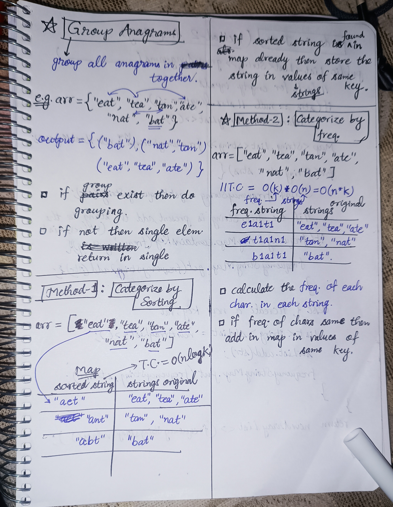

<h2><a href="https://leetcode.com/problems/group-anagrams">49. Group Anagrams</a></h2><h3>Medium</h3><hr><p>Given an array of strings <code>strs</code>, group the <span data-keyword="anagram">anagrams</span> together. You can return the answer in <strong>any order</strong>.</p>

<p>&nbsp;</p>
<p><strong class="example">Example 1:</strong></p>

<div class="example-block">
<p><strong>Input:</strong> <span class="example-io">strs = [&quot;eat&quot;,&quot;tea&quot;,&quot;tan&quot;,&quot;ate&quot;,&quot;nat&quot;,&quot;bat&quot;]</span></p>

<p><strong>Output:</strong> <span class="example-io">[[&quot;bat&quot;],[&quot;nat&quot;,&quot;tan&quot;],[&quot;ate&quot;,&quot;eat&quot;,&quot;tea&quot;]]</span></p>

<p><strong>Explanation:</strong></p>

<ul>
	<li>There is no string in strs that can be rearranged to form <code>&quot;bat&quot;</code>.</li>
	<li>The strings <code>&quot;nat&quot;</code> and <code>&quot;tan&quot;</code> are anagrams as they can be rearranged to form each other.</li>
	<li>The strings <code>&quot;ate&quot;</code>, <code>&quot;eat&quot;</code>, and <code>&quot;tea&quot;</code> are anagrams as they can be rearranged to form each other.</li>
</ul>
</div>

<p><strong class="example">Example 2:</strong></p>

<div class="example-block">
<p><strong>Input:</strong> <span class="example-io">strs = [&quot;&quot;]</span></p>

<p><strong>Output:</strong> <span class="example-io">[[&quot;&quot;]]</span></p>
</div>

<p><strong class="example">Example 3:</strong></p>

<div class="example-block">
<p><strong>Input:</strong> <span class="example-io">strs = [&quot;a&quot;]</span></p>

<p><strong>Output:</strong> <span class="example-io">[[&quot;a&quot;]]</span></p>
</div>

<p>&nbsp;</p>
<p><strong>Constraints:</strong></p>

<ul>
	<li><code>1 &lt;= strs.length &lt;= 10<sup>4</sup></code></li>
	<li><code>0 &lt;= strs[i].length &lt;= 100</code></li>
	<li><code>strs[i]</code> consists of lowercase English letters.</li>
</ul>


<!-- AUTO-GENERATED-SOLUTION-START -->
---

## 🧠 Visual Solution & Intuition



---

## 💡 Approach

```text
Approach : Hashing (Hash Map + Frequency Count)
```

---

## ⏱️ Complexity Analysis

```text
Time Complexity = O(n * k) => n = number of strings in strs, k = maximum length of a string.
Space Complexity = O(n * k) =>
```

---

## 💻 C++ Solution

[View Original C++ File](./0049-group-anagrams.cpp)

```cpp
class Solution {
public:
    //Approach : Hashing (Hash Map + Frequency Count)

    //Time Complexity = O(n * k) => n = number of strings in strs, k = maximum length of a string.
    /* Outer loop goes upto n for n elements : O(n)
    * Inner loop :Each string takes O(k) to count frequencies and O(26) to generate its key. O(k)
    */

    //Space Complexity = O(n * k) =>
    /* Hash map stores frequency keys and groups of strings. : O(n * k)
    * The frequency array takes O(1) extra space (26 characters).
    * Why O(n × k)? unordered_map<string, vector<string>> mp;
    * Keys: In the worst case, there are n unique frequency keys. Each key has a fixed length of 26 frequency entries, so total key space is O(n).
    * Values: The hashmap stores all n original strings. If each string has at most k characters, the total space for strings is O(n × k).
    */


    vector<vector<string>> groupAnagrams(vector<string>& strs) {
        
        int n = strs.size();

        vector<vector<string>> ans; //to store the output
        
        
        unordered_map<string, vector<string>> mp;//(key, value)
        //here key = string type, value = vector<string> (multiple strings)

        for(int i = 0; i < n; i++){
            //make a freq. array to store the freq. of elem in strings.
            vector<int> freq(26);//26 chars. size


            for(int j = 0; j < strs[i].size(); j++){
                
                freq[strs[i][j] - 'a']++;                
            }

            //Convert freq array into unique key
            string key = "";

            for(int j = 0; j < 26; j++){
                key += "$" + to_string(freq[j]);
            }

            // Group strings with the same key
            mp[key].push_back(strs[i]);
        }
        
        //Store all groups values in ans
        for(auto& it : mp){
            ans.push_back(it.second); //in map second column is values of strings
        }

        //finally return the output
        return ans;

    }
};
```

<!-- AUTO-GENERATED-SOLUTION-END -->
