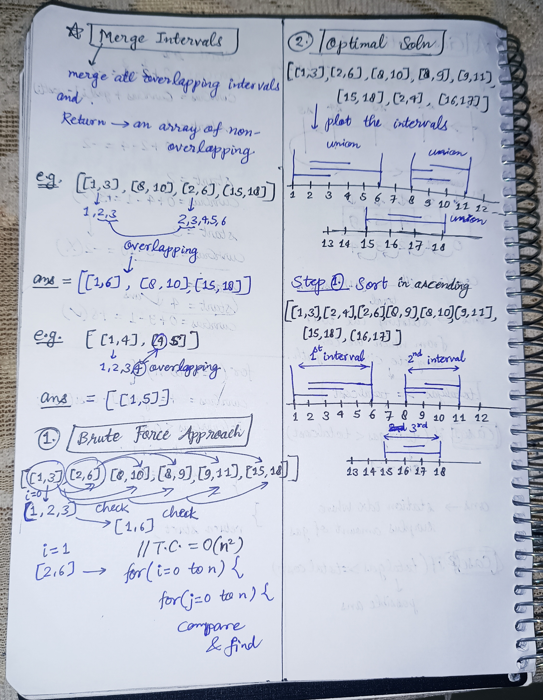

<h2><a href="https://leetcode.com/problems/merge-intervals">56. Merge Intervals</a></h2><h3>Medium</h3><hr><p>Given an array&nbsp;of <code>intervals</code>&nbsp;where <code>intervals[i] = [start<sub>i</sub>, end<sub>i</sub>]</code>, merge all overlapping intervals, and return <em>an array of the non-overlapping intervals that cover all the intervals in the input</em>.</p>

<p>&nbsp;</p>
<p><strong class="example">Example 1:</strong></p>

<pre>
<strong>Input:</strong> intervals = [[1,3],[2,6],[8,10],[15,18]]
<strong>Output:</strong> [[1,6],[8,10],[15,18]]
<strong>Explanation:</strong> Since intervals [1,3] and [2,6] overlap, merge them into [1,6].
</pre>

<p><strong class="example">Example 2:</strong></p>

<pre>
<strong>Input:</strong> intervals = [[1,4],[4,5]]
<strong>Output:</strong> [[1,5]]
<strong>Explanation:</strong> Intervals [1,4] and [4,5] are considered overlapping.
</pre>

<p><strong class="example">Example 3:</strong></p>

<pre>
<strong>Input:</strong> intervals = [[4,7],[1,4]]
<strong>Output:</strong> [[1,7]]
<strong>Explanation:</strong> Intervals [1,4] and [4,7] are considered overlapping.
</pre>

<p>&nbsp;</p>
<p><strong>Constraints:</strong></p>

<ul>
	<li><code>1 &lt;= intervals.length &lt;= 10<sup>4</sup></code></li>
	<li><code>intervals[i].length == 2</code></li>
	<li><code>0 &lt;= start<sub>i</sub> &lt;= end<sub>i</sub> &lt;= 10<sup>4</sup></code></li>
</ul>


<!-- AUTO-GENERATED-SOLUTION-START -->
---

## 🧠 Visual Solution & Intuition



---

## ⏱️ Complexity Analysis

```text
Time Complexity = O(nlogn) for sorting + O(n) for traversing intervals = O(nlogn)
Space Complexity = O(n) => cause using ans vector to store
```

---

## 💻 C++ Solution

[View Original C++ File](./0056-merge-intervals.cpp)

```cpp
class Solution {
public:
   //Time Complexity = O(nlogn) for sorting + O(n) for traversing intervals = O(nlogn) 
   //Space Complexity = O(n) => cause using ans vector to store
    vector<vector<int>> merge(vector<vector<int>>& intervals) {
        //Step 1 : sort in ascending order
        sort(intervals.begin(), intervals.end()) ;

        vector<vector<int>> ans ; //to store all the ans vectors

        //iterate on the intervals
        for(int i=0 ; i<intervals.size() ; i++){

            //if ans vector is empty push current
            if(ans.empty()){
                ans.push_back(intervals[i]) ;
            }
            else{
                vector<int> &v = ans.back() ; //this is prev interval
                //e.g. v = [1,5] so v[0] = 1, v[1] = ending of prev
                int y = v[1] ; //stores the ending of prev
                
                //check if current interval overlaps with prev
                if(intervals[i][0] <= v[1]){
                    v[1] = max(intervals[i][1] , y) ;
                    //ending of prev interval will change to max of current, prev
                }
                else{ //if no overlap then simply add in ans 
                    ans.push_back(intervals[i]) ; //push current
                }
            }
        }

        return ans ; //very important to return the ans vector
    }
};
```

<!-- AUTO-GENERATED-SOLUTION-END -->
