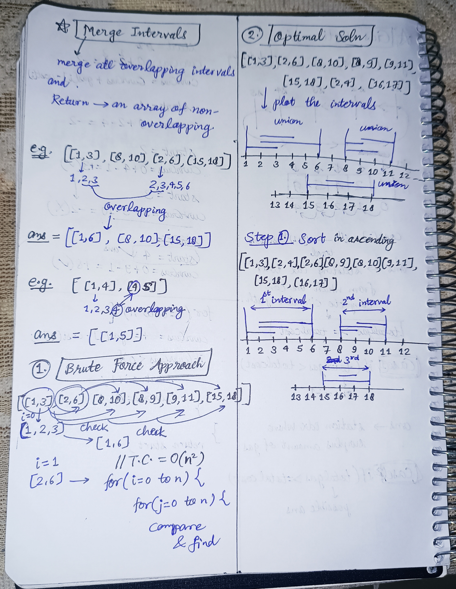

<h2><a href="https://leetcode.com/problems/merge-intervals">56. Merge Intervals</a></h2><h3>Medium</h3><hr><p>Given an array&nbsp;of <code>intervals</code>&nbsp;where <code>intervals[i] = [start<sub>i</sub>, end<sub>i</sub>]</code>, merge all overlapping intervals, and return <em>an array of the non-overlapping intervals that cover all the intervals in the input</em>.</p>

<p>&nbsp;</p>
<p><strong class="example">Example 1:</strong></p>

<pre>
<strong>Input:</strong> intervals = [[1,3],[2,6],[8,10],[15,18]]
<strong>Output:</strong> [[1,6],[8,10],[15,18]]
<strong>Explanation:</strong> Since intervals [1,3] and [2,6] overlap, merge them into [1,6].
</pre>

<p><strong class="example">Example 2:</strong></p>

<pre>
<strong>Input:</strong> intervals = [[1,4],[4,5]]
<strong>Output:</strong> [[1,5]]
<strong>Explanation:</strong> Intervals [1,4] and [4,5] are considered overlapping.
</pre>

<p><strong class="example">Example 3:</strong></p>

<pre>
<strong>Input:</strong> intervals = [[4,7],[1,4]]
<strong>Output:</strong> [[1,7]]
<strong>Explanation:</strong> Intervals [1,4] and [4,7] are considered overlapping.
</pre>

<p>&nbsp;</p>
<p><strong>Constraints:</strong></p>

<ul>
	<li><code>1 &lt;= intervals.length &lt;= 10<sup>4</sup></code></li>
	<li><code>intervals[i].length == 2</code></li>
	<li><code>0 &lt;= start<sub>i</sub> &lt;= end<sub>i</sub> &lt;= 10<sup>4</sup></code></li>
</ul>


<!-- AUTO-GENERATED-SOLUTION-START -->
---

## 🧠 Visual Solution & Intuition



---

## 💡 Approach

```text
Approach : Sorting + Linear Scan (Greedy Interval Merging)
```

---

## ⏱️ Complexity Analysis

```text
Time Complexity = O(n * logn) =>
Space Complexity = O(n) =>
```

---

## 💻 C++ Solution

[View Original C++ File](./0056-merge-intervals.cpp)

```cpp
class Solution {
public:
    //Approach : Sorting + Linear Scan (Greedy Interval Merging)

    //Time Complexity = O(n * logn) =>
    /* Sorting : O(n * logn)
    * Linear Scan : O(n)
    * Total : O(n * logn) + O(n) = O(n * logn)
    */

    //Space Complexity = O(n) =>
    /* O(log n) to O(n) auxiliary space for std::sort recursion stack.
    * O(n) output space to store the merged ans vector.
    * 
    */


    vector<vector<int>> merge(vector<vector<int>>& intervals) {
        // Step 1: Sort intervals by start time.
        sort(intervals.begin(), intervals.end());

        vector<vector<int>> ans; //to store the output

        //Traverse the intervals
        for(auto& interval : intervals){

            // Step 2: If empty or no overlap, add as a new interval.
            if(ans.empty() || ans.back()[1] < interval[0]){ // index[0] = start, index[1] = end, ans.back()[1] means end of ans, interval[0] means start of interval
                ans.push_back(interval);
            }

            // Step 3: If overlapping, expand end to larger boundary.
            else{
                ans.back()[1] = max(ans.back()[1], interval[1]);
            }
        }

        //Finally return the output
        return ans;
    }
};
```

<!-- AUTO-GENERATED-SOLUTION-END -->
