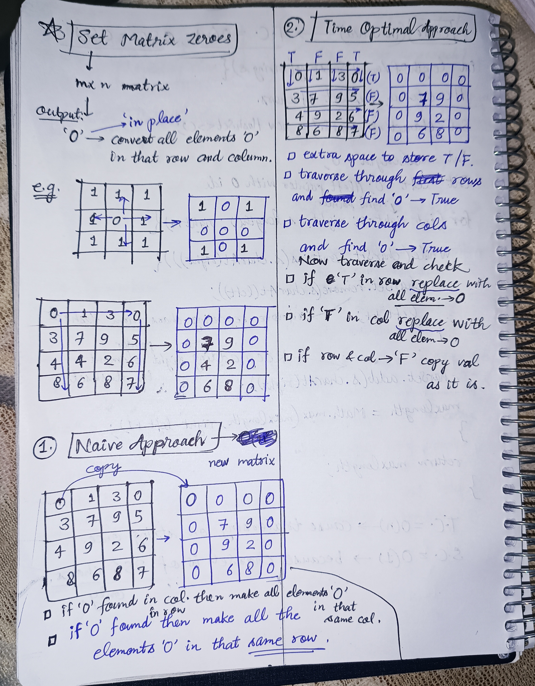
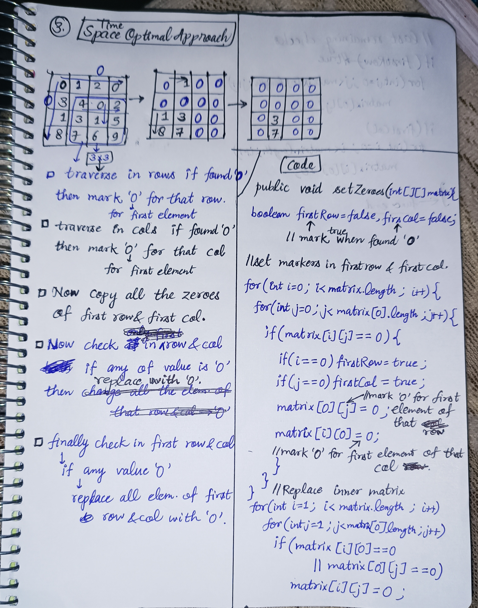

<h2><a href="https://leetcode.com/problems/set-matrix-zeroes">73. Set Matrix Zeroes</a></h2><h3>Medium</h3><hr><p>Given an <code>m x n</code> integer matrix <code>matrix</code>, if an element is <code>0</code>, set its entire row and column to <code>0</code>&#39;s.</p>

<p>You must do it <a href="https://en.wikipedia.org/wiki/In-place_algorithm" target="_blank">in place</a>.</p>

<p>&nbsp;</p>
<p><strong class="example">Example 1:</strong></p>

<pre>
<strong>Input:</strong> matrix = [[1,1,1],[1,0,1],[1,1,1]]
<strong>Output:</strong> [[1,0,1],[0,0,0],[1,0,1]]
</pre>

<p><strong class="example">Example 2:</strong></p>

<pre>
<strong>Input:</strong> matrix = [[0,1,2,0],[3,4,5,2],[1,3,1,5]]
<strong>Output:</strong> [[0,0,0,0],[0,4,5,0],[0,3,1,0]]
</pre>

<p>&nbsp;</p>
<p><strong>Constraints:</strong></p>

<ul>
	<li><code>m == matrix.length</code></li>
	<li><code>n == matrix[0].length</code></li>
	<li><code>1 &lt;= m, n &lt;= 200</code></li>
	<li><code>-2<sup>31</sup> &lt;= matrix[i][j] &lt;= 2<sup>31</sup> - 1</code></li>
</ul>

<p>&nbsp;</p>
<p><strong>Follow up:</strong></p>

<ul>
	<li>A straightforward solution using <code>O(mn)</code> space is probably a bad idea.</li>
	<li>A simple improvement uses <code>O(m + n)</code> space, but still not the best solution.</li>
	<li>Could you devise a constant space solution?</li>
</ul>


<!-- AUTO-GENERATED-SOLUTION-START -->
---

## 🧠 Visual Solution & Intuition

### Part 1



### Part 2



---

## ⏱️ Complexity Analysis

```text
Time Complexity = O(m x n) => for traversing in matrix
Space Complexity = O(1) => no extra array, vector used.
```

---

## 💻 C++ Solution

[View Original C++ File](./0073-set-matrix-zeroes.cpp)

```cpp
class Solution {
public:
    //Time Complexity = O(m x n) => for traversing in matrix
    //Space Complexity = O(1) => no extra array, vector used.
    void setZeroes(vector<vector<int>>& matrix) {
        bool firstRow = false, firstCol = false ;//to mark true when found '0'
        int m = matrix.size() ; //row size
        int n = matrix[0].size() ; //col size

        //set markers in first row and first col
        for(int i=0 ; i<m ; i++){
            for(int j=0 ; j<n ; j++){
                if(matrix[i][j] == 0){
                    if(i == 0) firstRow = true ;
                    if(j == 0) firstCol = true ;
                    matrix[0][j] = 0 ; //replace '0' with first element of that row
                    matrix[i][0] = 0 ; //replace '0' with first element of that col
                }
            }
        }

        //Replace inner matrix
        for(int i=1 ; i<m ; i++){
            for(int j=1 ; j<n ; j++){
                if(matrix[0][j] == 0 || matrix[i][0] == 0){
                    matrix[i][j] = 0 ;
                }//for any element if any of row and col value is '0' then replace it with zero 
            }
        }

        //last remaining first row and first col checks 
        if(firstRow){ //if '0' in firstRow
            for(int j=0 ; j<n ; j++){
                matrix[0][j] = 0 ; //replace all elements of first row with '0'
            }
        }
        if(firstCol){
            for(int i=0 ; i<m ; i++){ //if '0' in firstCol
                matrix[i][0] = 0 ; //replace all elements of first col with '0'
            }
        }       

    }
};
```

<!-- AUTO-GENERATED-SOLUTION-END -->
