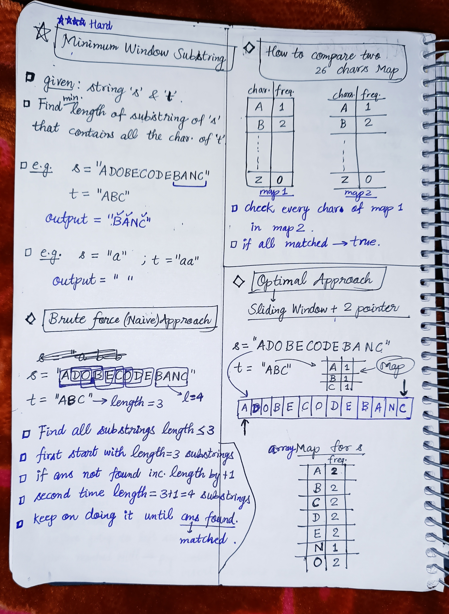
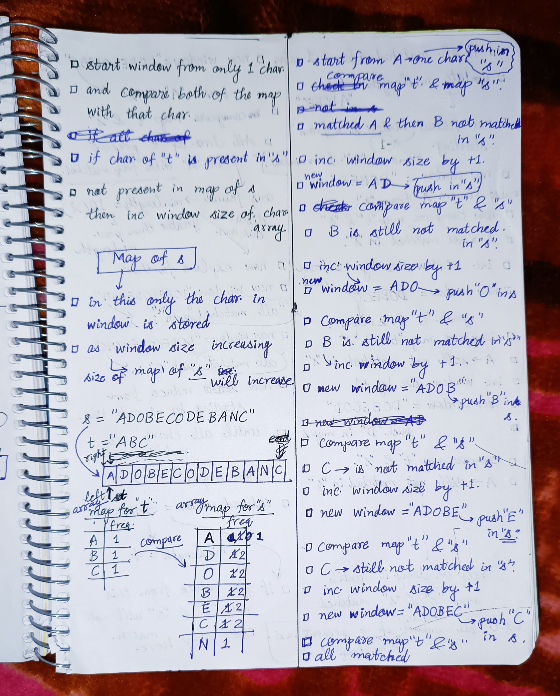
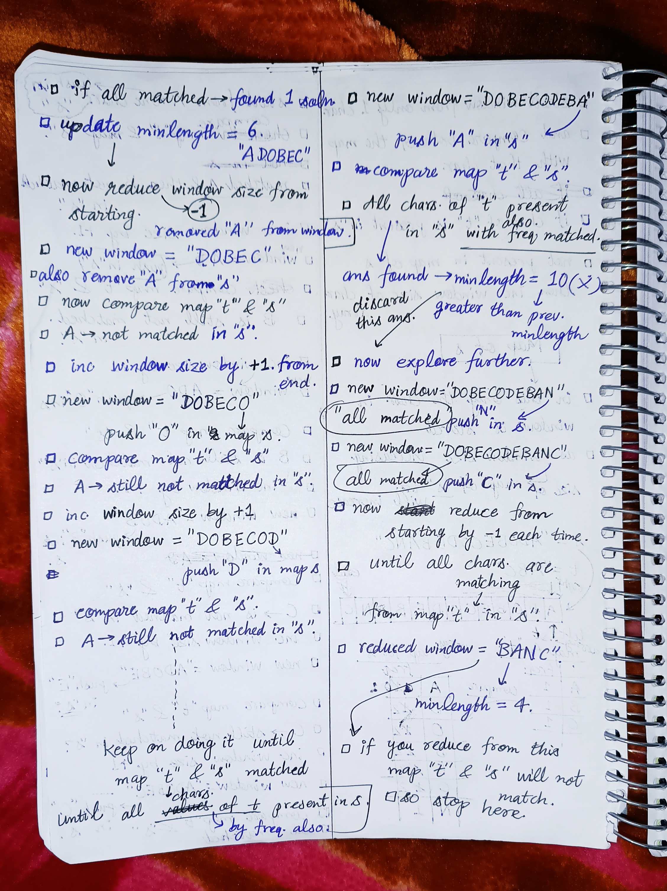

<h2><a href="https://leetcode.com/problems/minimum-window-substring">76. Minimum Window Substring</a></h2><h3>Hard</h3><hr><p>Given two strings <code>s</code> and <code>t</code> of lengths <code>m</code> and <code>n</code> respectively, return <em>the <strong>minimum window</strong></em> <span data-keyword="substring-nonempty"><strong><em>substring</em></strong></span><em> of </em><code>s</code><em> such that every character in </em><code>t</code><em> (<strong>including duplicates</strong>) is included in the window</em>. If there is no such substring, return <em>the empty string </em><code>&quot;&quot;</code>.</p>

<p>The testcases will be generated such that the answer is <strong>unique</strong>.</p>

<p>&nbsp;</p>
<p><strong class="example">Example 1:</strong></p>

<pre>
<strong>Input:</strong> s = &quot;ADOBECODEBANC&quot;, t = &quot;ABC&quot;
<strong>Output:</strong> &quot;BANC&quot;
<strong>Explanation:</strong> The minimum window substring &quot;BANC&quot; includes &#39;A&#39;, &#39;B&#39;, and &#39;C&#39; from string t.
</pre>

<p><strong class="example">Example 2:</strong></p>

<pre>
<strong>Input:</strong> s = &quot;a&quot;, t = &quot;a&quot;
<strong>Output:</strong> &quot;a&quot;
<strong>Explanation:</strong> The entire string s is the minimum window.
</pre>

<p><strong class="example">Example 3:</strong></p>

<pre>
<strong>Input:</strong> s = &quot;a&quot;, t = &quot;aa&quot;
<strong>Output:</strong> &quot;&quot;
<strong>Explanation:</strong> Both &#39;a&#39;s from t must be included in the window.
Since the largest window of s only has one &#39;a&#39;, return empty string.
</pre>

<p>&nbsp;</p>
<p><strong>Constraints:</strong></p>

<ul>
	<li><code>m == s.length</code></li>
	<li><code>n == t.length</code></li>
	<li><code>1 &lt;= m, n &lt;= 10<sup>5</sup></code></li>
	<li><code>s</code> and <code>t</code> consist of uppercase and lowercase English letters.</li>
</ul>

<p>&nbsp;</p>
<p><strong>Follow up:</strong> Could you find an algorithm that runs in <code>O(m + n)</code> time?</p>


<!-- AUTO-GENERATED-SOLUTION-START -->
---

## 🧠 Visual Solution & Intuition

### Part 1



### Part 2



### Part 3



---

## 💻 C++ Solution

[View Original C++ File](./0076-minimum-window-substring.cpp)

```cpp
class Solution {
public:
    string minWindow(string s, string t) {
        
        //Step-1: Initialize variables and array
        vector<int> freq(128, 0);

        //store  freq of chars. of t into freq array
        for(char ch : t){
            freq[ch]++;
        }

        int left = 0;
        int minLength = INT_MAX;
        int startIdx = 0;

        int required = t.length(); 

        //Step-2: Expand the window using right pointer
        for(int right = 0; right < s.length(); right++){

            if(freq[s[right]] > 0){ //check if current char is required
                required--;
            }

            freq[s[right]]--;

            //Step-3: Check window validity
            while(required == 0){

                //Step-4: Shrink the window
                int windowLen = right - left + 1;

                //update minLength & startIdx
                if(windowLen < minLength){
                    minLength = windowLen;
                    startIdx = left;
                }

                //Remove leftmost char to reduce the size of currWindow
                freq[s[left]]++; //because it's leaving the window

                if(freq[s[left]] > 0){
                    required++;
                }

                //move left pointer
                left++; //now it's out of window
            }
        }


        //Step-5: Return the answer
        return minLength == INT_MAX ? "" : s.substr(startIdx, minLength);


    }
};
```

<!-- AUTO-GENERATED-SOLUTION-END -->
