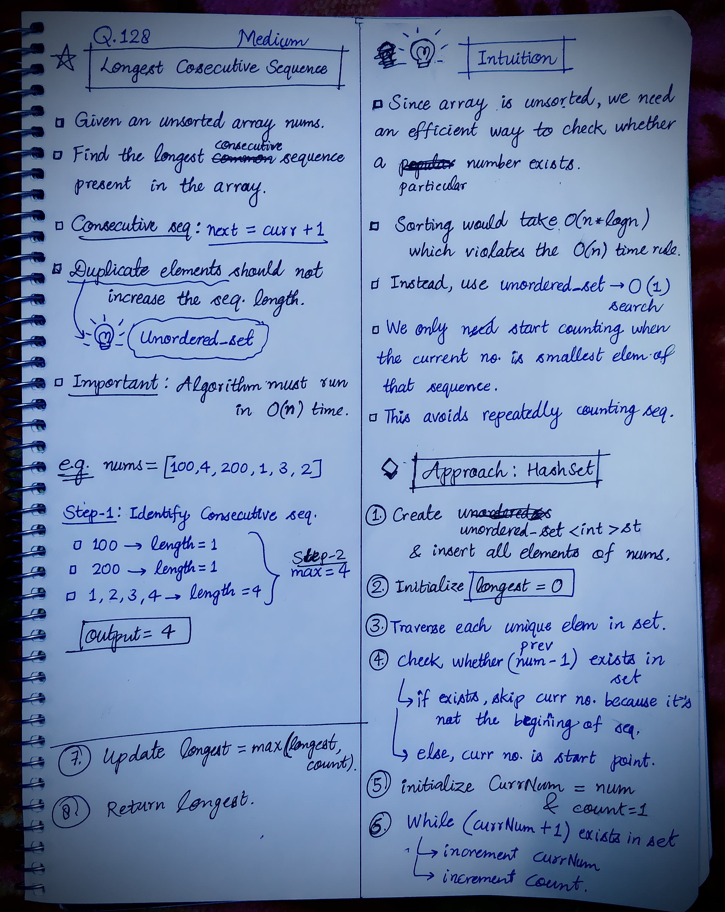

<h2><a href="https://leetcode.com/problems/longest-consecutive-sequence">128. Longest Consecutive Sequence</a></h2><h3>Medium</h3><hr><p>Given an unsorted array of integers <code>nums</code>, return <em>the length of the longest consecutive elements sequence.</em></p>

<p>You must write an algorithm that runs in&nbsp;<code>O(n)</code>&nbsp;time.</p>

<p>&nbsp;</p>
<p><strong class="example">Example 1:</strong></p>

<pre>
<strong>Input:</strong> nums = [100,4,200,1,3,2]
<strong>Output:</strong> 4
<strong>Explanation:</strong> The longest consecutive elements sequence is <code>[1, 2, 3, 4]</code>. Therefore its length is 4.
</pre>

<p><strong class="example">Example 2:</strong></p>

<pre>
<strong>Input:</strong> nums = [0,3,7,2,5,8,4,6,0,1]
<strong>Output:</strong> 9
</pre>

<p><strong class="example">Example 3:</strong></p>

<pre>
<strong>Input:</strong> nums = [1,0,1,2]
<strong>Output:</strong> 3
</pre>

<p>&nbsp;</p>
<p><strong>Constraints:</strong></p>

<ul>
	<li><code>0 &lt;= nums.length &lt;= 10<sup>5</sup></code></li>
	<li><code>-10<sup>9</sup> &lt;= nums[i] &lt;= 10<sup>9</sup></code></li>
</ul>


<!-- AUTO-GENERATED-SOLUTION-START -->
---

## 🧠 Visual Solution & Intuition



---

## 💡 Approach

```text
Approach : Hashing using unordered_set
```

---

## ⏱️ Complexity Analysis

```text
Time Complexity = O(n) =>
Space Complexity = O(1) =>
```

---

## 💻 C++ Solution

[View Original C++ File](./0128-longest-consecutive-sequence.cpp)

```cpp
class Solution {
public:
    //Approach : Hashing using unordered_set

    //Time Complexity = O(n) =>
    /* Inserting elements into unordered_set → O(n).
    * Traversing unique elements → O(n).
    * All while loops combined → O(n), since each consecutive sequence is traversed only once.
    * Total: O(n).
    */

    //Space Complexity = O(1) =>
    /* unordered_set stores at most n unique elements → O(n).
    * Additional variables → O(1).
    * Total: O(n).
    */

    int longestConsecutive(vector<int>& nums) {
        
        //1.)
        unordered_set<int> st(nums.begin(), nums.end());
        //2.)
        int longest = 0;//to store the count of longest consecutive sequence

        //3.) traverse each unique element in set
        for(int num : st){

            //4.)check whether num-1 exists in set
            if(num == INT_MIN || !st.count(num - 1)){//not present in the set
                
                //5.)
                int currNum = num;
                int count = 1; //starting point of sequence found

                //6.)if currNum+1 exists means increment sequence length
                while(currNum != INT_MAX && st.count(currNum + 1)){
                    
                    currNum++;
                    count++;
                }

                //7.) Update longest
                longest = max(longest, count);

            }            
        }
        
        //8.) finally return the output
        return longest;
        
    }
};
```

<!-- AUTO-GENERATED-SOLUTION-END -->
