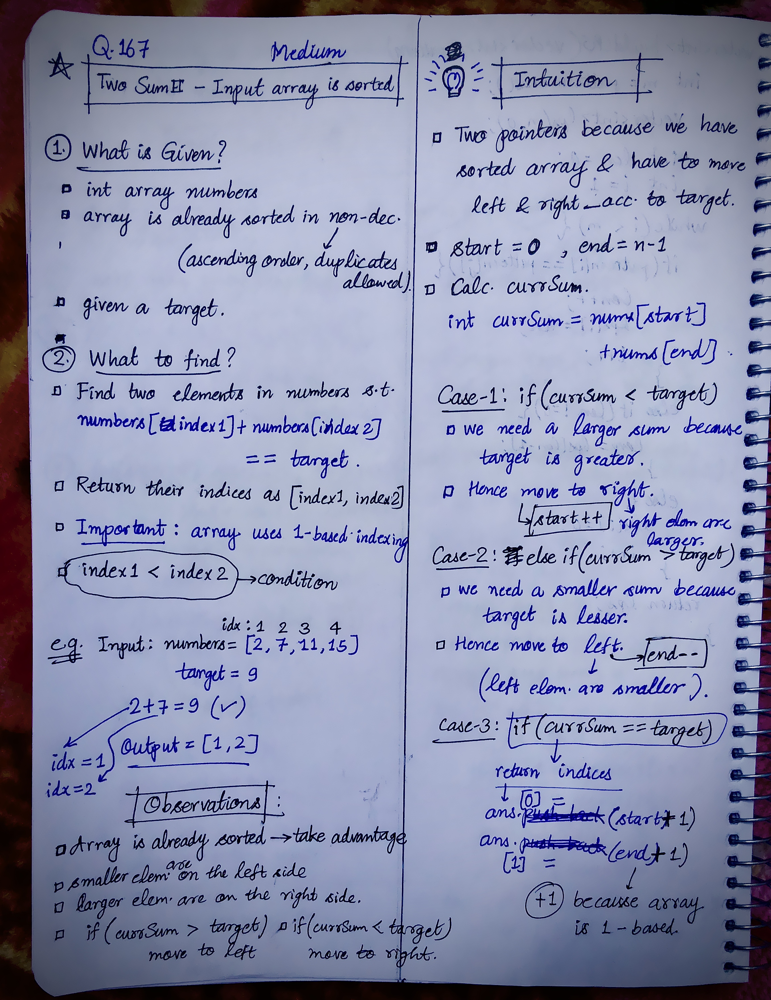

<h2><a href="https://leetcode.com/problems/two-sum-ii-input-array-is-sorted">167. Two Sum II - Input Array Is Sorted</a></h2><h3>Medium</h3><hr><p>You are given a <strong>1-indexed</strong> array of integers <code>numbers</code> that is already <strong>sorted in non-decreasing order</strong>.</p>

<p>Find <strong>two</strong> numbers such that they add up to a specific <code>target</code> number. Let these two numbers be <code>numbers[index<sub>1</sub>]</code> and <code>numbers[index<sub>2</sub>]</code> where <code>1 &lt;= index<sub>1</sub> &lt; index<sub>2</sub> &lt;= numbers.length</code>.</p>

<p>Return the indices of the two numbers <code>index<sub>1</sub></code> and <code>index<sub>2</sub></code> as an integer array <code>[index<sub>1</sub>, index<sub>2</sub>]</code> of length 2.</p>

<p>The tests are generated such that there is <strong>exactly one solution</strong>. You <strong>may not</strong> use the same element twice.</p>

<p>Your solution must use only constant extra space.</p>

<p>&nbsp;</p>
<p><strong class="example">Example 1:</strong></p>

<pre>
<strong>Input:</strong> numbers = [<u>2</u>,<u>7</u>,11,15], target = 9
<strong>Output:</strong> [1,2]
<strong>Explanation:</strong> The sum of 2 and 7 is 9. Therefore, index<sub>1</sub> = 1, index<sub>2</sub> = 2. We return [1, 2].
</pre>

<p><strong class="example">Example 2:</strong></p>

<pre>
<strong>Input:</strong> numbers = [<u>2</u>,3,<u>4</u>], target = 6
<strong>Output:</strong> [1,3]
<strong>Explanation:</strong> The sum of 2 and 4 is 6. Therefore index<sub>1</sub> = 1, index<sub>2</sub> = 3. We return [1, 3].
</pre>

<p><strong class="example">Example 3:</strong></p>

<pre>
<strong>Input:</strong> numbers = [<u>-1</u>,<u>0</u>], target = -1
<strong>Output:</strong> [1,2]
<strong>Explanation:</strong> The sum of -1 and 0 is -1. Therefore index<sub>1</sub> = 1, index<sub>2</sub> = 2. We return [1, 2].
</pre>

<p>&nbsp;</p>
<p><strong>Constraints:</strong></p>

<ul>
	<li><code>2 &lt;= numbers.length &lt;= 3 * 10<sup>4</sup></code></li>
	<li><code>-1000 &lt;= numbers[i] &lt;= 1000</code></li>
	<li><code>numbers</code> is sorted in <strong>non-decreasing order</strong>.</li>
	<li><code>-1000 &lt;= target &lt;= 1000</code></li>
	<li>The tests are generated such that there is <strong>exactly one solution</strong>.</li>
</ul>


<!-- AUTO-GENERATED-SOLUTION-START -->
---

## 🧠 Visual Solution & Intuition



---

## 💡 Approach

```text
Approach : Two Pointers (Opposite Direction)
```

---

## ⏱️ Complexity Analysis

```text
Time Complexity  = O(n) =>
Space Complexity = O(1) =>
```

---

## 💻 C++ Solution

[View Original C++ File](./0167-two-sum-ii-input-array-is-sorted.cpp)

```cpp
class Solution {
public:
    //Approach : Two Pointers (Opposite Direction)

    //Time Complexity  = O(n) =>
    /* Two Pointers: Both pointers traverse the array from opposite ends. 
    * Each Iteration: Sum calculation and comparison take O(1) time.
    * Total: At most n - 1 iterations → O(n).
    */

    //Space Complexity = O(1) =>
    /* Two Pointers: start and end require constant space.
    * Other Variables: n and currSum require constant space.
    * Answer Vector: ans stores exactly 2 integers → O(1).
    * Total: O(1).
    */

    vector<int> twoSum(vector<int>& nums, int target) {
        
        vector<int> ans(2); //size 2 is fixed for two integer indices = [index1, index2]
        
        //Initialize two pointers
        int n = nums.size();

        int start = 0;
        int end = n - 1;

        while(start < end){

            //calc. currSum
            int currSum = nums[start] + nums[end];

            //Case-1: when target is greater
            if(currSum < target){
                start++;//move to right
            }

            //Case-2: when target is lesser
            else if(currSum > target){
                end--; //move to left
            }

            //Case-3 : if currSum == target
            else{
                ans[0] = start+1; //store index1 in ans
                ans[1] = end+1; //store index2 in ans
                break; //because loop will be infinite if not stopped when indices found
            }
        }


        //finally return the output
        return ans;

    }
};
```

<!-- AUTO-GENERATED-SOLUTION-END -->
