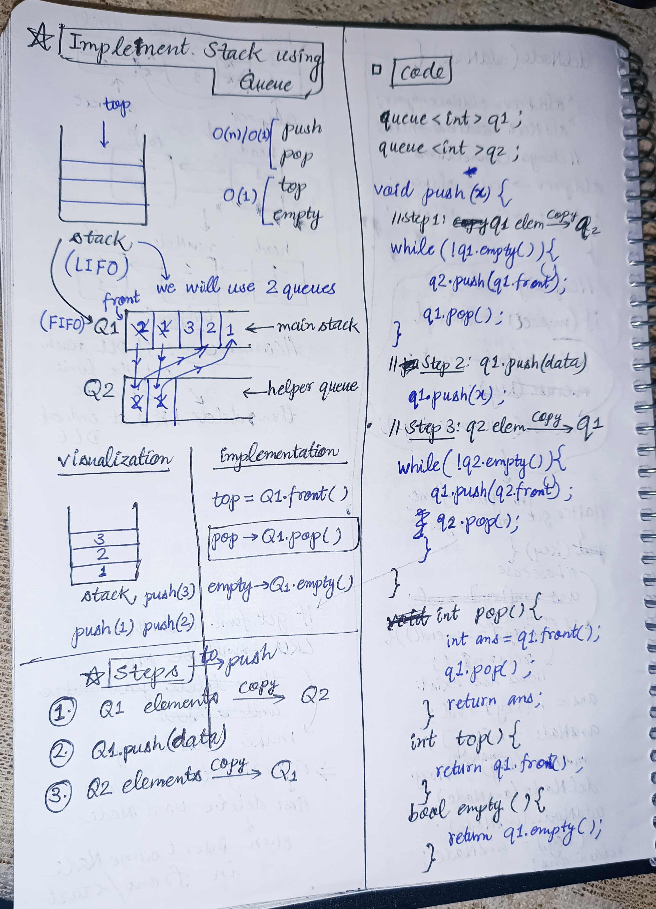

<h2><a href="https://leetcode.com/problems/implement-stack-using-queues">225. Implement Stack using Queues</a></h2><h3>Easy</h3><hr><p>Implement a last-in-first-out (LIFO) stack using only two queues. The implemented stack should support all the functions of a normal stack (<code>push</code>, <code>top</code>, <code>pop</code>, and <code>empty</code>).</p>

<p>Implement the <code>MyStack</code> class:</p>

<ul>
	<li><code>void push(int x)</code> Pushes element x to the top of the stack.</li>
	<li><code>int pop()</code> Removes the element on the top of the stack and returns it.</li>
	<li><code>int top()</code> Returns the element on the top of the stack.</li>
	<li><code>boolean empty()</code> Returns <code>true</code> if the stack is empty, <code>false</code> otherwise.</li>
</ul>

<p><b>Notes:</b></p>

<ul>
	<li>You must use <strong>only</strong> standard operations of a queue, which means that only <code>push to back</code>, <code>peek/pop from front</code>, <code>size</code> and <code>is empty</code> operations are valid.</li>
	<li>Depending on your language, the queue may not be supported natively. You may simulate a queue using a list or deque (double-ended queue) as long as you use only a queue&#39;s standard operations.</li>
</ul>

<p>&nbsp;</p>
<p><strong class="example">Example 1:</strong></p>

<pre>
<strong>Input</strong>
[&quot;MyStack&quot;, &quot;push&quot;, &quot;push&quot;, &quot;top&quot;, &quot;pop&quot;, &quot;empty&quot;]
[[], [1], [2], [], [], []]
<strong>Output</strong>
[null, null, null, 2, 2, false]

<strong>Explanation</strong>
MyStack myStack = new MyStack();
myStack.push(1);
myStack.push(2);
myStack.top(); // return 2
myStack.pop(); // return 2
myStack.empty(); // return False
</pre>

<p>&nbsp;</p>
<p><strong>Constraints:</strong></p>

<ul>
	<li><code>1 &lt;= x &lt;= 9</code></li>
	<li>At most <code>100</code> calls will be made to <code>push</code>, <code>pop</code>, <code>top</code>, and <code>empty</code>.</li>
	<li>All the calls to <code>pop</code> and <code>top</code> are valid.</li>
</ul>

<p>&nbsp;</p>
<p><strong>Follow-up:</strong> Can you implement the stack using only one queue?</p>


<!-- AUTO-GENERATED-SOLUTION-START -->
---

## 🧠 Visual Solution & Intuition



---

## ⏱️ Complexity Analysis

```text
Time Complexity = O(n) = O(n) + O(1) + O(1) + O(1)
Space Complexity = O(n) => cause using two extra queues
Time Complexity = O(n)
Time Complexity = O(1)
Time Complexity = O(1)
Time Complexity = O(1)
```

---

## 💻 C++ Solution

[View Original C++ File](./0225-implement-stack-using-queues.cpp)

```cpp
class MyStack {
public:
    //Time Complexity = O(n) = O(n) + O(1) + O(1) + O(1) 
    //Space Complexity = O(n) => cause using two extra queues

    
    //we will use two queues
    queue<int> q1 ;
    queue<int> q2 ;

    MyStack() { //constructor
        
    }
    
    void push(int x) { //Time Complexity = O(n)
        //Step 1 : q1 elements copy -> q2
        while(!q1.empty()){
            q2.push(q1.front()) ;
            q1.pop() ; //after copying pop from q1 
        }
        //Step 2 : q1.push(data) 
        q1.push(x) ;

        //Step 3 : q2 elements copy -> q1 (reverse)
        while(!q2.empty()){
            q1.push(q2.front()) ;
            q2.pop() ; //after copying into q1 pop from q2
        }

    }
    
    int pop() { //Time Complexity = O(1)
        int ans = q1.front() ;
        q1.pop() ;
        return ans ;
    }
    
    int top() { //Time Complexity = O(1)
        return q1.front() ; //q1 front is stack top
    }
    
    bool empty() { //Time Complexity = O(1)
        return q1.empty() ;
    }
};

/**
 * Your MyStack object will be instantiated and called as such:
 * MyStack* obj = new MyStack();
 * obj->push(x);
 * int param_2 = obj->pop();
 * int param_3 = obj->top();
 * bool param_4 = obj->empty();
 */
```

<!-- AUTO-GENERATED-SOLUTION-END -->
