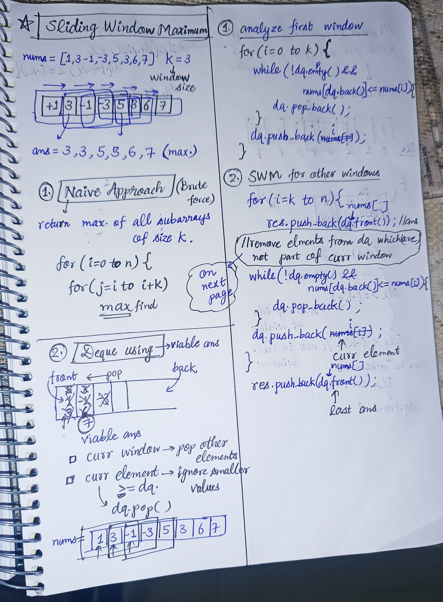
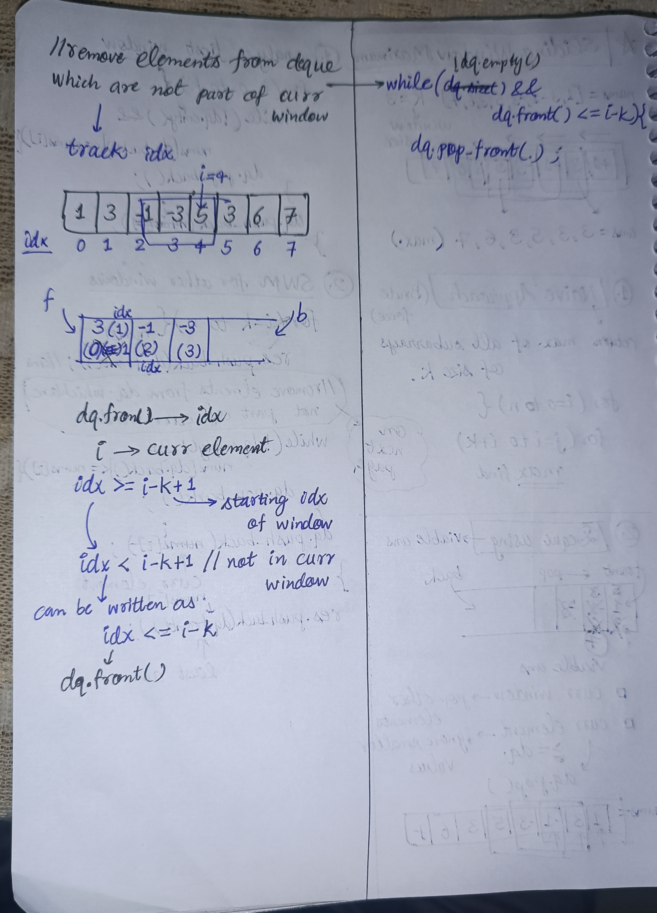

<h2><a href="https://leetcode.com/problems/sliding-window-maximum">239. Sliding Window Maximum</a></h2><h3>Hard</h3><hr><p>You are given an array of integers&nbsp;<code>nums</code>, there is a sliding window of size <code>k</code> which is moving from the very left of the array to the very right. You can only see the <code>k</code> numbers in the window. Each time the sliding window moves right by one position.</p>

<p>Return <em>the max sliding window</em>.</p>

<p>&nbsp;</p>
<p><strong class="example">Example 1:</strong></p>

<pre>
<strong>Input:</strong> nums = [1,3,-1,-3,5,3,6,7], k = 3
<strong>Output:</strong> [3,3,5,5,6,7]
<strong>Explanation:</strong> 
Window position                Max
---------------               -----
[1  3  -1] -3  5  3  6  7       <strong>3</strong>
 1 [3  -1  -3] 5  3  6  7       <strong>3</strong>
 1  3 [-1  -3  5] 3  6  7      <strong> 5</strong>
 1  3  -1 [-3  5  3] 6  7       <strong>5</strong>
 1  3  -1  -3 [5  3  6] 7       <strong>6</strong>
 1  3  -1  -3  5 [3  6  7]      <strong>7</strong>
</pre>

<p><strong class="example">Example 2:</strong></p>

<pre>
<strong>Input:</strong> nums = [1], k = 1
<strong>Output:</strong> [1]
</pre>

<p>&nbsp;</p>
<p><strong>Constraints:</strong></p>

<ul>
	<li><code>1 &lt;= nums.length &lt;= 10<sup>5</sup></code></li>
	<li><code>-10<sup>4</sup> &lt;= nums[i] &lt;= 10<sup>4</sup></code></li>
	<li><code>1 &lt;= k &lt;= nums.length</code></li>
</ul>


<!-- AUTO-GENERATED-SOLUTION-START -->
---

## 🧠 Visual Solution & Intuition

### Part 1



### Part 2



---

## ⏱️ Complexity Analysis

```text
Time Complexity = O(n) => cause pushing and popping n elements in deque
Space Complexity = O(k) => cause store k elements at a time in deque
```

---

## 💻 C++ Solution

[View Original C++ File](./0239-sliding-window-maximum.cpp)

```cpp
class Solution {
public:
    //Time Complexity = O(n) => cause pushing and popping n elements in deque
   //Space Complexity = O(k) => cause store k elements at a time in deque
    vector<int> maxSlidingWindow(vector<int>& nums, int k) {
        deque<int> dq ; //to store viable ans to find res
        vector<int> res ; //to store answers

        //Step 1 : analyze first window
        for(int i=0 ; i<k ; i++){
            while(!dq.empty() && nums[dq.back()] <= nums[i]){
                dq.pop_back() ; //pop smaller values than current element
            }
            //push idx of current element in the dequeue
            dq.push_back(i) ;

        }

        //Step 2 : SWM for other windows
        for(int i=k ; i<nums.size() ; i++){
            //first push idx of front element in the res
            res.push_back(nums[dq.front()]) ;

            //remove elements from dq which are not part of curr window
            while(!dq.empty() && dq.front() <= i-k){
                dq.pop_front() ;
            }

            //remove the smaller values than current
            while(!dq.empty() && nums[dq.back()] <= nums[i]){
                dq.pop_back() ;
            }

            //push current idx in dq
            dq.push_back(i) ;

        }

        //push last ans in result
        res.push_back(nums[dq.front()]) ;

        return res ; //very important to return result 

    }
};
```

<!-- AUTO-GENERATED-SOLUTION-END -->
