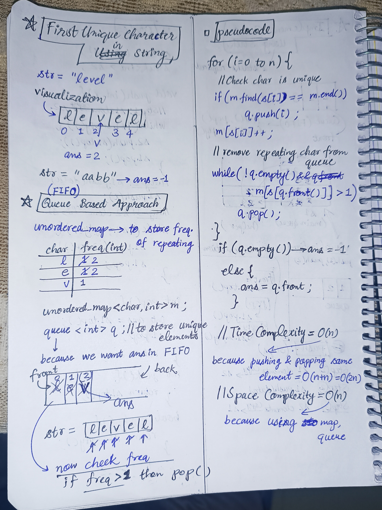

<h2><a href="https://leetcode.com/problems/first-unique-character-in-a-string">387. First Unique Character in a String</a></h2><h3>Easy</h3><hr><p>Given a string <code>s</code>, find the <strong>first</strong> non-repeating character in it and return its index. If it <strong>does not</strong> exist, return <code>-1</code>.</p>

<p>&nbsp;</p>
<p><strong class="example">Example 1:</strong></p>

<div class="example-block">
<p><strong>Input:</strong> <span class="example-io">s = &quot;leetcode&quot;</span></p>

<p><strong>Output:</strong> <span class="example-io">0</span></p>

<p><strong>Explanation:</strong></p>

<p>The character <code>&#39;l&#39;</code> at index 0 is the first character that does not occur at any other index.</p>
</div>

<p><strong class="example">Example 2:</strong></p>

<div class="example-block">
<p><strong>Input:</strong> <span class="example-io">s = &quot;loveleetcode&quot;</span></p>

<p><strong>Output:</strong> <span class="example-io">2</span></p>
</div>

<p><strong class="example">Example 3:</strong></p>

<div class="example-block">
<p><strong>Input:</strong> <span class="example-io">s = &quot;aabb&quot;</span></p>

<p><strong>Output:</strong> <span class="example-io">-1</span></p>
</div>

<p>&nbsp;</p>
<p><strong>Constraints:</strong></p>

<ul>
	<li><code>1 &lt;= s.length &lt;= 10<sup>5</sup></code></li>
	<li><code>s</code> consists of only lowercase English letters.</li>
</ul>


<!-- AUTO-GENERATED-SOLUTION-START -->
---

## 🧠 Visual Solution & Intuition



---

## ⏱️ Complexity Analysis

```text
Time Complexity = O(n) => cause pushing and popping only n elements
Space Complexity = O(n) => cause using map , queue
```

---

## 💻 C++ Solution

[View Original C++ File](./0387-first-unique-character-in-a-string.cpp)

```cpp
class Solution {
public: 
    //Time Complexity = O(n) => cause pushing and popping only n elements 
    //Space Complexity = O(n) => cause using map , queue
    int firstUniqChar(string s) {
        unordered_map<char,int> m ; //to store frequency of repeating
        queue <int> q ; //to store unique elements

        for(int i=0 ; i<s.size() ; i++){
            //check char is unique
            if(m.find(s[i]) == m.end()){
                q.push(i) ;
            }
            m[s[i]]++ ; //update for next

            //remove repeating elements from queue
            while(!q.empty() && m[s[q.front()]] > 1){
                q.pop() ; //if freq > 1 then pop
            }
        }

        //if queue is empty then ans = -1
        //else ans = q.front
        return q.empty() ? -1 : q.front() ; //ternary statement for above checks

    }
};
```

<!-- AUTO-GENERATED-SOLUTION-END -->
