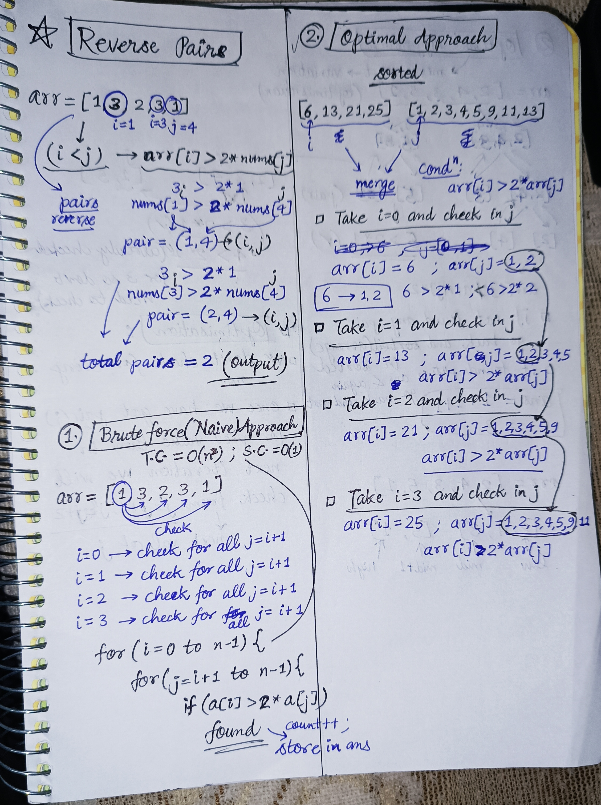
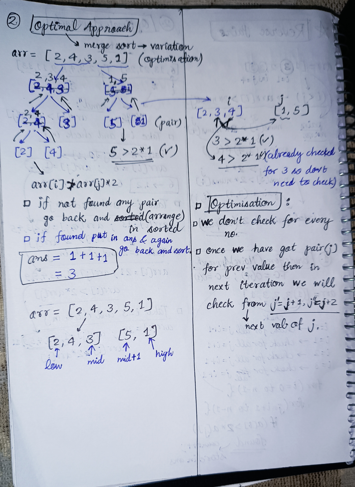
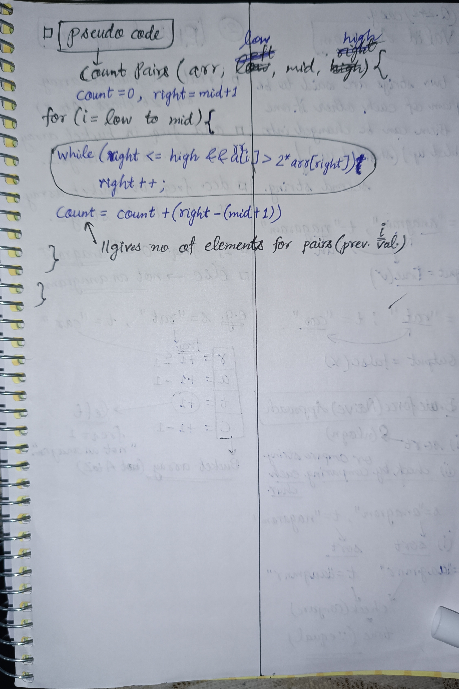

<h2><a href="https://leetcode.com/problems/reverse-pairs">493. Reverse Pairs</a></h2><h3>Hard</h3><hr><p>Given an integer array <code>nums</code>, return <em>the number of <strong>reverse pairs</strong> in the array</em>.</p>

<p>A <strong>reverse pair</strong> is a pair <code>(i, j)</code> where:</p>

<ul>
	<li><code>0 &lt;= i &lt; j &lt; nums.length</code> and</li>
	<li><code>nums[i] &gt; 2 * nums[j]</code>.</li>
</ul>

<p>&nbsp;</p>
<p><strong class="example">Example 1:</strong></p>

<pre>
<strong>Input:</strong> nums = [1,3,2,3,1]
<strong>Output:</strong> 2
<strong>Explanation:</strong> The reverse pairs are:
(1, 4) --&gt; nums[1] = 3, nums[4] = 1, 3 &gt; 2 * 1
(3, 4) --&gt; nums[3] = 3, nums[4] = 1, 3 &gt; 2 * 1
</pre>

<p><strong class="example">Example 2:</strong></p>

<pre>
<strong>Input:</strong> nums = [2,4,3,5,1]
<strong>Output:</strong> 3
<strong>Explanation:</strong> The reverse pairs are:
(1, 4) --&gt; nums[1] = 4, nums[4] = 1, 4 &gt; 2 * 1
(2, 4) --&gt; nums[2] = 3, nums[4] = 1, 3 &gt; 2 * 1
(3, 4) --&gt; nums[3] = 5, nums[4] = 1, 5 &gt; 2 * 1
</pre>

<p>&nbsp;</p>
<p><strong>Constraints:</strong></p>

<ul>
	<li><code>1 &lt;= nums.length &lt;= 5 * 10<sup>4</sup></code></li>
	<li><code>-2<sup>31</sup> &lt;= nums[i] &lt;= 2<sup>31</sup> - 1</code></li>
</ul>


<!-- AUTO-GENERATED-SOLUTION-START -->
---

## 🧠 Visual Solution & Intuition

### Part 1



### Part 2



### Part 3



---

## ⏱️ Complexity Analysis

```text
Time Complexity = O(nlogn) + O(n) = O(nlogn) => merge sort = O(nlogn) + traversal in array = O(n)
Space Complexity = O(n) => merge sort using recursion
```

---

## 💻 C++ Solution

[View Original C++ File](./0493-reverse-pairs.cpp)

```cpp
class Solution {
public:
    //Time Complexity = O(nlogn) + O(n) = O(nlogn) => merge sort = O(nlogn) + traversal in array = O(n)
    //Space Complexity = O(n) => merge sort using recursion 
int countPairs(vector<int>&arr, int low, int mid, int high){
    int count = 0 , right = mid+1 ;
    for(int i = low ; i<=mid ; i++){
       while (right <= high && (long long)arr[i] > 2LL * arr[right]) right++; //long long to avoid overflow
       
       count = count + (right-(mid+1)) ;

    }
    return count ; 
}
    // Merges two subarrays of arr[].
// First subarray is arr[left..mid]
// Second subarray is arr[mid+1..right]
void merge(vector<int>& arr, int left, 
                     int mid, int right){
                         
    int n1 = mid - left + 1;
    int n2 = right - mid;

    // Create temp vectors
    vector<int> L(n1), R(n2);

    // Copy data to temp vectors L[] and R[]
    for (int i = 0; i < n1; i++)
        L[i] = arr[left + i];
    for (int j = 0; j < n2; j++)
        R[j] = arr[mid + 1 + j];

    int i = 0, j = 0;
    int k = left;

    // Merge the temp vectors back 
    // into arr[left..right]
    while (i < n1 && j < n2) {
        if (L[i] <= R[j]) {
            arr[k] = L[i];
            i++;
        }
        else {
            arr[k] = R[j];
            j++;
        }
        k++;
    }

    // Copy the remaining elements of L[], 
    // if there are any
    while (i < n1) {
        arr[k] = L[i];
        i++;
        k++;
    }

    // Copy the remaining elements of R[], 
    // if there are any
    while (j < n2) {
        arr[k] = R[j];
        j++;
        k++;
    }
}

// begin is for left index and end is right index
// of the sub-array of arr to be sorted
int mergeSort(vector<int>& arr, int left, int right){
    int count = 0 ;
    if (left >= right)
        return count;

    int mid = left + (right - left) / 2;
    count += mergeSort(arr, left, mid);
    count += mergeSort(arr, mid + 1, right);
    //before merging we have to calc. ans
    count += countPairs(arr,left,mid,right) ; 
    merge(arr, left, mid, right);
    
    return count ;
}
    int reversePairs(vector<int>& arr) {
        int n = arr.size() ;
        return mergeSort(arr,0,n-1) ;

    }
};
```

<!-- AUTO-GENERATED-SOLUTION-END -->
