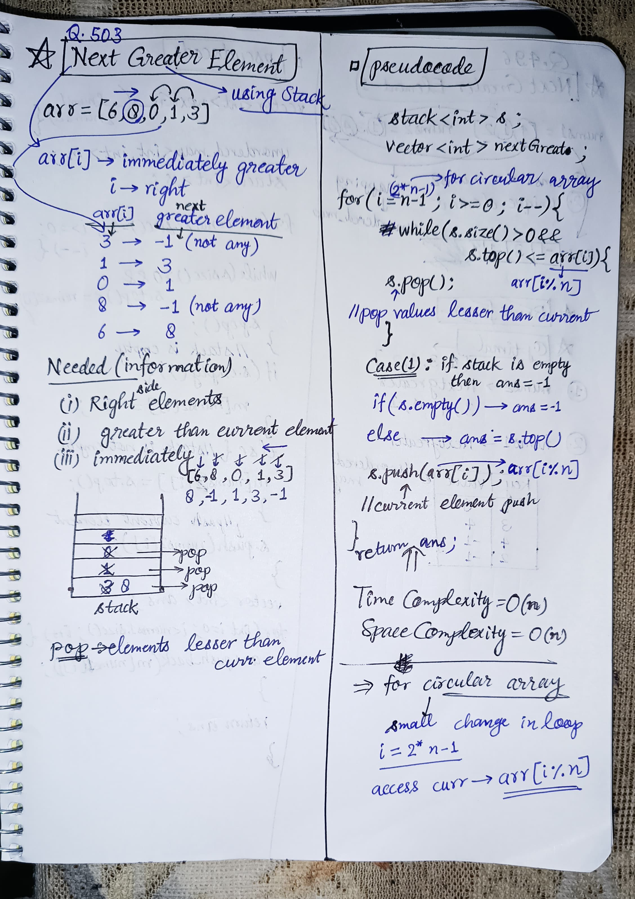

<h2><a href="https://leetcode.com/problems/next-greater-element-ii">503. Next Greater Element II</a></h2><h3>Medium</h3><hr><p>Given a circular integer array <code>nums</code> (i.e., the next element of <code>nums[nums.length - 1]</code> is <code>nums[0]</code>), return <em>the <strong>next greater number</strong> for every element in</em> <code>nums</code>.</p>

<p>The <strong>next greater number</strong> of a number <code>x</code> is the first greater number to its traversing-order next in the array, which means you could search circularly to find its next greater number. If it doesn&#39;t exist, return <code>-1</code> for this number.</p>

<p>&nbsp;</p>
<p><strong class="example">Example 1:</strong></p>

<pre>
<strong>Input:</strong> nums = [1,2,1]
<strong>Output:</strong> [2,-1,2]
Explanation: The first 1&#39;s next greater number is 2; 
The number 2 can&#39;t find next greater number. 
The second 1&#39;s next greater number needs to search circularly, which is also 2.
</pre>

<p><strong class="example">Example 2:</strong></p>

<pre>
<strong>Input:</strong> nums = [1,2,3,4,3]
<strong>Output:</strong> [2,3,4,-1,4]
</pre>

<p>&nbsp;</p>
<p><strong>Constraints:</strong></p>

<ul>
	<li><code>1 &lt;= nums.length &lt;= 10<sup>4</sup></code></li>
	<li><code>-10<sup>9</sup> &lt;= nums[i] &lt;= 10<sup>9</sup></code></li>
</ul>


<!-- AUTO-GENERATED-SOLUTION-START -->
---

## 🧠 Visual Solution & Intuition



---

## ⏱️ Complexity Analysis

```text
Time Complexity = O(n+n) = O(2n) = O(n) => cause traversing whole array
Space Complexity = O(n) => cause using extra data structure => " stack " ;
```

---

## 💻 C++ Solution

[View Original C++ File](./0503-next-greater-element-ii.cpp)

```cpp
class Solution {
public: 
    //Time Complexity = O(n+n) = O(2n) = O(n) => cause traversing whole array 
    //Space Complexity = O(n) => cause using extra data structure => " stack " ;
    vector<int> nextGreaterElements(vector<int>& nums) {
        int n = nums.size();
        vector<int> ans(n, -1); //to store all nextG
        stack<int> st; //to find nextG
        //traverse 2 times for circular array
        for (int i = 2 * n - 1; i >= 0; i--) {
            while (!st.empty() && st.top() <= nums[i % n]) {
                st.pop(); //remove elements lesser than current
            }
            //check if stack is empty then ans = -1
            //else ans = st.top() 
            if (i < n) {
                ans[i] = st.empty() ? -1 : st.top();
                //ternary statement for above checks
            }
            //push current element in the stack
            st.push(nums[i % n]);
        }

        return ans; //very important to return all the nextG vector
    }
};
```

<!-- AUTO-GENERATED-SOLUTION-END -->
