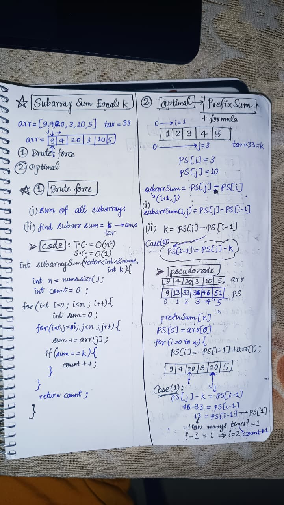
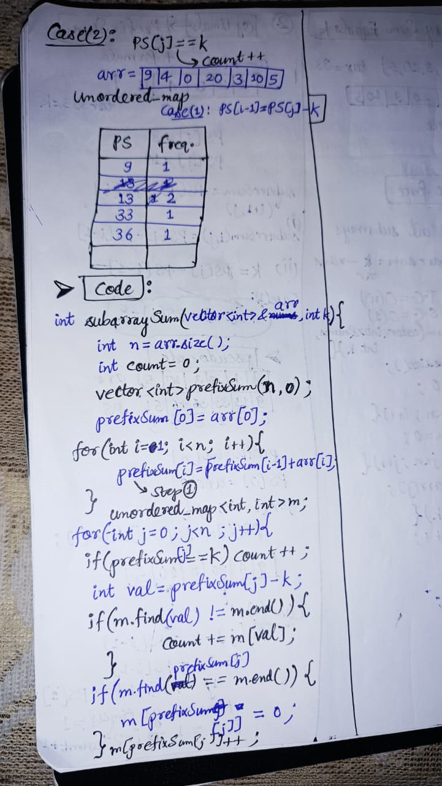

<h2><a href="https://leetcode.com/problems/subarray-sum-equals-k">560. Subarray Sum Equals K</a></h2><h3>Medium</h3><hr><p>Given an array of integers <code>nums</code> and an integer <code>k</code>, return <em>the total number of subarrays whose sum equals to</em> <code>k</code>.</p>

<p>A subarray is a contiguous <strong>non-empty</strong> sequence of elements within an array.</p>

<p>&nbsp;</p>
<p><strong class="example">Example 1:</strong></p>
<pre><strong>Input:</strong> nums = [1,1,1], k = 2
<strong>Output:</strong> 2
</pre><p><strong class="example">Example 2:</strong></p>
<pre><strong>Input:</strong> nums = [1,2,3], k = 3
<strong>Output:</strong> 2
</pre>
<p>&nbsp;</p>
<p><strong>Constraints:</strong></p>

<ul>
	<li><code>1 &lt;= nums.length &lt;= 2 * 10<sup>4</sup></code></li>
	<li><code>-1000 &lt;= nums[i] &lt;= 1000</code></li>
	<li><code>-10<sup>7</sup> &lt;= k &lt;= 10<sup>7</sup></code></li>
</ul>


<!-- AUTO-GENERATED-SOLUTION-START -->
---

## 🧠 Visual Solution & Intuition

### Part 1



### Part 2



---

## 💻 C++ Solution

[View Original C++ File](./0560-subarray-sum-equals-k.cpp)

```cpp
class Solution {
public:
    int subarraySum(vector<int>& arr, int k) {
        //2.) Optimal Approach(Prefix Sum + unordered_map)
        int n = arr.size() ;
        int count = 0 ; //count var to store ans subarrays
        
        vector<int> prefixSum(n,0) ; //to store prefixSum
        prefixSum[0] = arr[0] ;//initialize with arr[0]
        
        //prefixSum starts from index 1 so, i=1 to n
        for(int i=1; i<n ; i++){
            prefixSum[i] = prefixSum[i-1] + arr[i] ;
        }
        //unordered_map to store (prefixSum, freq)
        unordered_map<int,int> m ;

        for(int j=0 ; j<n ; j++){
            if(prefixSum[j] == k) count ++ ;
            int val = prefixSum[j] - k ; //to find val = PS[i-1]

            //check if found val
            if(m.find(val) != m.end()){
               count += m[val] ; //if found then add
            }

            //check if not found prefixSum
            if(m.find(prefixSum[j]) == m.end()){
                m[prefixSum[j]] = 0 ; //then store in map
            }
            m[prefixSum[j]]++ ; //update by 1
        }

        return count ; //return no. of ans subarrays

    }
};
```

<!-- AUTO-GENERATED-SOLUTION-END -->
