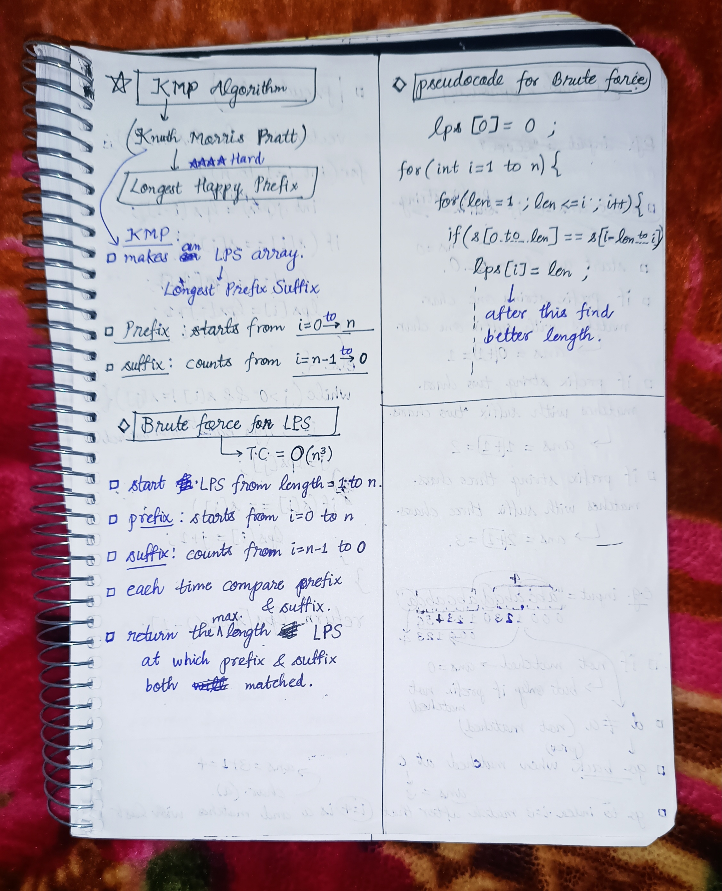
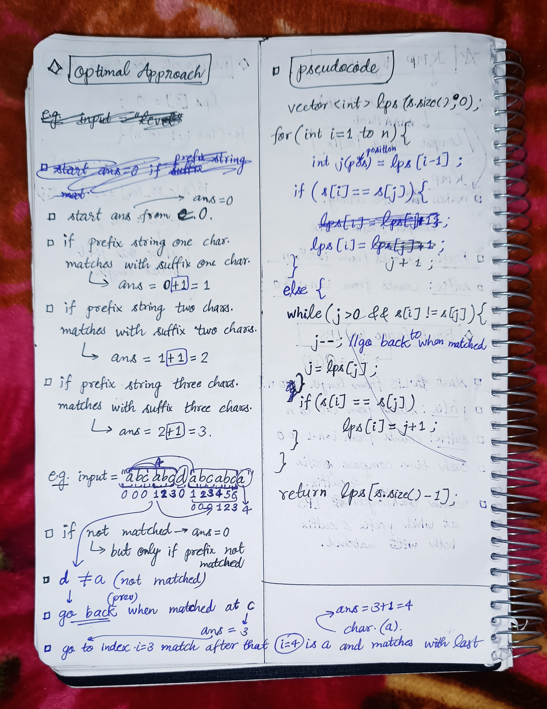

<h2><a href="https://leetcode.com/problems/longest-happy-prefix">1508. Longest Happy Prefix</a></h2><h3>Hard</h3><hr><p>A string is called a <strong>happy prefix</strong> if it is a <strong>non-empty</strong> prefix which is also a suffix (excluding itself).</p>

<p>Given a string <code>s</code>, return <em>the <strong>longest happy prefix</strong> of</em> <code>s</code>. Return an empty string <code>&quot;&quot;</code> if no such prefix exists.</p>

<p>&nbsp;</p>
<p><strong class="example">Example 1:</strong></p>

<pre>
<strong>Input:</strong> s = &quot;level&quot;
<strong>Output:</strong> &quot;l&quot;
<strong>Explanation:</strong> s contains 4 prefix excluding itself (&quot;l&quot;, &quot;le&quot;, &quot;lev&quot;, &quot;leve&quot;), and suffix (&quot;l&quot;, &quot;el&quot;, &quot;vel&quot;, &quot;evel&quot;). The largest prefix which is also suffix is given by &quot;l&quot;.
</pre>

<p><strong class="example">Example 2:</strong></p>

<pre>
<strong>Input:</strong> s = &quot;ababab&quot;
<strong>Output:</strong> &quot;abab&quot;
<strong>Explanation:</strong> &quot;abab&quot; is the largest prefix which is also suffix. They can overlap in the original string.
</pre>

<p>&nbsp;</p>
<p><strong>Constraints:</strong></p>

<ul>
	<li><code>1 &lt;= s.length &lt;= 10<sup>5</sup></code></li>
	<li><code>s</code> contains only lowercase English letters.</li>
</ul>


<!-- AUTO-GENERATED-SOLUTION-START -->
---

## 🧠 Visual Solution & Intuition

### Part 1



### Part 2



---

## 💻 C++ Solution

[View Original C++ File](./1392-longest-happy-prefix.cpp)

```cpp
class Solution {
public:
    int ComputeLPS(string& s){
        vector<int> lps(s.size(),0) ;

        for(int i=1 ; i<s.size() ; i++){
            int j = lps[i-1] ; //length of previous longest prefix suffix
            
            if(s[i] == s[j]){ //when matched 
                lps[i] = j+1 ; //every time ans += 1 ;
            }

            else{
                while(j > 0 && s[i] != s[j]){
                    j-- ; //go back to when previously matched
                    j = lps[j] ;
                }
                if(s[i] == s[j]) //check from prev matched if matched
                   lps[i] = j+1 ; //then prev ans += 1

            }
        }

        return lps[s.size()-1] ;

    }
    string longestPrefix(string s) {
        //very important to return the LPS string.
        return s.substr(0,ComputeLPS(s)) ;
    }
};
```

<!-- AUTO-GENERATED-SOLUTION-END -->
