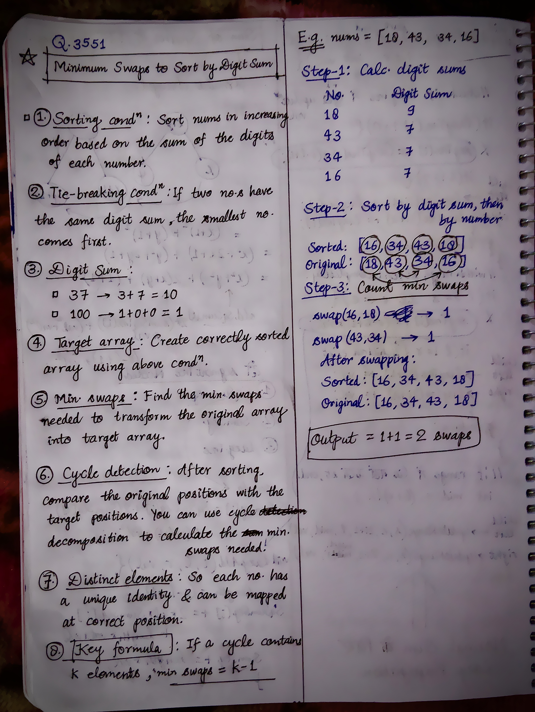
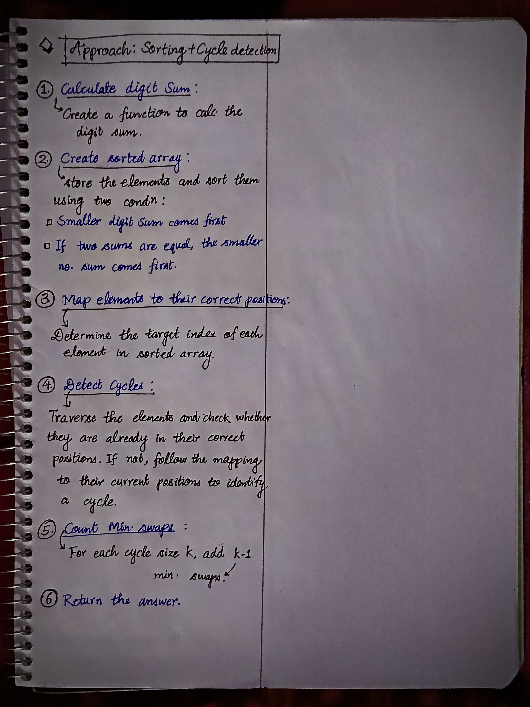

<h2><a href="https://leetcode.com/problems/minimum-swaps-to-sort-by-digit-sum">3847. Minimum Swaps to Sort by Digit Sum</a></h2><h3>Medium</h3><hr><p>You are given an array <code>nums</code> of <strong>distinct</strong> positive integers. You need to sort the array in <strong>increasing</strong> order based on the sum of the digits of each number. If two numbers have the same digit sum, the <strong>smaller</strong> number appears first in the sorted order.</p>

<p>Return the <strong>minimum</strong> number of swaps required to rearrange <code>nums</code> into this sorted order.</p>

<p>A <strong>swap</strong> is defined as exchanging the values at two distinct positions in the array.</p>

<p>&nbsp;</p>
<p><strong class="example">Example 1:</strong></p>

<div class="example-block">
<p><strong>Input:</strong> <span class="example-io">nums = [37,100]</span></p>

<p><strong>Output:</strong> <span class="example-io">1</span></p>

<p><strong>Explanation:</strong></p>

<ul>
	<li>Compute the digit sum for each integer: <code>[3 + 7 = 10, 1 + 0 + 0 = 1] &rarr; [10, 1]</code></li>
	<li>Sort the integers based on digit sum: <code>[100, 37]</code>. Swap <code>37</code> with <code>100</code> to obtain the sorted order.</li>
	<li>Thus, the minimum number of swaps required to rearrange <code>nums</code> is 1.</li>
</ul>
</div>

<p><strong class="example">Example 2:</strong></p>

<div class="example-block">
<p><strong>Input:</strong> <span class="example-io">nums = [22,14,33,7]</span></p>

<p><strong>Output:</strong> <span class="example-io">0</span></p>

<p><strong>Explanation:</strong></p>

<ul>
	<li>Compute the digit sum for each integer: <code>[2 + 2 = 4, 1 + 4 = 5, 3 + 3 = 6, 7 = 7] &rarr; [4, 5, 6, 7]</code></li>
	<li>Sort the integers based on digit sum: <code>[22, 14, 33, 7]</code>. The array is already sorted.</li>
	<li>Thus, the minimum number of swaps required to rearrange <code>nums</code> is 0.</li>
</ul>
</div>

<p><strong class="example">Example 3:</strong></p>

<div class="example-block">
<p><strong>Input:</strong> <span class="example-io">nums = [18,43,34,16]</span></p>

<p><strong>Output:</strong> <span class="example-io">2</span></p>

<p><strong>Explanation:</strong></p>

<ul>
	<li>Compute the digit sum for each integer: <code>[1 + 8 = 9, 4 + 3 = 7, 3 + 4 = 7, 1 + 6 = 7] &rarr; [9, 7, 7, 7]</code></li>
	<li>Sort the integers based on digit sum: <code>[16, 34, 43, 18]</code>. Swap <code>18</code> with <code>16</code>, and swap <code>43</code> with <code>34</code> to obtain the sorted order.</li>
	<li>Thus, the minimum number of swaps required to rearrange <code>nums</code> is 2.</li>
</ul>
</div>

<p>&nbsp;</p>
<p><strong>Constraints:</strong></p>

<ul>
	<li><code>1 &lt;= nums.length &lt;= 10<sup>5</sup></code></li>
	<li><code>1 &lt;= nums[i] &lt;= 10<sup>9</sup></code></li>
	<li><code>nums</code> consists of <strong>distinct</strong> positive integers.</li>
</ul>


<!-- AUTO-GENERATED-SOLUTION-START -->
---

## 🧠 Visual Solution & Intuition

### Part 1



### Part 2



---

## 💡 Approach

```text
Approach : Sorting + Cycle detection
```

---

## ⏱️ Complexity Analysis

```text
Time Complexity = O(n logn) => O(n logn) + O(n) + O(n)
Space Complexity = O(n) =>
```

---

## 💻 C++ Solution

[View Original C++ File](./3551-minimum-swaps-to-sort-by-digit-sum.cpp)

```cpp
class Solution {
public:
    //Approach : Sorting + Cycle detection

    //Time Complexity = O(n logn) => O(n logn) + O(n) + O(n)
    /* 1. Calculate digit sums: Each number has at most 10 digits because nums[i] <= 10^9. Therefore, digitSum() takes O(1) time per number.
    2. Sorting: Sorting n elements takes O(n log n) time. The comparator calculates digit sums in O(1) time.
    3. Create index map: Iterating through nums takes O(n) time on average.
    4. Cycle detection: Each element is visited at most once, taking O(n) time.
    */

    //Space Complexity = O(n) =>
    /* 1. Sorted array: Stores n elements → O(n).
    2. Unordered map: Stores the original index of each element → O(n).
    3. Visited array: Tracks whether each element has been visited → O(n).
    */


    //1.) create func. for digit sum
    int digitSum(int num){
        
        int sum = 0;

        while(num > 0){
            int digit = num % 10;
            sum += digit;

            num /= 10;
        }

        return sum;
    }

    bool compare(int a, int b){
        int sumA = digitSum(a);
        int sumB = digitSum(b);
        
        //2.a) smaller digit sum comes first
        if(sumA != sumB){
            return sumA < sumB;
        }
        
        //2.b) if digits are equal
        return a < b; //then smaller no. comes first
    }
    int minSwaps(vector<int>& nums) {
        
        int n = nums.size();

        //2.) create sorted array
        vector<int> sorted = nums;

        sort(sorted.begin(), sorted.end(), [this](int a, int b) {
            return compare(a, b);
        });

        //3.) Map elements to their correct positions
        unordered_map<int, int> originalIdx;

        for(int i = 0; i < n; i++){
            originalIdx[nums[i]] = i;
        }

        //4.) Detect Cycles
        vector<bool> visited(n, false);
        int swaps = 0;

        for(int i = 0; i < n; i++){

            //Skip elements that are visited or already sorted place
            if(visited[i] || sorted[i] == nums[i]){
                visited[i] = true;
                continue;
            }

            int cycleSize = 0;
            int j = i;
            
            //if not visited 
            while(!visited[j]){
                
                visited[j] = true;

                j = originalIdx[sorted[j]];// Find the original position of the target element

                cycleSize++;
            }

            //5. Count swaps
            if(cycleSize > 1){
                swaps += cycleSize - 1;
            }
        }

        //6.) Return the answer
        return swaps;
    }
};
```

<!-- AUTO-GENERATED-SOLUTION-END -->
