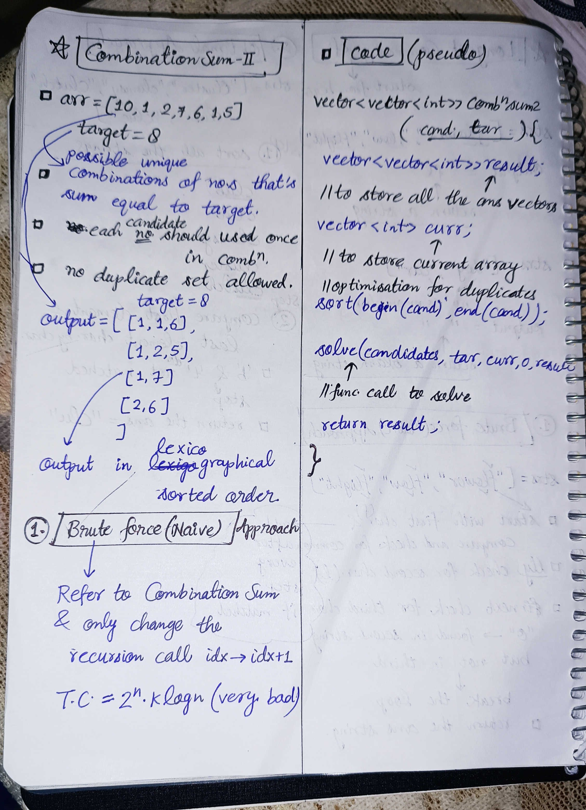
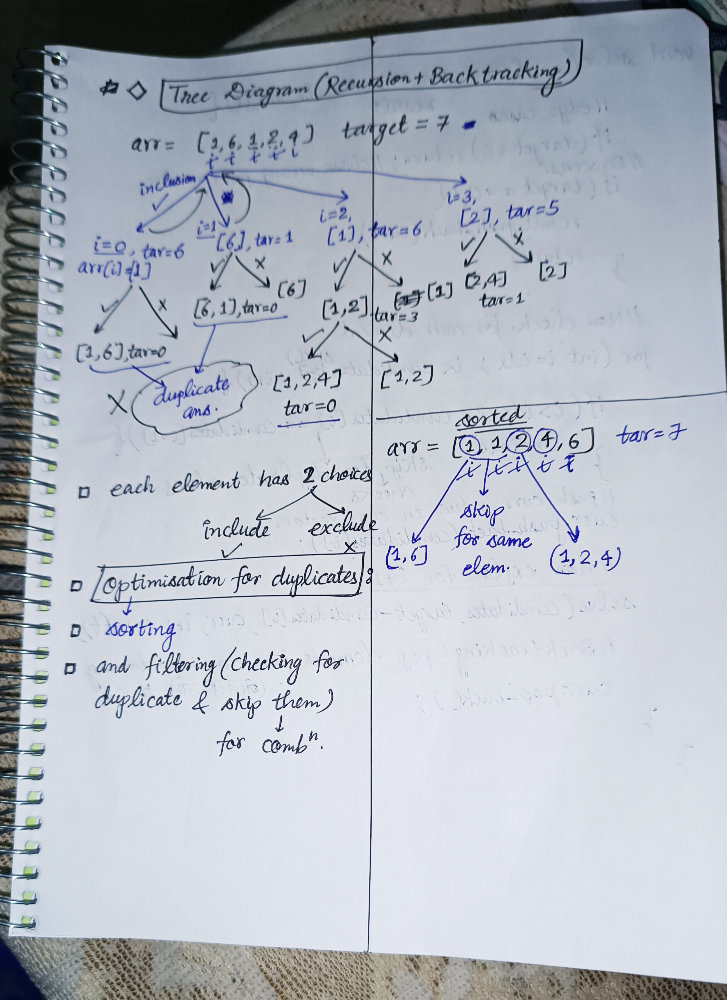

<h2><a href="https://leetcode.com/problems/combination-sum-ii">40. Combination Sum II</a></h2><h3>Medium</h3><hr><p>Given a collection of candidate numbers (<code>candidates</code>) and a target number (<code>target</code>), find all unique combinations in <code>candidates</code>&nbsp;where the candidate numbers sum to <code>target</code>.</p>

<p>Each number in <code>candidates</code>&nbsp;may only be used <strong>once</strong> in the combination.</p>

<p><strong>Note:</strong>&nbsp;The solution set must not contain duplicate combinations.</p>

<p>&nbsp;</p>
<p><strong class="example">Example 1:</strong></p>

<pre>
<strong>Input:</strong> candidates = [10,1,2,7,6,1,5], target = 8
<strong>Output:</strong> 
[
[1,1,6],
[1,2,5],
[1,7],
[2,6]
]
</pre>

<p><strong class="example">Example 2:</strong></p>

<pre>
<strong>Input:</strong> candidates = [2,5,2,1,2], target = 5
<strong>Output:</strong> 
[
[1,2,2],
[5]
]
</pre>

<p>&nbsp;</p>
<p><strong>Constraints:</strong></p>

<ul>
	<li><code>1 &lt;=&nbsp;candidates.length &lt;= 100</code></li>
	<li><code>1 &lt;=&nbsp;candidates[i] &lt;= 50</code></li>
	<li><code>1 &lt;= target &lt;= 30</code></li>
</ul>


<!-- AUTO-GENERATED-SOLUTION-START -->
---

## 🧠 Visual Solution & Intuition

### Part 1



### Part 2



---

## ⏱️ Complexity Analysis

```text
Time Complexity = O(2^n * k) => O(2^n) cause for every step there is 2 choices
Space Complexity = O(k * n)
```

---

## 💻 C++ Solution

[View Original C++ File](./0040-combination-sum-ii.cpp)

```cpp
class Solution {
public:
    //Time Complexity = O(2^n * k) => O(2^n) cause for every step there is 2 choices
    //Space Complexity = O(k * n)
    void getCombinations(vector<int>& candidates, int target,vector<int> &curr, int idx, vector<vector<int>> &result){
        //edge case when target = -ve
        if(target < 0) return ; //cause chose wrong path (return)

        //base case
        if(target == 0){
            result.push_back(curr) ;
            return ;
        }

        //now check for each element
        for(int i = idx ; i<candidates.size() ; i++){
            if(i > idx && candidates[i] == candidates[i-1]){
                continue ; //skip checks for duplicate values
            }
            //push current element in curr vector
            curr.push_back(candidates[i]) ;

            //now explore for i+1
            getCombinations(candidates,target-candidates[i], curr, i+1, result) ;
            //Backtracking step : remove elements from curr (wapas aate time)
            curr.pop_back() ;

        }
    }
    vector<vector<int>> combinationSum2(vector<int>& candidates, int target) {
        vector<vector<int>> result ; //to store all the ans vectors

        vector<int> curr ; //to store current array of selected elements

        //optimisaton to avoid duplicates
        sort(begin(candidates), end(candidates)) ;

        //function call to solve
        getCombinations(candidates,target,curr,0,result) ;

        return result ; //very important to return vector of all the ans
    }
};
```

<!-- AUTO-GENERATED-SOLUTION-END -->
