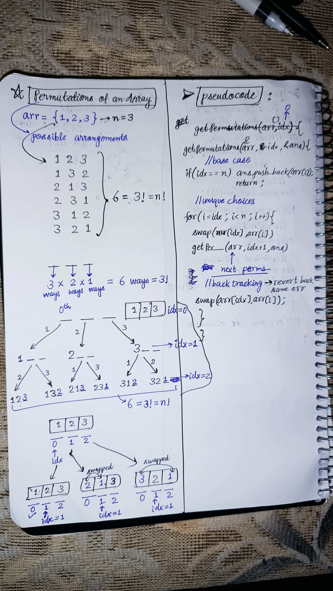

<h2><a href="https://leetcode.com/problems/permutations">46. Permutations</a></h2><h3>Medium</h3><hr><p>Given an array <code>nums</code> of distinct integers, return all the possible <span data-keyword="permutation-array">permutations</span>. You can return the answer in <strong>any order</strong>.</p>

<p>&nbsp;</p>
<p><strong class="example">Example 1:</strong></p>
<pre><strong>Input:</strong> nums = [1,2,3]
<strong>Output:</strong> [[1,2,3],[1,3,2],[2,1,3],[2,3,1],[3,1,2],[3,2,1]]
</pre><p><strong class="example">Example 2:</strong></p>
<pre><strong>Input:</strong> nums = [0,1]
<strong>Output:</strong> [[0,1],[1,0]]
</pre><p><strong class="example">Example 3:</strong></p>
<pre><strong>Input:</strong> nums = [1]
<strong>Output:</strong> [[1]]
</pre>
<p>&nbsp;</p>
<p><strong>Constraints:</strong></p>

<ul>
	<li><code>1 &lt;= nums.length &lt;= 6</code></li>
	<li><code>-10 &lt;= nums[i] &lt;= 10</code></li>
	<li>All the integers of <code>nums</code> are <strong>unique</strong>.</li>
</ul>


<!-- AUTO-GENERATED-SOLUTION-START -->
---

## 🧠 Visual Solution & Intuition



---

## ⏱️ Complexity Analysis

```text
Time Complexity = O(n * n!)
```

---

## 💻 C++ Solution

[View Original C++ File](./0046-permutations.cpp)

```cpp
class Solution {
public: //Time Complexity = O(n * n!)
    void getPermutations(vector<int> &arr, int idx, vector<vector<int>> &ans){
        //base case 
        if(idx == arr.size()){
            //store in the ans
            ans.push_back({arr}) ;
            return ;
        }

        //unique choices
        for(int i = idx ; i<arr.size() ; i++){
            //swap idx place => (i)th choice
            swap(arr[idx],arr[i]) ;
            getPermutations(arr, idx+1, ans) ;// to get next permutations
            //Backtracking : change to avoid duplicate 
            swap(arr[idx], arr[i]) ;
        }

    }

    vector<vector<int>> permute(vector<int>& arr) {
        vector<vector<int>> ans ;

        //function call to getPermutations
        getPermutations(arr,0,ans) ;

        return ans ; //very important to return the ans : All permutations

    }
};
```

<!-- AUTO-GENERATED-SOLUTION-END -->
