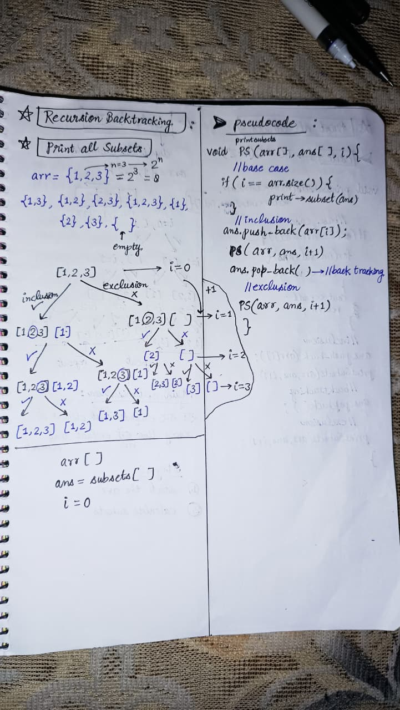

<h2><a href="https://leetcode.com/problems/subsets">78. Subsets</a></h2><h3>Medium</h3><hr><p>Given an integer array <code>nums</code> of <strong>unique</strong> elements, return <em>all possible</em> <span data-keyword="subset"><em>subsets</em></span> <em>(the power set)</em>.</p>

<p>The solution set <strong>must not</strong> contain duplicate subsets. Return the solution in <strong>any order</strong>.</p>

<p>&nbsp;</p>
<p><strong class="example">Example 1:</strong></p>

<pre>
<strong>Input:</strong> nums = [1,2,3]
<strong>Output:</strong> [[],[1],[2],[1,2],[3],[1,3],[2,3],[1,2,3]]
</pre>

<p><strong class="example">Example 2:</strong></p>

<pre>
<strong>Input:</strong> nums = [0]
<strong>Output:</strong> [[],[0]]
</pre>

<p>&nbsp;</p>
<p><strong>Constraints:</strong></p>

<ul>
	<li><code>1 &lt;= nums.length &lt;= 10</code></li>
	<li><code>-10 &lt;= nums[i] &lt;= 10</code></li>
	<li>All the numbers of&nbsp;<code>nums</code> are <strong>unique</strong>.</li>
</ul>


<!-- AUTO-GENERATED-SOLUTION-START -->
---

## 🧠 Visual Solution & Intuition



---

## ⏱️ Complexity Analysis

```text
Time Complexity = O(n * 2^n) => at every step there is two choices include or exclude for n elements.
Space Complexity = O(n * 2^n) => cause extra array used for storing elements and output array.
```

---

## 💻 C++ Solution

[View Original C++ File](./0078-subsets.cpp)

```cpp
class Solution {
public: 
    //Time Complexity = O(n * 2^n) => at every step there is two choices include or exclude for n elements.
    //Space Complexity = O(n * 2^n) => cause extra array used for storing elements and output array.
    void getAllSubsets(vector<int>&arr, vector<int>&ans, int i, vector<vector<int>> &allSubsets ){
        //base case
        if(i == arr.size()){
            //store subsets
            allSubsets.push_back({ans}) ;
            return ;
        }
        //inclusion
        ans.push_back(arr[i]) ;
        getAllSubsets(arr,ans,i+1,allSubsets) ;
        
        //Backtracking
        ans.pop_back() ;

        //exclusion
        getAllSubsets(arr,ans,i+1,allSubsets) ;
    }
     

    vector<vector<int>> subsets(vector<int>& arr) {
        vector<vector<int>> allSubsets ; //to store all subsets
        vector<int> ans ;
        //function call to getAllSubsets
        getAllSubsets(arr,ans,0,allSubsets) ;

        return allSubsets ; //important to return allSubsets vector
    }
};
```

<!-- AUTO-GENERATED-SOLUTION-END -->
