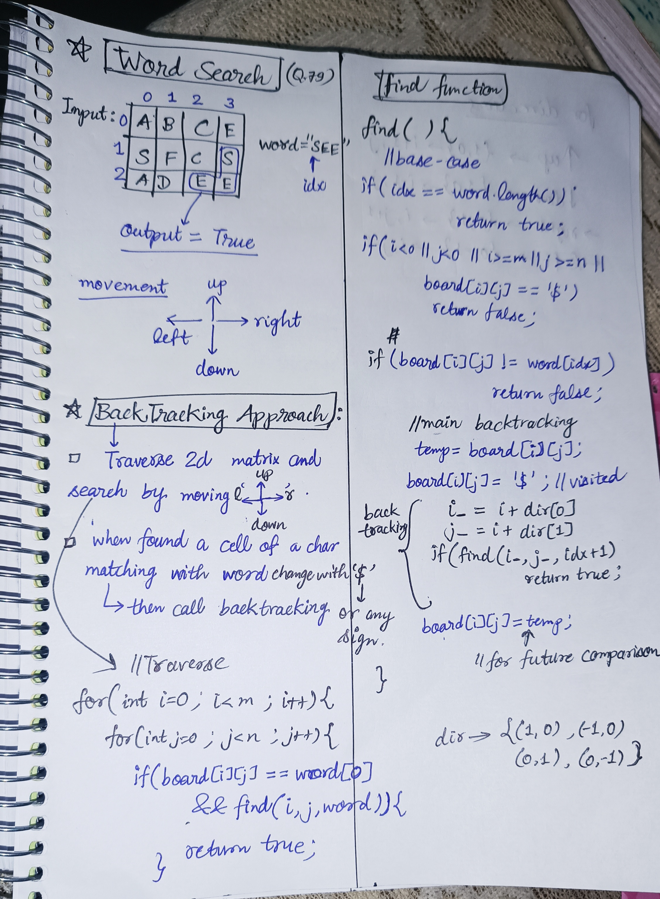
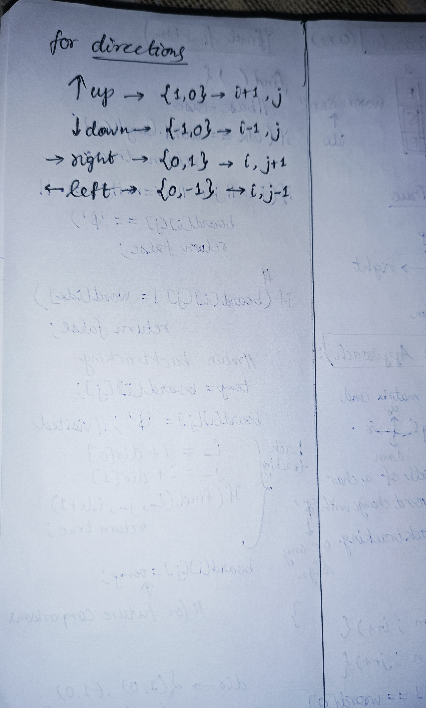

<h2><a href="https://leetcode.com/problems/word-search">79. Word Search</a></h2><h3>Medium</h3><hr><p>Given an <code>m x n</code> grid of characters <code>board</code> and a string <code>word</code>, return <code>true</code> <em>if</em> <code>word</code> <em>exists in the grid</em>.</p>

<p>The word can be constructed from letters of sequentially adjacent cells, where adjacent cells are horizontally or vertically neighboring. The same letter cell may not be used more than once.</p>

<p>&nbsp;</p>
<p><strong class="example">Example 1:</strong></p>

<pre>
<strong>Input:</strong> board = [[&quot;A&quot;,&quot;B&quot;,&quot;C&quot;,&quot;E&quot;],[&quot;S&quot;,&quot;F&quot;,&quot;C&quot;,&quot;S&quot;],[&quot;A&quot;,&quot;D&quot;,&quot;E&quot;,&quot;E&quot;]], word = &quot;ABCCED&quot;
<strong>Output:</strong> true
</pre>

<p><strong class="example">Example 2:</strong></p>

<pre>
<strong>Input:</strong> board = [[&quot;A&quot;,&quot;B&quot;,&quot;C&quot;,&quot;E&quot;],[&quot;S&quot;,&quot;F&quot;,&quot;C&quot;,&quot;S&quot;],[&quot;A&quot;,&quot;D&quot;,&quot;E&quot;,&quot;E&quot;]], word = &quot;SEE&quot;
<strong>Output:</strong> true
</pre>

<p><strong class="example">Example 3:</strong></p>

<pre>
<strong>Input:</strong> board = [[&quot;A&quot;,&quot;B&quot;,&quot;C&quot;,&quot;E&quot;],[&quot;S&quot;,&quot;F&quot;,&quot;C&quot;,&quot;S&quot;],[&quot;A&quot;,&quot;D&quot;,&quot;E&quot;,&quot;E&quot;]], word = &quot;ABCB&quot;
<strong>Output:</strong> false
</pre>

<p>&nbsp;</p>
<p><strong>Constraints:</strong></p>

<ul>
	<li><code>m == board.length</code></li>
	<li><code>n = board[i].length</code></li>
	<li><code>1 &lt;= m, n &lt;= 6</code></li>
	<li><code>1 &lt;= word.length &lt;= 15</code></li>
	<li><code>board</code> and <code>word</code> consists of only lowercase and uppercase English letters.</li>
</ul>

<p>&nbsp;</p>
<p><strong>Follow up:</strong> Could you use search pruning to make your solution faster with a larger <code>board</code>?</p>


<!-- AUTO-GENERATED-SOLUTION-START -->
---

## 🧠 Visual Solution & Intuition

### Part 1



### Part 2



---

## ⏱️ Complexity Analysis

```text
Time Complexity = O(m × n × 4^L) => O(4^L) move in 4 directions
Space Complexity = O(L) => recursive stack depth = L(length of word)
```

---

## 💻 C++ Solution

[View Original C++ File](./0079-word-search.cpp)

```cpp
class Solution {
public:
    //Time Complexity = O(m × n × 4^L) => O(4^L) move in 4 directions
    //Space Complexity = O(L) => recursive stack depth = L(length of word)
    
    bool find(vector<vector<char>>& board, int i, int j, int idx,string &word, int m, int n ){
        //basecase
        if(idx == word.size()) return true ; //found
        //edge cases
        if(i < 0 || j < 0 || i >= m || j >= n || board[i][j] == '$'){
            return false ; 
        }

        if(board[i][j] != word[idx]) return false ;
       
        //mark visited
        char temp = board[i][j] ; //store in temp
        board[i][j] = '$' ;
        //main backtracking step 
        // manually checking 4 directions(to save extra space)
        if(find(board, i+1, j, idx+1, word, m, n)) return true; //move up
        if(find(board, i-1, j, idx+1, word, m, n)) return true; //move down
        if(find(board, i, j+1, idx+1, word, m, n)) return true; //move right
        if(find(board, i, j-1, idx+1, word, m, n)) return true; //move left


        //update again for next iterations or checks
        board[i][j] = temp ;
        
        //if not found in upper loop then
        return false ;

    }


    bool exist(vector<vector<char>>& board, string word) {
       int m = board.size() ; //row size
       int n = board[0].size() ; //col size

        //Traverse the 2d matrix
        for(int i=0 ; i<m ; i++){
            for(int j=0 ; j<n ; j++){
                if(board[i][j] == word[0] && find(board,i,j,0,word,m,n)){
                    return true ; //found
                }

            }
        }

        return false ; //if not found in upper loop
    }
};
```

<!-- AUTO-GENERATED-SOLUTION-END -->
