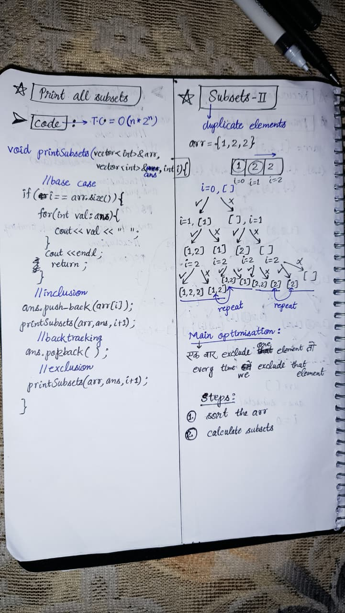
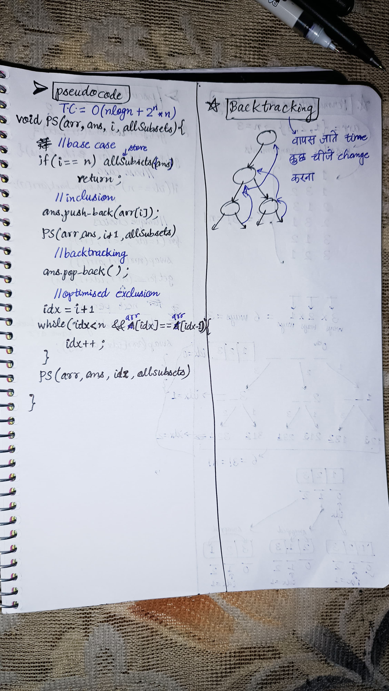

<h2><a href="https://leetcode.com/problems/subsets-ii">90. Subsets II</a></h2><h3>Medium</h3><hr><p>Given an integer array <code>nums</code> that may contain duplicates, return <em>all possible</em> <span data-keyword="subset"><em>subsets</em></span><em> (the power set)</em>.</p>

<p>The solution set <strong>must not</strong> contain duplicate subsets. Return the solution in <strong>any order</strong>.</p>

<p>&nbsp;</p>
<p><strong class="example">Example 1:</strong></p>
<pre><strong>Input:</strong> nums = [1,2,2]
<strong>Output:</strong> [[],[1],[1,2],[1,2,2],[2],[2,2]]
</pre><p><strong class="example">Example 2:</strong></p>
<pre><strong>Input:</strong> nums = [0]
<strong>Output:</strong> [[],[0]]
</pre>
<p>&nbsp;</p>
<p><strong>Constraints:</strong></p>

<ul>
	<li><code>1 &lt;= nums.length &lt;= 10</code></li>
	<li><code>-10 &lt;= nums[i] &lt;= 10</code></li>
</ul>


<!-- AUTO-GENERATED-SOLUTION-START -->
---

## 🧠 Visual Solution & Intuition

### Part 1



### Part 2



---

## ⏱️ Complexity Analysis

```text
Time Complexity = O(nlogn + n * 2^n) =>
```

---

## 💻 C++ Solution

[View Original C++ File](./0090-subsets-ii.cpp)

```cpp
class Solution {
public: 
    //Time Complexity = O(nlogn + n * 2^n) =>
    // O(nlogn) => sort, O(n * 2^n) => n times for 2^n subsets
    void getAllSubsets(vector<int> &arr, vector<int>&ans, int i , vector<vector<int>>&allSubsets){
        //base case 
        if(i == arr.size()){
            //store the ans
            allSubsets.push_back({ans}) ;
            return ;
        }

        //inclusion
        ans.push_back(arr[i]) ;
        getAllSubsets(arr, ans, i+1, allSubsets) ;

        //Backtracking
        ans.pop_back() ;

        //exclusion
        int idx = i+1 ;
        while(idx < arr.size() && arr[idx] == arr[idx-1]){
            idx++ ; //to skip until equal values 
        }
        getAllSubsets(arr, ans, idx, allSubsets) ;


    }
    
    vector<vector<int>> subsetsWithDup(vector<int>& arr) {
        //Step 1 : sort (to avoid duplicate subsets)
        sort(arr.begin(), arr.end()) ;

        vector<vector<int>> allSubsets ; //to store allSubsets
        vector<int> ans ; //to store 1 ans at a time
       
        //function call to getAllSubsets
        getAllSubsets(arr, ans, 0, allSubsets) ;
        return allSubsets ; //very important to return allSubsets
    }
};
```

<!-- AUTO-GENERATED-SOLUTION-END -->
