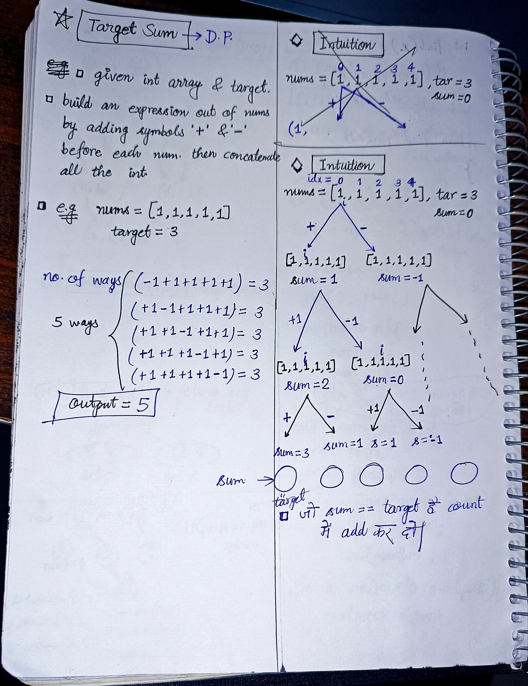
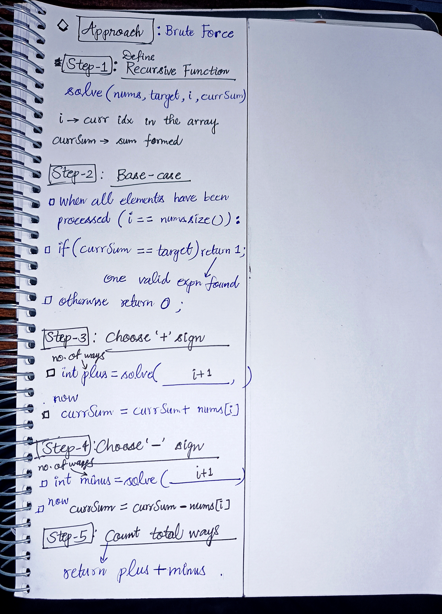

<h2><a href="https://leetcode.com/problems/target-sum">494. Target Sum</a></h2><h3>Medium</h3><hr><p>You are given an integer array <code>nums</code> and an integer <code>target</code>.</p>

<p>You want to build an <strong>expression</strong> out of nums by adding one of the symbols <code>&#39;+&#39;</code> and <code>&#39;-&#39;</code> before each integer in nums and then concatenate all the integers.</p>

<ul>
	<li>For example, if <code>nums = [2, 1]</code>, you can add a <code>&#39;+&#39;</code> before <code>2</code> and a <code>&#39;-&#39;</code> before <code>1</code> and concatenate them to build the expression <code>&quot;+2-1&quot;</code>.</li>
</ul>

<p>Return the number of different <strong>expressions</strong> that you can build, which evaluates to <code>target</code>.</p>

<p>&nbsp;</p>
<p><strong class="example">Example 1:</strong></p>

<pre>
<strong>Input:</strong> nums = [1,1,1,1,1], target = 3
<strong>Output:</strong> 5
<strong>Explanation:</strong> There are 5 ways to assign symbols to make the sum of nums be target 3.
-1 + 1 + 1 + 1 + 1 = 3
+1 - 1 + 1 + 1 + 1 = 3
+1 + 1 - 1 + 1 + 1 = 3
+1 + 1 + 1 - 1 + 1 = 3
+1 + 1 + 1 + 1 - 1 = 3
</pre>

<p><strong class="example">Example 2:</strong></p>

<pre>
<strong>Input:</strong> nums = [1], target = 1
<strong>Output:</strong> 1
</pre>

<p>&nbsp;</p>
<p><strong>Constraints:</strong></p>

<ul>
	<li><code>1 &lt;= nums.length &lt;= 20</code></li>
	<li><code>0 &lt;= nums[i] &lt;= 1000</code></li>
	<li><code>0 &lt;= sum(nums[i]) &lt;= 1000</code></li>
	<li><code>-1000 &lt;= target &lt;= 1000</code></li>
</ul>


<!-- AUTO-GENERATED-SOLUTION-START -->
---

## 🧠 Visual Solution & Intuition

### Part 1



### Part 2



---

## ⏱️ Complexity Analysis

```text
Time Complexity = O(2^n)
Space Complexity = O(n)
```

---

## 💻 C++ Solution

[View Original C++ File](./0494-target-sum.cpp)

```cpp
class Solution {
public:
    //Time Complexity = O(2^n)
    //Space Complexity = O(n)
    int solve(vector<int>& nums, int target, int i, int currSum){
        //Base-case
        if(i == nums.size() ){
            if(currSum == target)
                return 1 ;

            else {
                return 0 ;
            }
        }

        //choose '+' sign : no. of ways choosing '+' sign
        int plus = solve(nums, target, i+1, currSum + nums[i]) ;

        //choose '-' sign : no. of ways choosing '-' sign
        int minus = solve(nums, target, i+1, currSum - nums[i]) ;


        //return the total no. of ways
        return plus + minus ;
    }
    int findTargetSumWays(vector<int>& nums, int target) {
        return solve(nums, target, 0, 0) ;
    }
};
```

<!-- AUTO-GENERATED-SOLUTION-END -->
