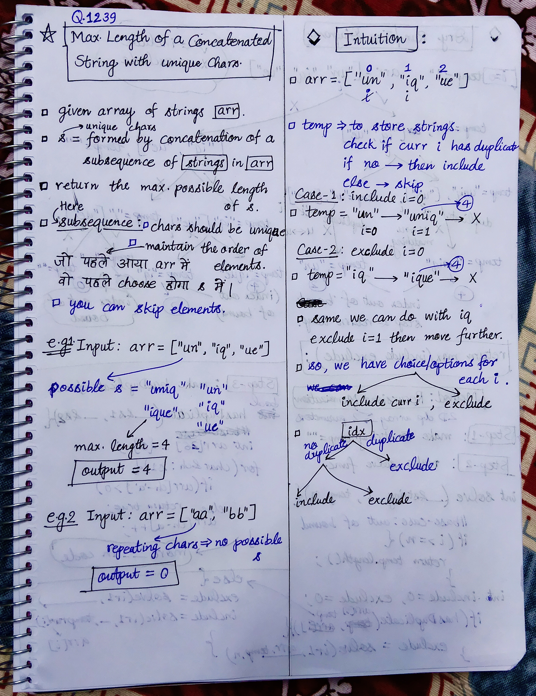
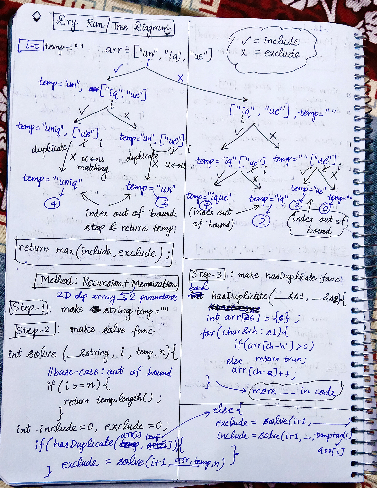

<h2><a href="https://leetcode.com/problems/maximum-length-of-a-concatenated-string-with-unique-characters">1239. Maximum Length of a Concatenated String with Unique Characters</a></h2><h3>Medium</h3><hr><p>You are given an array of strings <code>arr</code>. A string <code>s</code> is formed by the <strong>concatenation</strong> of a <strong>subsequence</strong> of <code>arr</code> that has <strong>unique characters</strong>.</p>

<p>Return <em>the <strong>maximum</strong> possible length</em> of <code>s</code>.</p>

<p>A <strong>subsequence</strong> is an array that can be derived from another array by deleting some or no elements without changing the order of the remaining elements.</p>

<p>&nbsp;</p>
<p><strong class="example">Example 1:</strong></p>

<pre>
<strong>Input:</strong> arr = [&quot;un&quot;,&quot;iq&quot;,&quot;ue&quot;]
<strong>Output:</strong> 4
<strong>Explanation:</strong> All the valid concatenations are:
- &quot;&quot;
- &quot;un&quot;
- &quot;iq&quot;
- &quot;ue&quot;
- &quot;uniq&quot; (&quot;un&quot; + &quot;iq&quot;)
- &quot;ique&quot; (&quot;iq&quot; + &quot;ue&quot;)
Maximum length is 4.
</pre>

<p><strong class="example">Example 2:</strong></p>

<pre>
<strong>Input:</strong> arr = [&quot;cha&quot;,&quot;r&quot;,&quot;act&quot;,&quot;ers&quot;]
<strong>Output:</strong> 6
<strong>Explanation:</strong> Possible longest valid concatenations are &quot;chaers&quot; (&quot;cha&quot; + &quot;ers&quot;) and &quot;acters&quot; (&quot;act&quot; + &quot;ers&quot;).
</pre>

<p><strong class="example">Example 3:</strong></p>

<pre>
<strong>Input:</strong> arr = [&quot;abcdefghijklmnopqrstuvwxyz&quot;]
<strong>Output:</strong> 26
<strong>Explanation:</strong> The only string in arr has all 26 characters.
</pre>

<p>&nbsp;</p>
<p><strong>Constraints:</strong></p>

<ul>
	<li><code>1 &lt;= arr.length &lt;= 16</code></li>
	<li><code>1 &lt;= arr[i].length &lt;= 26</code></li>
	<li><code>arr[i]</code> contains only lowercase English letters.</li>
</ul>


<!-- AUTO-GENERATED-SOLUTION-START -->
---

## 🧠 Visual Solution & Intuition

### Part 1



### Part 2



---

## ⏱️ Complexity Analysis

```text
Time Complexity = O(2^n)
Space Complexity = O(2^n)
```

---

## 💻 C++ Solution

[View Original C++ File](./1239-maximum-length-of-a-concatenated-string-with-unique-characters.cpp)

```cpp
class Solution {
public:
    //Method : Recursion + Memoization 
    
    //Time Complexity = O(2^n)
    //Space Complexity = O(2^n)
    bool hasDuplicates(string& s1, string& s2){
        //take array of 26 chars. 
        int arr[26] = {0} ;//to store frequency of chars.

        //check in s1 if repeating chars.
        for(char &ch : s1){
            if(arr[ch - 'a'] > 0){ //repeating
                return true ;
            }
            else{ //if not repeating push in freq array
                arr[ch - 'a']++ ; 
            }
        }


        //check in s2 if repeating chars.
        for(char &ch : s2){
            if(arr[ch - 'a'] > 0){
                return true ;
            }
        }


        //finally if no duplicates found in above checks
        return false ;


    }

    unordered_map<string, int>dpMap ;

    int solve(int i, vector<string>& arr, string temp, int n){
        //base-case : if index out of bound then return temp
        if(i >= n){
            return temp.length() ;
        }

        //check in dpMap if solved before or not
        if(dpMap.find(temp) != dpMap.end()){ //solved
            return dpMap[temp] ; //just return that
        }

        int include = 0 ;
        int exclude = 0 ;

        if(hasDuplicates(arr[i], temp)){
            exclude = solve(i+1, arr, temp, n) ; //just move i
        }

        else{ //two choices : exclude, include
            exclude = solve(i+1, arr, temp, n) ;
            include = solve(i+1, arr, temp+arr[i], n) ;
        }

        return dpMap[temp] = max(include, exclude) ;
    }
    int maxLength(vector<string>& arr) {
        int n = arr.size() ;

        dpMap.clear() ;

        string temp = "" ; //empty string
        int i = 0 ; 

        return solve(i, arr, temp, n) ;

        
    }
};
```

<!-- AUTO-GENERATED-SOLUTION-END -->
