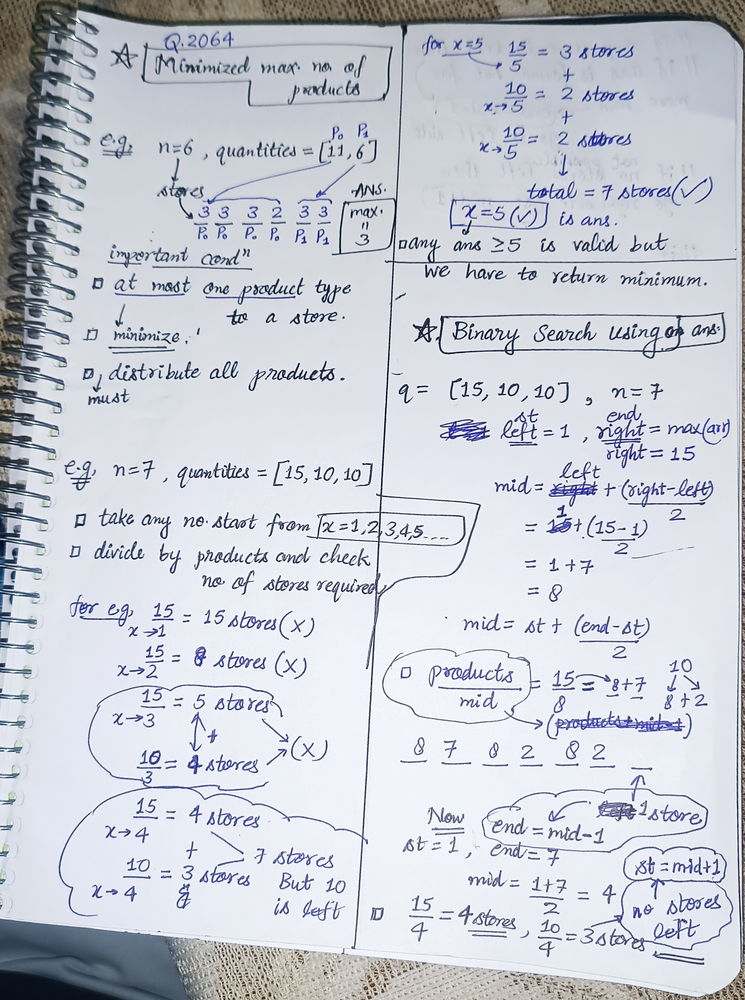
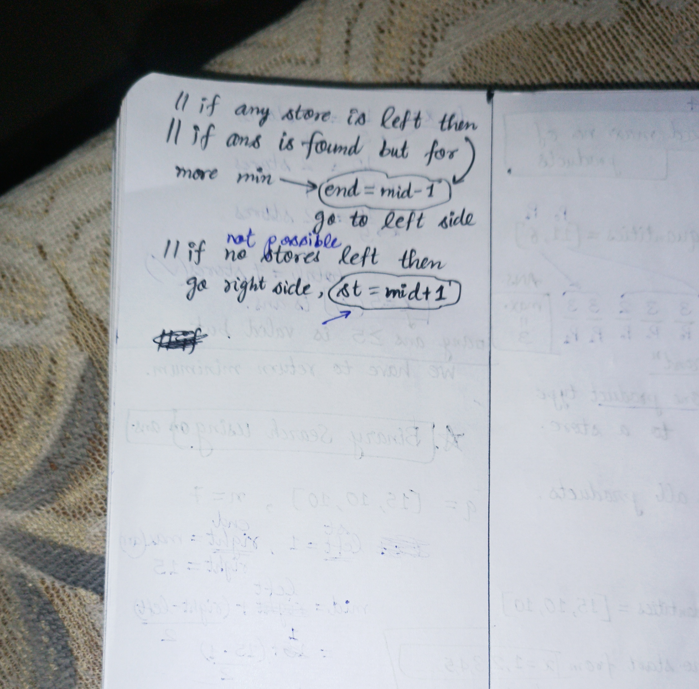

<h2><a href="https://leetcode.com/problems/minimized-maximum-of-products-distributed-to-any-store">2188. Minimized Maximum of Products Distributed to Any Store</a></h2><h3>Medium</h3><hr><p>You are given an integer <code>n</code> indicating there are <code>n</code> specialty retail stores. There are <code>m</code> product types of varying amounts, which are given as a <strong>0-indexed</strong> integer array <code>quantities</code>, where <code>quantities[i]</code> represents the number of products of the <code>i<sup>th</sup></code> product type.</p>

<p>You need to distribute <strong>all products</strong> to the retail stores following these rules:</p>

<ul>
	<li>A store can only be given <strong>at most one product type</strong> but can be given <strong>any</strong> amount of it.</li>
	<li>After distribution, each store will have been given some number of products (possibly <code>0</code>). Let <code>x</code> represent the maximum number of products given to any store. You want <code>x</code> to be as small as possible, i.e., you want to <strong>minimize</strong> the <strong>maximum</strong> number of products that are given to any store.</li>
</ul>

<p>Return <em>the minimum possible</em> <code>x</code>.</p>

<p>&nbsp;</p>
<p><strong class="example">Example 1:</strong></p>

<pre>
<strong>Input:</strong> n = 6, quantities = [11,6]
<strong>Output:</strong> 3
<strong>Explanation:</strong> One optimal way is:
- The 11 products of type 0 are distributed to the first four stores in these amounts: 2, 3, 3, 3
- The 6 products of type 1 are distributed to the other two stores in these amounts: 3, 3
The maximum number of products given to any store is max(2, 3, 3, 3, 3, 3) = 3.
</pre>

<p><strong class="example">Example 2:</strong></p>

<pre>
<strong>Input:</strong> n = 7, quantities = [15,10,10]
<strong>Output:</strong> 5
<strong>Explanation:</strong> One optimal way is:
- The 15 products of type 0 are distributed to the first three stores in these amounts: 5, 5, 5
- The 10 products of type 1 are distributed to the next two stores in these amounts: 5, 5
- The 10 products of type 2 are distributed to the last two stores in these amounts: 5, 5
The maximum number of products given to any store is max(5, 5, 5, 5, 5, 5, 5) = 5.
</pre>

<p><strong class="example">Example 3:</strong></p>

<pre>
<strong>Input:</strong> n = 1, quantities = [100000]
<strong>Output:</strong> 100000
<strong>Explanation:</strong> The only optimal way is:
- The 100000 products of type 0 are distributed to the only store.
The maximum number of products given to any store is max(100000) = 100000.
</pre>

<p>&nbsp;</p>
<p><strong>Constraints:</strong></p>

<ul>
	<li><code>m == quantities.length</code></li>
	<li><code>1 &lt;= m &lt;= n &lt;= 10<sup>5</sup></code></li>
	<li><code>1 &lt;= quantities[i] &lt;= 10<sup>5</sup></code></li>
</ul>


<!-- AUTO-GENERATED-SOLUTION-START -->
---

## 🧠 Visual Solution & Intuition

### Part 1



### Part 2



---

## ⏱️ Complexity Analysis

```text
Time Complexity = O(n * log(MaxValue)) => O(log(MaxValue)) for binary search , O(n) for isPossibleAns function .
Space Complexity = O(1)
Time Complexity = O(n)
Time Complexity = O(log(MaxValue))
```

---

## 💻 C++ Solution

[View Original C++ File](./2064-minimized-maximum-of-products-distributed-to-any-store.cpp)

```cpp
class Solution {
public:
   //Time Complexity = O(n * log(MaxValue)) => O(log(MaxValue)) for binary search , O(n) for isPossibleAns function .
   //Space Complexity = O(1)
    bool isPossibleAns(int mid, vector<int>& quantities, int stores){ //Time Complexity = O(n)
        //Note x = mid => written mid for no confusion

        //iterate on quantities to check possible ans
        for(int &products : quantities){

            stores -= (products + mid -1)/mid ; //to calculate products on each store 

            if(stores < 0){
                return false ;
            }
        }

        //if passed all the checks in above loop then mark true
        return true ;
    }
    int minimizedMaximum(int n, vector<int>& quantities) { //O(n * log(MaxValue))
        int m = quantities.size() ; 

        int st = 1 ; 
        int hi = *max_element(begin(quantities), end(quantities)) ;//end = max(quantities)
       //beware you can't name variable end in above
       //int end = *max_element(begin(quantities), end(quantities)) ;
        int ans = 0 ; 

        while(st <= hi){ //Time Complexity = O(log(MaxValue))
            int mid = st + (hi-st)/2 ;

            if(isPossibleAns(mid,quantities,n)){
                ans = mid ; //if ans found then store and check for more min.
                hi = mid-1 ; //move in left to check more min. ans
            }
            else{  //if not possible ans
                st = mid+1 ; //then move to right to max. the value
            }
        }

        return ans ;
    }
};
```

<!-- AUTO-GENERATED-SOLUTION-END -->
