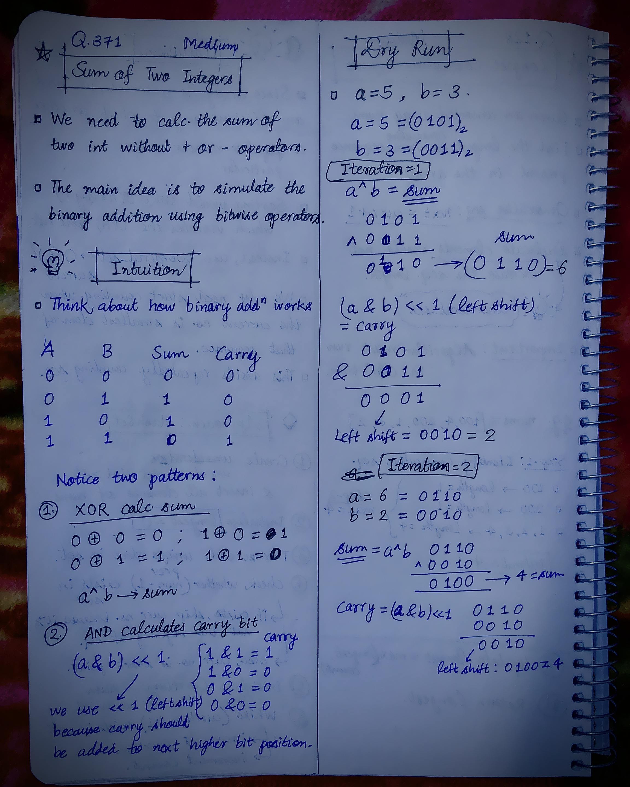
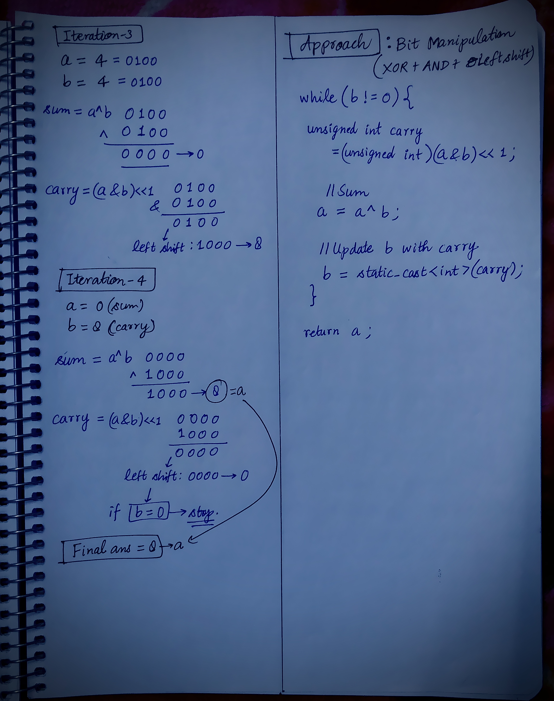

<h2><a href="https://leetcode.com/problems/sum-of-two-integers">371. Sum of Two Integers</a></h2><h3>Medium</h3><hr><p>Given two integers <code>a</code> and <code>b</code>, return <em>the sum of the two integers without using the operators</em> <code>+</code> <em>and</em> <code>-</code>.</p>

<p>&nbsp;</p>
<p><strong class="example">Example 1:</strong></p>
<pre><strong>Input:</strong> a = 1, b = 2
<strong>Output:</strong> 3
</pre><p><strong class="example">Example 2:</strong></p>
<pre><strong>Input:</strong> a = 2, b = 3
<strong>Output:</strong> 5
</pre>
<p>&nbsp;</p>
<p><strong>Constraints:</strong></p>

<ul>
	<li><code>-1000 &lt;= a, b &lt;= 1000</code></li>
</ul>


<!-- AUTO-GENERATED-SOLUTION-START -->
---

## 🧠 Visual Solution & Intuition

### Part 1



### Part 2



---

## 💡 Approach

```text
Approach : Bit Manipulation (XOR + AND + Left Shift)
```

---

## ⏱️ Complexity Analysis

```text
Time Complexity = O(1) =>
Space Complexity = O(1) =>
```

---

## 💻 C++ Solution

[View Original C++ File](./0371-sum-of-two-integers.cpp)

```cpp
class Solution {
public:
    //Approach : Bit Manipulation (XOR + AND + Left Shift)

    //Time Complexity = O(1) =>
    /* Each iteration performs constant-time bitwise operations.
    * The carry can propagate through at most 32 bit positions.
    * Therefore, the maximum number of iterations is bounded by 32.
    */

    //Space Complexity = O(1) =>
    /* Only one additional variable, carry, is used.
    * No extra arrays or data structures are required.
    * Total SC = O(1).
    */

    int getSum(int a, int b) {
        
        //if b == 0 stop
        while(b != 0){

            //calc. carry
            unsigned int carry = (unsigned int)(a & b) << 1; 

            //calc. sum and assign to a
            a = a ^ b;

            //update b with carry
            b = static_cast<int>(carry);//type-cast : convert carry into integer
        }

        //finally return the sum
        return a;
    }
};
```

<!-- AUTO-GENERATED-SOLUTION-END -->
