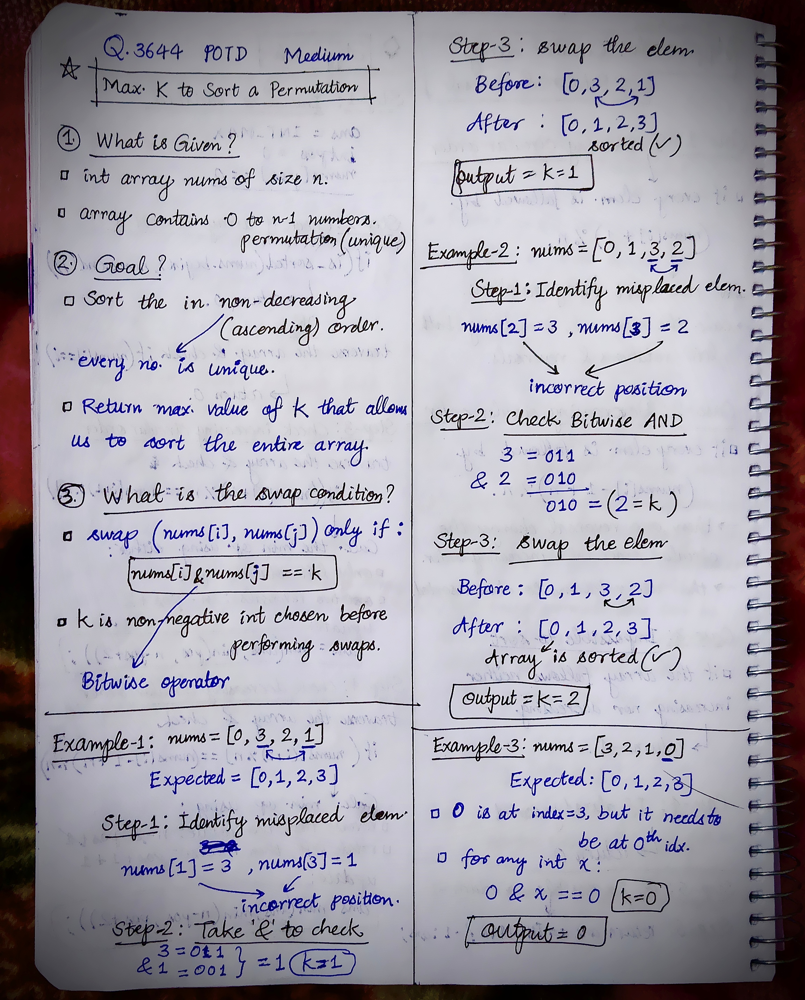
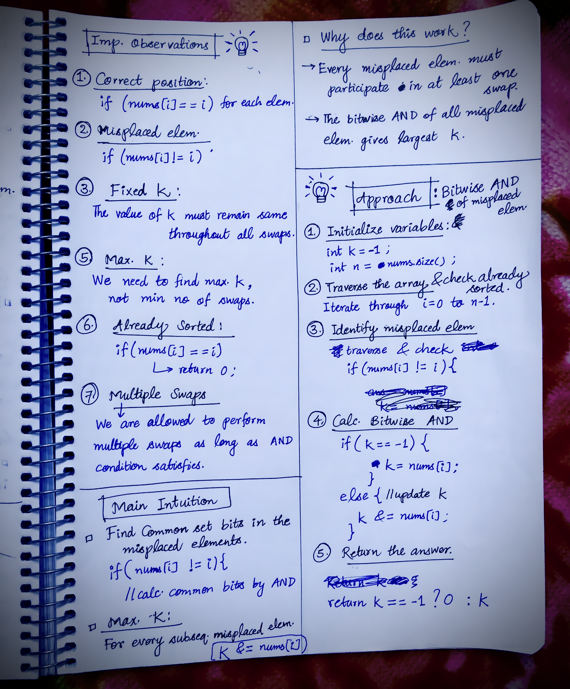

<h2><a href="https://leetcode.com/problems/maximum-k-to-sort-a-permutation">3950. Maximum K to Sort a Permutation</a></h2><h3>Medium</h3><hr><p>You are given an integer array <code>nums</code> of length <code>n</code>, where <code>nums</code> is a <strong><span data-keyword="permutation-array">permutation</span></strong> of the numbers in the range <code>[0..n - 1]</code>.</p>

<p>You may swap elements at indices <code>i</code> and <code>j</code> <strong>only if</strong> <code>nums[i] AND nums[j] == k</code>, where <code>AND</code> denotes the bitwise AND operation and <code>k</code> is a <strong>non-negative</strong> integer.</p>

<p>Return the <strong>maximum</strong> value of <code>k</code> such that the array can be sorted in <strong>non-decreasing</strong> order using any number of such swaps. If <code>nums</code> is already sorted, return 0.</p>

<p>&nbsp;</p>
<p><strong class="example">Example 1:</strong></p>

<div class="example-block">
<p><strong>Input:</strong> <span class="example-io">nums = [0,3,2,1]</span></p>

<p><strong>Output:</strong> <span class="example-io">1</span></p>

<p><strong>Explanation:</strong></p>

<p>Choose <code>k = 1</code>. Swapping <code>nums[1] = 3</code> and <code>nums[3] = 1</code> is allowed since <code>nums[1] AND nums[3] == 1</code>, resulting in a sorted permutation: <code>[0, 1, 2, 3]</code>.</p>
</div>

<p><strong class="example">Example 2:</strong></p>

<div class="example-block">
<p><strong>Input:</strong> <span class="example-io">nums = [0,1,3,2]</span></p>

<p><strong>Output:</strong> <span class="example-io">2</span></p>

<p><strong>Explanation:</strong></p>

<p>Choose <code>k = 2</code>. Swapping <code>nums[2] = 3</code> and <code>nums[3] = 2</code> is allowed since <code>nums[2] AND nums[3] == 2</code>, resulting in a sorted permutation: <code>[0, 1, 2, 3]</code>.</p>
</div>

<p><strong class="example">Example 3:</strong></p>

<div class="example-block">
<p><strong>Input:</strong> <span class="example-io">nums = [3,2,1,0]</span></p>

<p><strong>Output:</strong> <span class="example-io">0</span></p>

<p><strong>Explanation:</strong></p>

<p>Only <code>k = 0</code> allows sorting since no greater <code>k</code> allows the required swaps where <code>nums[i] AND nums[j] == k</code>.</p>
</div>

<p>&nbsp;</p>
<p><strong>Constraints:</strong></p>

<ul>
	<li><code>1 &lt;= n == nums.length &lt;= 10<sup>5</sup></code></li>
	<li><code>0 &lt;= nums[i] &lt;= n - 1</code></li>
	<li><code>nums</code> is a permutation of integers from <code>0</code> to <code>n - 1</code>.</li>
</ul>


<!-- AUTO-GENERATED-SOLUTION-START -->
---

## 🧠 Visual Solution & Intuition

### Part 1



### Part 2



---

## 💡 Approach

```text
Approach : Bitwise AND of misplaced elements
```

---

## ⏱️ Complexity Analysis

```text
Time Complexity = O(n) =>
Space Complexity = O(1) =>
```

---

## 💻 C++ Solution

[View Original C++ File](./3644-maximum-k-to-sort-a-permutation.cpp)

```cpp
class Solution {
public:
    //Approach : Bitwise AND of misplaced elements

    //Time Complexity = O(n) =>
    /* Single traversal of the array → O(n).
    * Each comparison and Bitwise AND operation → O(1).
    * Total: O(n).
    */

    //Space Complexity = O(1) =>
    /* Only two extra variables, k and n.
    * No additional arrays or data structures.
    * Total: O(1).
    */
    
    int sortPermutation(vector<int>& nums) {
        
        //1.) Initialize variables
        int k = -1;
        int n = nums.size();

        //2.) traverse the nums array
        for(int i = 0; i < n; i++){

            if(nums[i] != i){//3.) find misplaced elem
                
                //4.) calc. misplaced elements
                if(k == -1){
                    k = nums[i];
                }
                else{
                    k &= nums[i];
                }
            }
        }
       

        //5.) Return the answer
        return k == -1 ? 0 : k;       
    }
};
```

<!-- AUTO-GENERATED-SOLUTION-END -->
