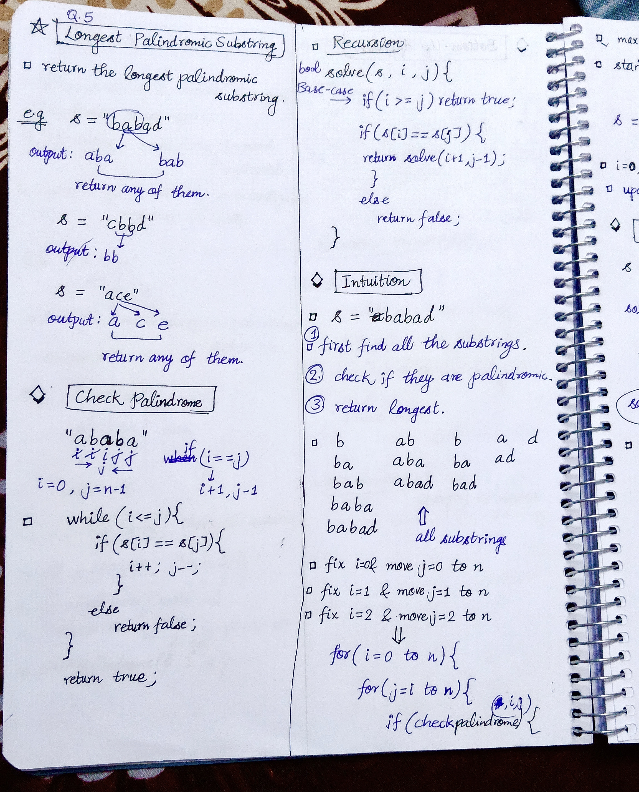
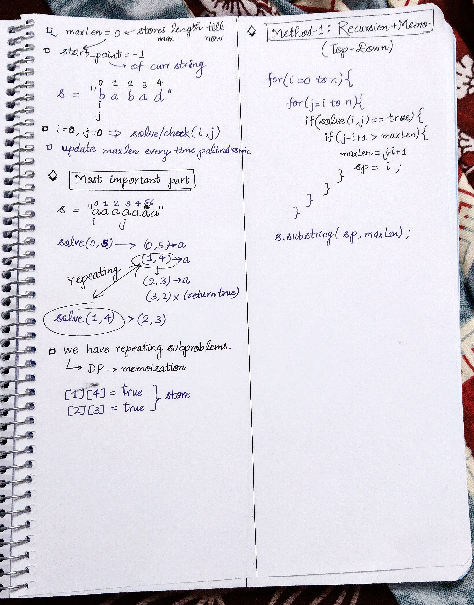

<h2><a href="https://leetcode.com/problems/longest-palindromic-substring">5. Longest Palindromic Substring</a></h2><h3>Medium</h3><hr><p>Given a string <code>s</code>, return <em>the longest</em> <span data-keyword="palindromic-string"><em>palindromic</em></span> <span data-keyword="substring-nonempty"><em>substring</em></span> in <code>s</code>.</p>

<p>&nbsp;</p>
<p><strong class="example">Example 1:</strong></p>

<pre>
<strong>Input:</strong> s = &quot;babad&quot;
<strong>Output:</strong> &quot;bab&quot;
<strong>Explanation:</strong> &quot;aba&quot; is also a valid answer.
</pre>

<p><strong class="example">Example 2:</strong></p>

<pre>
<strong>Input:</strong> s = &quot;cbbd&quot;
<strong>Output:</strong> &quot;bb&quot;
</pre>

<p>&nbsp;</p>
<p><strong>Constraints:</strong></p>

<ul>
	<li><code>1 &lt;= s.length &lt;= 1000</code></li>
	<li><code>s</code> consist of only digits and English letters.</li>
</ul>


<!-- AUTO-GENERATED-SOLUTION-START -->
---

## 🧠 Visual Solution & Intuition

### Part 1



### Part 2



---

## 💻 C++ Solution

[View Original C++ File](./0005-longest-palindromic-substring.cpp)

```cpp
class Solution {
public:
    //Method-1 : Top-Down Approach(Recursion + Memoization)

    //Time-Complexity = O(n * n) =>
    //1.) nested loops = O(n* n)
    //2.) solve(i, j) = O(n * n)

    //Space-Complexity = O(n * n) =>
    //1.) Dp table = O(n * n)
    //2.) recursion stack = O(n)
    int dp[1001][1001] ; //2d DP array cause two variables i, j are changing

    bool solve(string&s, int i, int j){
        //base-case
        if(i >= j) return true ;
        
        //check memoization table
        if(dp[i][j] != -1){ //means solved 
            return dp[i][j] ; 
        }
        //check s[i], s[j]
        if(s[i] == s[j]){
            return dp[i][j] = solve(s, i+1, j-1) ;
        }

        return dp[i][j] = false ;
    }
    string longestPalindrome(string s) {
        int n = s.length() ;
        
        memset(dp, -1, sizeof(dp)) ;

        int maxLen = INT_MIN ;
        int sp = 0 ; //starting point
        //fix i and move j
        // Check every possible substring by fixing the starting index (i)
        // and expanding the ending index (j)
        for(int i=0 ; i<n ; i++){
            for(int j=i ; j<n ; j++){
                if(solve(s,i,j)){
                    if(j-i+1 > maxLen){
                        maxLen = j-i+1 ; //update maxLen
                        sp = i ; //store starting index
                    }
                }
            }
        }

        //return substring from sp to maxLen
        return s.substr(sp, maxLen) ;
    }
};
```

<!-- AUTO-GENERATED-SOLUTION-END -->
