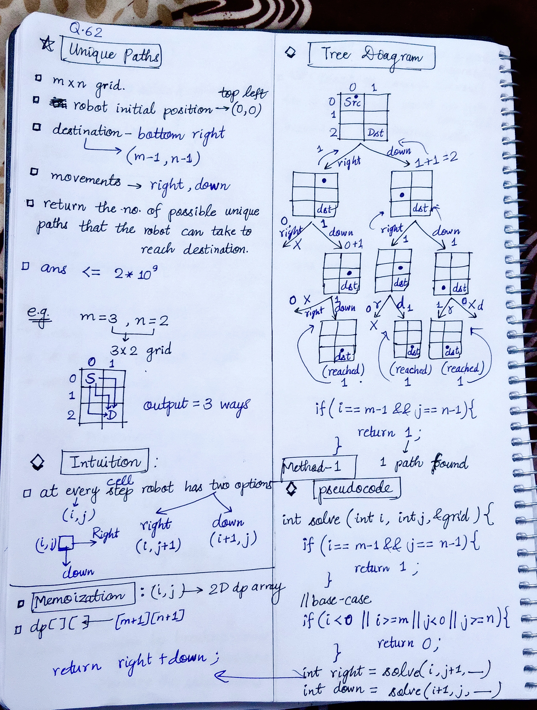
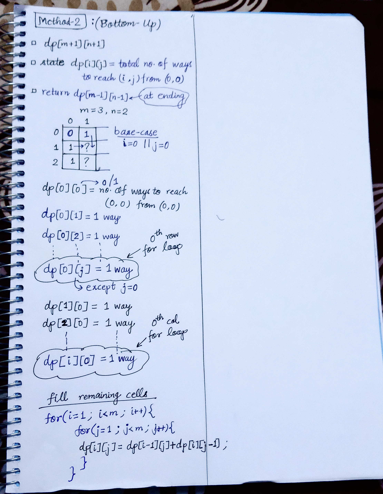

<h2><a href="https://leetcode.com/problems/unique-paths">62. Unique Paths</a></h2><h3>Medium</h3><hr><p>There is a robot on an <code>m x n</code> grid. The robot is initially located at the <strong>top-left corner</strong> (i.e., <code>grid[0][0]</code>). The robot tries to move to the <strong>bottom-right corner</strong> (i.e., <code>grid[m - 1][n - 1]</code>). The robot can only move either down or right at any point in time.</p>

<p>Given the two integers <code>m</code> and <code>n</code>, return <em>the number of possible unique paths that the robot can take to reach the bottom-right corner</em>.</p>

<p>The test cases are generated so that the answer will be less than or equal to <code>2 * 10<sup>9</sup></code>.</p>

<p>&nbsp;</p>
<p><strong class="example">Example 1:</strong></p>

<pre>
<strong>Input:</strong> m = 3, n = 7
<strong>Output:</strong> 28
</pre>

<p><strong class="example">Example 2:</strong></p>

<pre>
<strong>Input:</strong> m = 3, n = 2
<strong>Output:</strong> 3
<strong>Explanation:</strong> From the top-left corner, there are a total of 3 ways to reach the bottom-right corner:
1. Right -&gt; Down -&gt; Down
2. Down -&gt; Down -&gt; Right
3. Down -&gt; Right -&gt; Down
</pre>

<p>&nbsp;</p>
<p><strong>Constraints:</strong></p>

<ul>
	<li><code>1 &lt;= m, n &lt;= 100</code></li>
</ul>


<!-- AUTO-GENERATED-SOLUTION-START -->
---

## 🧠 Visual Solution & Intuition

### Part 1



### Part 2



---

## 💻 C++ Solution

[View Original C++ File](./0062-unique-paths.cpp)

```cpp
class Solution {
public:
    int solve(int i, int j, int m, int n, vector<vector<int>>& dp){
        //base-case
        if(i < 0 || i >= m || j < 0 || j >= n){ //out of bound
            return 0 ;
        }

        //if reached to destination return 1 path found
        if(i == m-1 && j == n-1){
            return 1 ;
        }
        
        //check memoization table
        if(dp[i][j] != -1){ //means solved before 
            return dp[i][j] ; //just return that state don't solve again
        }
        int right = solve(i, j+1, m, n, dp) ;
        int down = solve(i+1, j, m, n, dp) ;

        return dp[i][j] = right + down ;


    }
    int uniquePaths(int m, int n) {
        
        //2d dp vector
        vector<vector<int>> dp(m+1, vector<int>(n+1, -1)) ;


        return solve(0, 0, m, n, dp) ;
    }
};
```

<!-- AUTO-GENERATED-SOLUTION-END -->
