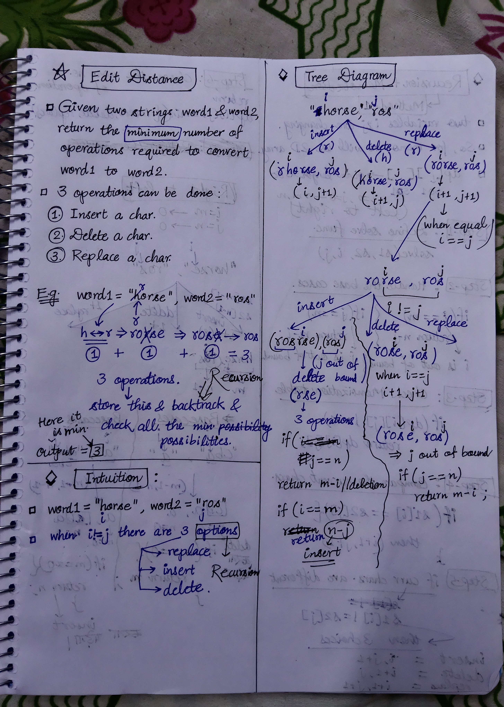
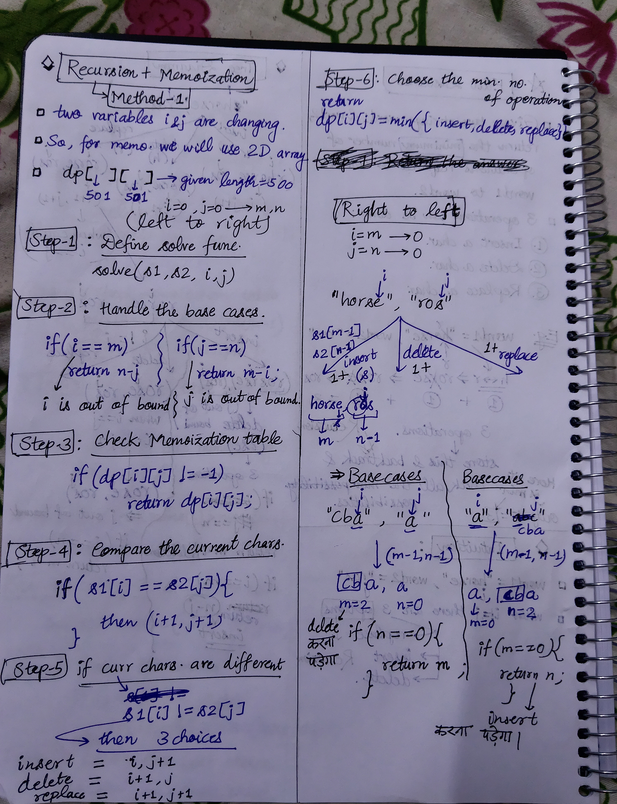

<h2><a href="https://leetcode.com/problems/edit-distance">72. Edit Distance</a></h2><h3>Medium</h3><hr><p>Given two strings <code>word1</code> and <code>word2</code>, return <em>the minimum number of operations required to convert <code>word1</code> to <code>word2</code></em>.</p>

<p>You have the following three operations permitted on a word:</p>

<ul>
	<li>Insert a character</li>
	<li>Delete a character</li>
	<li>Replace a character</li>
</ul>

<p>&nbsp;</p>
<p><strong class="example">Example 1:</strong></p>

<pre>
<strong>Input:</strong> word1 = &quot;horse&quot;, word2 = &quot;ros&quot;
<strong>Output:</strong> 3
<strong>Explanation:</strong> 
horse -&gt; rorse (replace &#39;h&#39; with &#39;r&#39;)
rorse -&gt; rose (remove &#39;r&#39;)
rose -&gt; ros (remove &#39;e&#39;)
</pre>

<p><strong class="example">Example 2:</strong></p>

<pre>
<strong>Input:</strong> word1 = &quot;intention&quot;, word2 = &quot;execution&quot;
<strong>Output:</strong> 5
<strong>Explanation:</strong> 
intention -&gt; inention (remove &#39;t&#39;)
inention -&gt; enention (replace &#39;i&#39; with &#39;e&#39;)
enention -&gt; exention (replace &#39;n&#39; with &#39;x&#39;)
exention -&gt; exection (replace &#39;n&#39; with &#39;c&#39;)
exection -&gt; execution (insert &#39;u&#39;)
</pre>

<p>&nbsp;</p>
<p><strong>Constraints:</strong></p>

<ul>
	<li><code>0 &lt;= word1.length, word2.length &lt;= 500</code></li>
	<li><code>word1</code> and <code>word2</code> consist of lowercase English letters.</li>
</ul>


<!-- AUTO-GENERATED-SOLUTION-START -->
---

## 🧠 Visual Solution & Intuition

### Part 1



### Part 2



---

## ⏱️ Complexity Analysis

```text
Time Complexity = O(m * n)
Space Complexity = O(m * n)
```

---

## 💻 C++ Solution

[View Original C++ File](./0072-edit-distance.cpp)

```cpp
class Solution {
public:
    //Method-1 : Top-Down Memoization(Dynamic Programming)
    //Time Complexity = O(m * n)
    //Space Complexity = O(m * n)
    int m, n ;
    int dp[501][501] ; //dp table
    int solve(string& s1, string& s2, int m, int n){
        //1.)handle basecases
        if(n == 0 || m == 0){
            return m+n ;
        }

        //2.)check memoization table 
        if(dp[m][n] != -1){
            return dp[m][n] ;         
        }

        //3.) compare curr chars. if equal
        if(s1[m-1] == s2[n-1]){
            return dp[m][n] = solve(s1, s2, m-1, n-1) ;
        }

        //4.) if curr chars. are not equal
        else{
            //three choices : insert, delete, replace
            int insertChar = 1 + solve(s1, s2, m, n-1) ;
            int deleteChar = 1 + solve(s1, s2, m-1, n) ;
            int replaceChar = 1 + solve(s1, s2, m-1, n-1) ;

            //5.) Choose the min 
            return dp[m][n] = min({insertChar, deleteChar, replaceChar}) ;
        }

        //if failed to find ans
        return -1 ;
        
    }
    int minDistance(string s1, string s2) {
        m = s1.length() ;
        n = s2.length() ;

        memset(dp, -1, sizeof(dp)) ; //fill dp table with -1

        //func call to solve
        return solve(s1, s2, m, n) ; //start from i = 0 , j = 0 
    }
};
```

<!-- AUTO-GENERATED-SOLUTION-END -->
