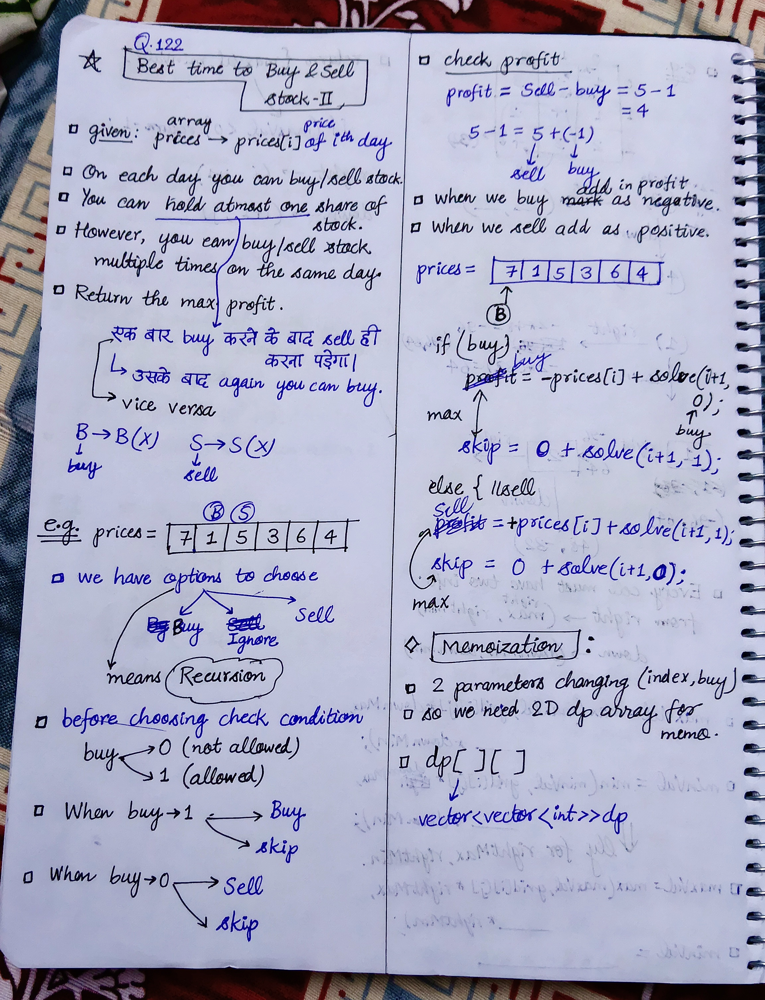

<h2><a href="https://leetcode.com/problems/best-time-to-buy-and-sell-stock-ii">122. Best Time to Buy and Sell Stock II</a></h2><h3>Medium</h3><hr><p>You are given an integer array <code>prices</code> where <code>prices[i]</code> is the price of a given stock on the <code>i<sup>th</sup></code> day.</p>

<p>On each day, you may decide to buy and/or sell the stock. You can only hold <strong>at most one</strong> share of the stock at any time. However, you can sell and buy the stock multiple times on the <strong>same day</strong>, ensuring you never hold more than one share of the stock.</p>

<p>Find and return <em>the <strong>maximum</strong> profit you can achieve</em>.</p>

<p>&nbsp;</p>
<p><strong class="example">Example 1:</strong></p>

<pre>
<strong>Input:</strong> prices = [7,1,5,3,6,4]
<strong>Output:</strong> 7
<strong>Explanation:</strong> Buy on day 2 (price = 1) and sell on day 3 (price = 5), profit = 5-1 = 4.
Then buy on day 4 (price = 3) and sell on day 5 (price = 6), profit = 6-3 = 3.
Total profit is 4 + 3 = 7.
</pre>

<p><strong class="example">Example 2:</strong></p>

<pre>
<strong>Input:</strong> prices = [1,2,3,4,5]
<strong>Output:</strong> 4
<strong>Explanation:</strong> Buy on day 1 (price = 1) and sell on day 5 (price = 5), profit = 5-1 = 4.
Total profit is 4.
</pre>

<p><strong class="example">Example 3:</strong></p>

<pre>
<strong>Input:</strong> prices = [7,6,4,3,1]
<strong>Output:</strong> 0
<strong>Explanation:</strong> There is no way to make a positive profit, so we never buy the stock to achieve the maximum profit of 0.
</pre>

<p>&nbsp;</p>
<p><strong>Constraints:</strong></p>

<ul>
	<li><code>1 &lt;= prices.length &lt;= 3 * 10<sup>4</sup></code></li>
	<li><code>0 &lt;= prices[i] &lt;= 10<sup>4</sup></code></li>
</ul>


<!-- AUTO-GENERATED-SOLUTION-START -->
---

## 🧠 Visual Solution & Intuition



---

## ⏱️ Complexity Analysis

```text
Time Complexity = O(n)
Space Complexity = O(n)
```

---

## 💻 C++ Solution

[View Original C++ File](./0122-best-time-to-buy-and-sell-stock-ii.cpp)

```cpp
class Solution {
public:
    //Method-1 : Top-Down Approach(Recursion + Memoization)
    
    //Time Complexity = O(n)
    //Space Complexity = O(n)
    
    int n ; 
    vector<vector<int>> dp ; //declaration of memoization dp

    int solve(int i, int buy, vector<int>& prices){
       //base-case
       if(i == n){
            return 0 ;
       }

       //check memoization table
       if(dp[i][buy] != -1){
            return dp[i][buy] ;
       }
       
       //check condition and then buy, sell
       int profit = 0 ;
       if(buy){
            int buyNow = -prices[i] + solve(i+1, 0, prices) ;
            int skipNow = 0 + solve(i+1, 1, prices) ;

            profit = max(buyNow, skipNow) ;
       }
       else{ //sell
            int sellNow = prices[i] + solve(i+1, 1, prices) ;
            int skip = 0 + solve(i+1, 0, prices) ;

            profit = max(sellNow, skip) ;
       }
       
       //finally return the total profit
       return dp[i][buy] = profit ;

    }
    int maxProfit(vector<int>& prices) {
        n = prices.size() ;

        dp = vector<vector<int>>(n, vector<int>(2, -1)) ; //fill dp array with -1

        return solve(0, 1, prices) ; //function call to solve
    }
};
```

<!-- AUTO-GENERATED-SOLUTION-END -->
