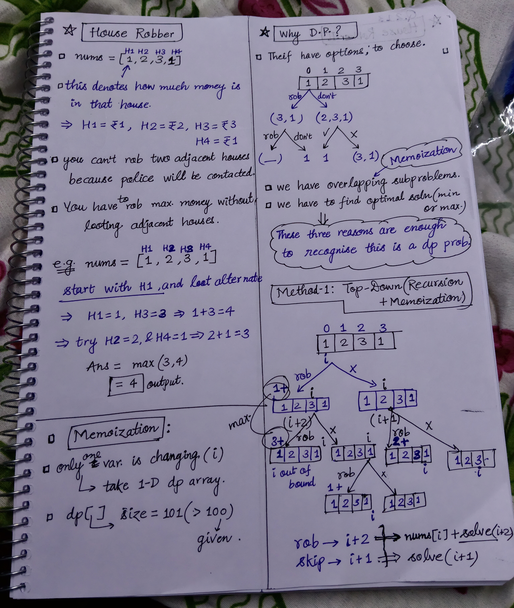

<h2><a href="https://leetcode.com/problems/house-robber">198. House Robber</a></h2><h3>Medium</h3><hr><p>You are a professional robber planning to rob houses along a street. Each house has a certain amount of money stashed, the only constraint stopping you from robbing each of them is that adjacent houses have security systems connected and <b>it will automatically contact the police if two adjacent houses were broken into on the same night</b>.</p>

<p>Given an integer array <code>nums</code> representing the amount of money of each house, return <em>the maximum amount of money you can rob tonight <b>without alerting the police</b></em>.</p>

<p>&nbsp;</p>
<p><strong class="example">Example 1:</strong></p>

<pre>
<strong>Input:</strong> nums = [1,2,3,1]
<strong>Output:</strong> 4
<strong>Explanation:</strong> Rob house 1 (money = 1) and then rob house 3 (money = 3).
Total amount you can rob = 1 + 3 = 4.
</pre>

<p><strong class="example">Example 2:</strong></p>

<pre>
<strong>Input:</strong> nums = [2,7,9,3,1]
<strong>Output:</strong> 12
<strong>Explanation:</strong> Rob house 1 (money = 2), rob house 3 (money = 9) and rob house 5 (money = 1).
Total amount you can rob = 2 + 9 + 1 = 12.
</pre>

<p>&nbsp;</p>
<p><strong>Constraints:</strong></p>

<ul>
	<li><code>1 &lt;= nums.length &lt;= 100</code></li>
	<li><code>0 &lt;= nums[i] &lt;= 400</code></li>
</ul>


<!-- AUTO-GENERATED-SOLUTION-START -->
---

## 🧠 Visual Solution & Intuition



---

## ⏱️ Complexity Analysis

```text
Time Complexity = O(n)
Space Complexity = O(n)
```

---

## 💻 C++ Solution

[View Original C++ File](./0198-house-robber.cpp)

```cpp
class Solution {
public:
    //Method-1 : Top-Down Approach(Recursion + Memoization)

    //Time Complexity = O(n)
    //Space Complexity = O(n)
    
    int dp[101] ; //memoization dp array

    int solve(vector<int>& nums, int i, int n){
        //1.) Handle base case
        if(i >= n) return 0 ;

        //2.) check memoization array
        if(dp[i] != -1){
            return dp[i] ;
        }

        //3.) we have two choices
        int rob = nums[i] + solve(nums, i+2, n) ;

        int dont = solve(nums, i+1, n) ;

        //return the max. ans
        return dp[i] = max({rob , dont}) ;
    }
    int rob(vector<int>& nums) {

        int n = nums.size() ;

        memset(dp, -1, sizeof(dp)) ;//fill memoization array with -1

        return solve(nums, 0, n) ;
    }
};
```

<!-- AUTO-GENERATED-SOLUTION-END -->
