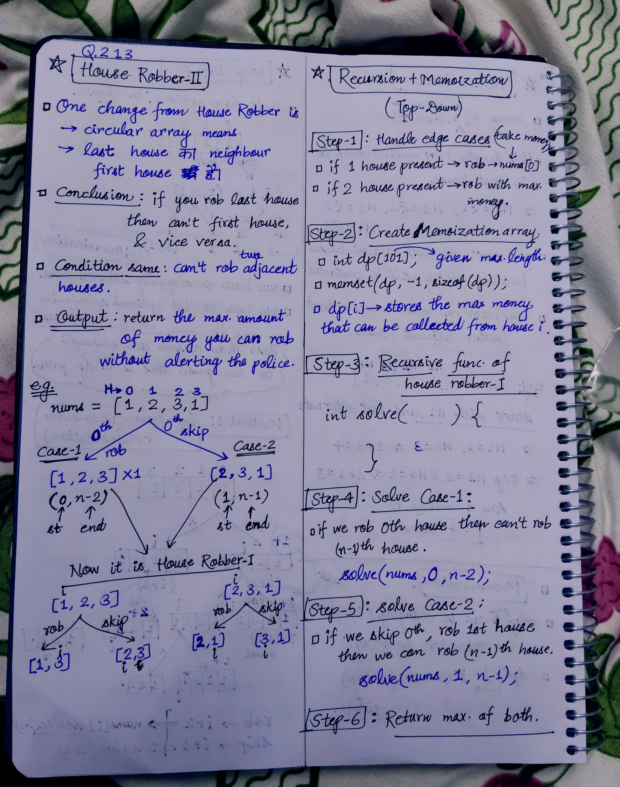

<h2><a href="https://leetcode.com/problems/house-robber-ii">213. House Robber II</a></h2><h3>Medium</h3><hr><p>You are a professional robber planning to rob houses along a street. Each house has a certain amount of money stashed. All houses at this place are <strong>arranged in a circle.</strong> That means the first house is the neighbor of the last one. Meanwhile, adjacent houses have a security system connected, and&nbsp;<b>it will automatically contact the police if two adjacent houses were broken into on the same night</b>.</p>

<p>Given an integer array <code>nums</code> representing the amount of money of each house, return <em>the maximum amount of money you can rob tonight <strong>without alerting the police</strong></em>.</p>

<p>&nbsp;</p>
<p><strong class="example">Example 1:</strong></p>

<pre>
<strong>Input:</strong> nums = [2,3,2]
<strong>Output:</strong> 3
<strong>Explanation:</strong> You cannot rob house 1 (money = 2) and then rob house 3 (money = 2), because they are adjacent houses.
</pre>

<p><strong class="example">Example 2:</strong></p>

<pre>
<strong>Input:</strong> nums = [1,2,3,1]
<strong>Output:</strong> 4
<strong>Explanation:</strong> Rob house 1 (money = 1) and then rob house 3 (money = 3).
Total amount you can rob = 1 + 3 = 4.
</pre>

<p><strong class="example">Example 3:</strong></p>

<pre>
<strong>Input:</strong> nums = [1,2,3]
<strong>Output:</strong> 3
</pre>

<p>&nbsp;</p>
<p><strong>Constraints:</strong></p>

<ul>
	<li><code>1 &lt;= nums.length &lt;= 100</code></li>
	<li><code>0 &lt;= nums[i] &lt;= 1000</code></li>
</ul>


<!-- AUTO-GENERATED-SOLUTION-START -->
---

## 🧠 Visual Solution & Intuition



---

## ⏱️ Complexity Analysis

```text
Time Complexity = O(n)
Space Complexity = O(n)
```

---

## 💻 C++ Solution

[View Original C++ File](./0213-house-robber-ii.cpp)

```cpp
class Solution {
public:
    //Method-1 : Top-Down(Recursion + Memoization)
    
    //Time Complexity = O(n)
    //Space Complexity = O(n)
    
    int dp[101] ; //memoization dp array

    int solve(vector<int>& nums, int i, int n){
        //1.)handle base case
        if(i > n) return 0 ;

        //2.)check memoization array
        if(dp[i] != -1){
            return dp[i] ;
        }

        //3.) We have two choices : rob current house or skip
        int rob = nums[i] + solve(nums, i+2, n) ;

        int skip = solve(nums, i+1, n) ;

        //4.) return max of rob, skip
        return dp[i] = max(rob, skip) ;
    }
    int rob(vector<int>& nums) {
        
        int n = nums.size() ;
        
        //1.) handle edge cases
        if(n == 1){ //only 1 house
            return nums[0] ; 
        }
        if(n == 2){ //only two houses
            return max(nums[0], nums[1]) ; //rob max money house
        }

        memset(dp, -1, sizeof(dp)) ; //fill memoization array with -1

        //Case-1 : if Robbed first house(0th index house)
        int rob_0th_house = solve(nums, 0, n-2) ;

        memset(dp, -1, sizeof(dp)) ;

        //Case-2 : if Robbed second house(1st index house)
        int rob_1st_house = solve(nums, 1, n-1) ;

        return max(rob_0th_house, rob_1st_house) ;
    }
};
```

<!-- AUTO-GENERATED-SOLUTION-END -->
