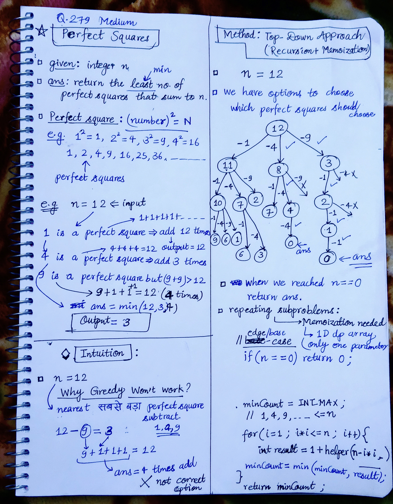

<h2><a href="https://leetcode.com/problems/perfect-squares">279. Perfect Squares</a></h2><h3>Medium</h3><hr><p>Given an integer <code>n</code>, return <em>the least number of perfect square numbers that sum to</em> <code>n</code>.</p>

<p>A <strong>perfect square</strong> is an integer that is the square of an integer; in other words, it is the product of some integer with itself. For example, <code>1</code>, <code>4</code>, <code>9</code>, and <code>16</code> are perfect squares while <code>3</code> and <code>11</code> are not.</p>

<p>&nbsp;</p>
<p><strong class="example">Example 1:</strong></p>

<pre>
<strong>Input:</strong> n = 12
<strong>Output:</strong> 3
<strong>Explanation:</strong> 12 = 4 + 4 + 4.
</pre>

<p><strong class="example">Example 2:</strong></p>

<pre>
<strong>Input:</strong> n = 13
<strong>Output:</strong> 2
<strong>Explanation:</strong> 13 = 4 + 9.
</pre>

<p>&nbsp;</p>
<p><strong>Constraints:</strong></p>

<ul>
	<li><code>1 &lt;= n &lt;= 10<sup>4</sup></code></li>
</ul>


<!-- AUTO-GENERATED-SOLUTION-START -->
---

## 🧠 Visual Solution & Intuition



---

## ⏱️ Complexity Analysis

```text
Time Complexity = O(n√n) =>
Space Complexity = O(n)
```

---

## 💻 C++ Solution

[View Original C++ File](./0279-perfect-squares.cpp)

```cpp
class Solution {
public:
    //Method : Top-Down Approach(Recursion + Memoization)

    //Time Complexity = O(n√n) =>
    // 1.)There are n possible states: helper(0) ... helper(n) → O(n).
    // 2.)For each state n, the loop checks all perfect squares:
    // =>.  1², 2², 3², ..., √n² → O(√n).

    //Space Complexity = O(n)
    // 1.) dp[10001] → O(n) space.
    // 2.) Recursion stack height = n => O(n)

    int dp[10001] ; //10^4 is max size given.
    int helper(int n){
        //base-case
        if(n == 0) return 0 ; //when number is zero no need to add any sqaure.

        //check memoization array : if we have solved before or not
        if(dp[n] != -1){ //means solved before
            return dp[n] ; //just return that value
        }

        int minCount = INT_MAX ; 

        //1, 4, 9, .... <= n
        for(int i=1 ; i*i <= n ; i++){
            int result = 1 + helper(n-i*i) ;
            minCount = min(minCount, result) ;
        }

        return dp[n] = minCount ;
    }
    int numSquares(int n) {
        
        memset(dp, -1, sizeof(dp)) ;//initialize with -1

        return helper(n) ;//func. call to helper 

    }
};
```

<!-- AUTO-GENERATED-SOLUTION-END -->
