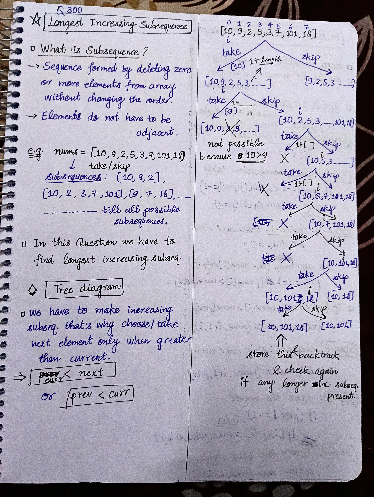
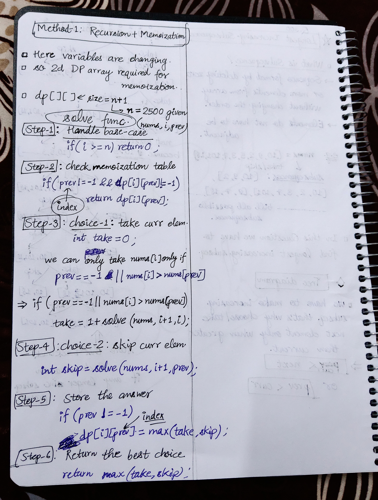

<h2><a href="https://leetcode.com/problems/longest-increasing-subsequence">300. Longest Increasing Subsequence</a></h2><h3>Medium</h3><hr><p>Given an integer array <code>nums</code>, return <em>the length of the longest <strong>strictly increasing </strong></em><span data-keyword="subsequence-array"><em><strong>subsequence</strong></em></span>.</p>

<p>&nbsp;</p>
<p><strong class="example">Example 1:</strong></p>

<pre>
<strong>Input:</strong> nums = [10,9,2,5,3,7,101,18]
<strong>Output:</strong> 4
<strong>Explanation:</strong> The longest increasing subsequence is [2,3,7,101], therefore the length is 4.
</pre>

<p><strong class="example">Example 2:</strong></p>

<pre>
<strong>Input:</strong> nums = [0,1,0,3,2,3]
<strong>Output:</strong> 4
</pre>

<p><strong class="example">Example 3:</strong></p>

<pre>
<strong>Input:</strong> nums = [7,7,7,7,7,7,7]
<strong>Output:</strong> 1
</pre>

<p>&nbsp;</p>
<p><strong>Constraints:</strong></p>

<ul>
	<li><code>1 &lt;= nums.length &lt;= 2500</code></li>
	<li><code>-10<sup>4</sup> &lt;= nums[i] &lt;= 10<sup>4</sup></code></li>
</ul>

<p>&nbsp;</p>
<p><b>Follow up:</b>&nbsp;Can you come up with an algorithm that runs in&nbsp;<code>O(n log(n))</code> time complexity?</p>


<!-- AUTO-GENERATED-SOLUTION-START -->
---

## 🧠 Visual Solution & Intuition

### Part 1



### Part 2



---

## ⏱️ Complexity Analysis

```text
Time Complexity = O(n * n)
Space Complexity = O(n * n)
```

---

## 💻 C++ Solution

[View Original C++ File](./0300-longest-increasing-subsequence.cpp)

```cpp
class Solution {
public:
    //Time Complexity = O(n * n)
    //Space Complexity = O(n * n)
    int n ;
    int dp[2501][2501] ;
    int solve(vector<int>& nums, int i, int prev){
        //1.) Handle edge case
        if(i >= n) return 0 ;

        //2.) check memoization table
        if(prev != -1 && dp[i][prev] != -1){

            return dp[i][prev] ;
        }
        
        //3.) choice-1 : take the curr elem
        int take = 0 ;
        
        if(prev == -1 || nums[i] > nums[prev]){

            take = 1 + solve(nums, i+1, i) ;
        }

        //4.) choice-2 : skip the curr elem
        int skip = solve(nums, i+1, prev) ;

        //5.) store the answer
        if(prev != -1){
            dp[i][prev] = max(take, skip) ;
        }
                
        return max(take, skip) ;
    }
    int lengthOfLIS(vector<int>& nums) {
        n = nums.size() ;

        memset(dp, -1, sizeof(dp)) ;

        return solve(nums, 0, -1) ;
    }
};
```

<!-- AUTO-GENERATED-SOLUTION-END -->
