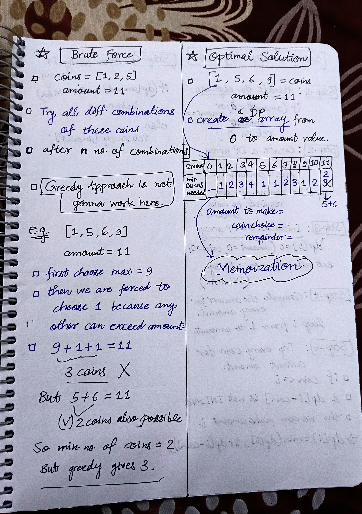
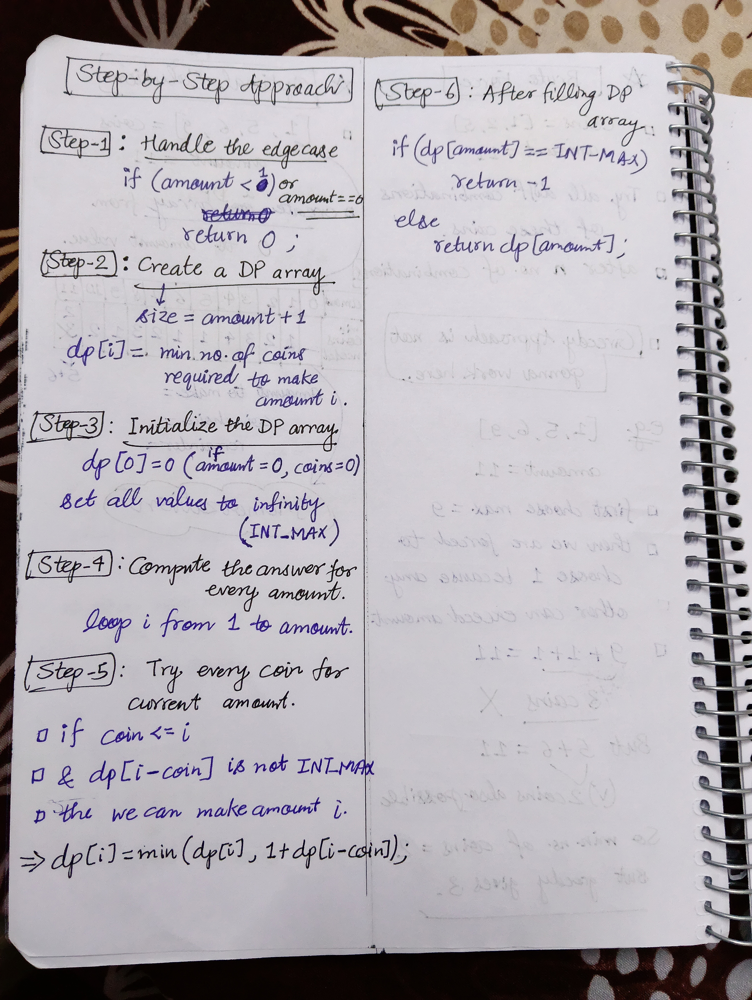

<h2><a href="https://leetcode.com/problems/coin-change">322. Coin Change</a></h2><h3>Medium</h3><hr><p>You are given an integer array <code>coins</code> representing coins of different denominations and an integer <code>amount</code> representing a total amount of money.</p>

<p>Return <em>the fewest number of coins that you need to make up that amount</em>. If that amount of money cannot be made up by any combination of the coins, return <code>-1</code>.</p>

<p>You may assume that you have an infinite number of each kind of coin.</p>

<p>&nbsp;</p>
<p><strong class="example">Example 1:</strong></p>

<pre>
<strong>Input:</strong> coins = [1,2,5], amount = 11
<strong>Output:</strong> 3
<strong>Explanation:</strong> 11 = 5 + 5 + 1
</pre>

<p><strong class="example">Example 2:</strong></p>

<pre>
<strong>Input:</strong> coins = [2], amount = 3
<strong>Output:</strong> -1
</pre>

<p><strong class="example">Example 3:</strong></p>

<pre>
<strong>Input:</strong> coins = [1], amount = 0
<strong>Output:</strong> 0
</pre>

<p>&nbsp;</p>
<p><strong>Constraints:</strong></p>

<ul>
	<li><code>1 &lt;= coins.length &lt;= 12</code></li>
	<li><code>1 &lt;= coins[i] &lt;= 2<sup>31</sup> - 1</code></li>
	<li><code>0 &lt;= amount &lt;= 10<sup>4</sup></code></li>
</ul>


<!-- AUTO-GENERATED-SOLUTION-START -->
---

## 🧠 Visual Solution & Intuition

### Part 2



### Part 3



---

## ⏱️ Complexity Analysis

```text
Time Complexity = O(amount x n)
Space Complexity = O(amount)
```

---

## 💻 C++ Solution

[View Original C++ File](./0322-coin-change.cpp)

```cpp
class Solution {
public:
    //Time Complexity = O(amount x n)
    //Space Complexity = O(amount)
    int coinChange(vector<int>& coins, int amount) {
        //edge case
        if(amount == 0)
            return 0 ;

        //create dp array
        vector<int> dp(amount+1, INT_MAX) ;
        dp[0] = 0 ; //start with 0 

        //fill dp array
        for(int i=1 ; i<=amount ; i++){
            //try every coin
            for(int coin : coins){

                if(coin <= i && dp[i-coin] != INT_MAX){
                    dp[i] = min(dp[i], 1 + dp[i-coin]) ;
                }
            }
         
        }

        //after filling decide answer/result
        if(dp[amount] == INT_MAX)
            return -1 ;

        else{
            return dp[amount] ;
        }     
    }
};
```

<!-- AUTO-GENERATED-SOLUTION-END -->
