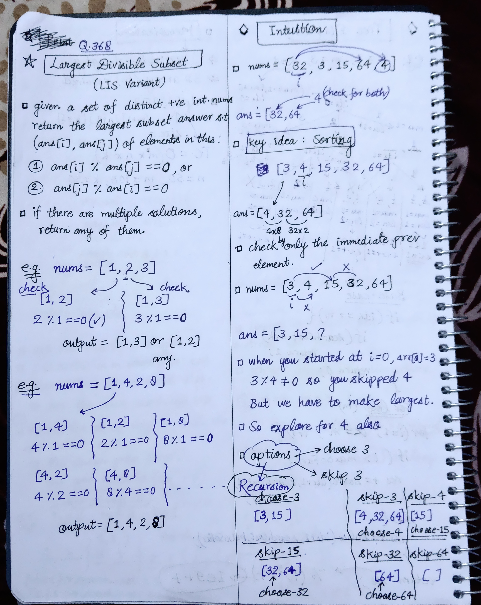
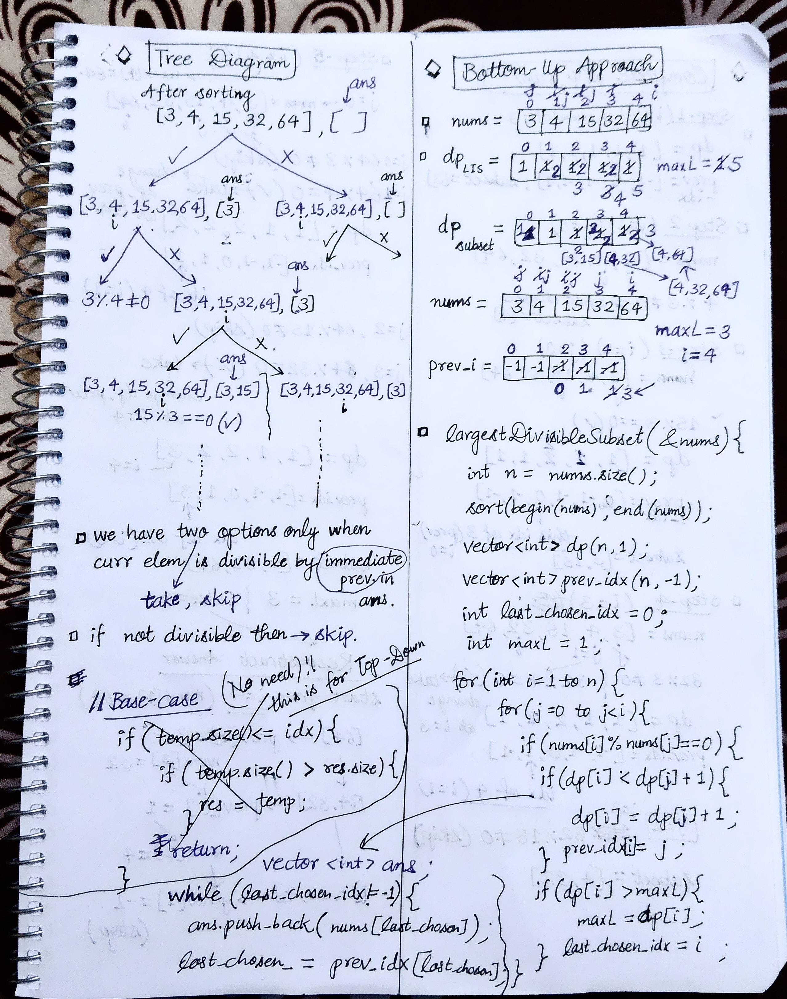
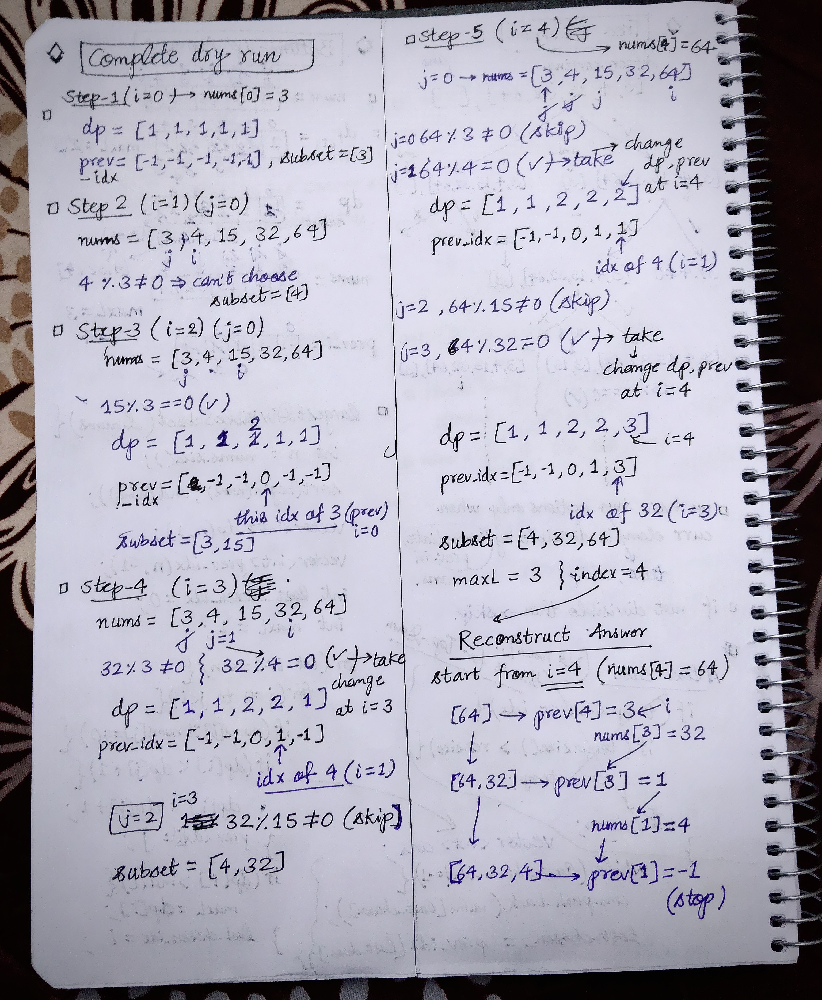

<h2><a href="https://leetcode.com/problems/largest-divisible-subset">368. Largest Divisible Subset</a></h2><h3>Medium</h3><hr><p>Given a set of <strong>distinct</strong> positive integers <code>nums</code>, return the largest subset <code>answer</code> such that every pair <code>(answer[i], answer[j])</code> of elements in this subset satisfies:</p>

<ul>
	<li><code>answer[i] % answer[j] == 0</code>, or</li>
	<li><code>answer[j] % answer[i] == 0</code></li>
</ul>

<p>If there are multiple solutions, return any of them.</p>

<p>&nbsp;</p>
<p><strong class="example">Example 1:</strong></p>

<pre>
<strong>Input:</strong> nums = [1,2,3]
<strong>Output:</strong> [1,2]
<strong>Explanation:</strong> [1,3] is also accepted.
</pre>

<p><strong class="example">Example 2:</strong></p>

<pre>
<strong>Input:</strong> nums = [1,2,4,8]
<strong>Output:</strong> [1,2,4,8]
</pre>

<p>&nbsp;</p>
<p><strong>Constraints:</strong></p>

<ul>
	<li><code>1 &lt;= nums.length &lt;= 1000</code></li>
	<li><code>1 &lt;= nums[i] &lt;= 2 * 10<sup>9</sup></code></li>
	<li>All the integers in <code>nums</code> are <strong>unique</strong>.</li>
</ul>


<!-- AUTO-GENERATED-SOLUTION-START -->
---

## 🧠 Visual Solution & Intuition

### Part 1



### Part 2



### Part 3



---

## ⏱️ Complexity Analysis

```text
Time Complexity = O(n * n) => O(n *logn) + O(n * n)
Space Complexity = O(n) => O(3n) = O(n) + O(n) + O(n)
```

---

## 💻 C++ Solution

[View Original C++ File](./0368-largest-divisible-subset.cpp)

```cpp
class Solution {
public:
    //Method : Bottom-Up Approach
    //Time Complexity = O(n * n) => O(n *logn) + O(n * n)
    // 1.) for sorting : O(n *logn)
    // 2.) for nested loops and traversing : O(n * n)
    // 3.) for reconstructing the answer : O(n)


    //Space Complexity = O(n) => O(3n) = O(n) + O(n) + O(n)
    // 1.) dp array : O(n)
    // 2.) prev_idx array : O(n)
    // 3.) ans array : O(n)
    vector<int> largestDivisibleSubset(vector<int>& nums) {
        int n = nums.size() ;
        
        //1.) sort to reduce no. of comparison
        sort(begin(nums), end(nums)) ; //O(n * logn)

        //2.)create dp, prev_idx array 
        vector<int> dp(n, 1) ;
        vector<int> prev_idx(n, -1) ;

        int last_chosen_idx = 0 ;
        int maxL = 1 ;
        
        // Traverse each element and try to extend the divisible subset
        // ending at every previous index j.
        for(int i=1 ; i<n ; i++){ //O(n * n)
            for(int j=0 ; j<i ; j++){
                //check divisibility
                if(nums[i] % nums[j] == 0){
                    //choose and update dp, prev at i
                    if(dp[i] < dp[j] + 1){
                        dp[i] = dp[j] + 1;
                        prev_idx[i] = j ;
                    }

                    if(dp[i] > maxL){ //if found greater subset then update
                        maxL = dp[i] ;
                        last_chosen_idx = i ;//remember the idx also
                    }
                }
            }
        }

        //Reconstruct the answer : from backside
        vector<int> ans ; 

        while(last_chosen_idx != -1){ //O(n)
            ans.push_back(nums[last_chosen_idx]) ;

            last_chosen_idx = prev_idx[last_chosen_idx] ;
        }

       //Return the answer vector
       return ans ;
    }
};
```

<!-- AUTO-GENERATED-SOLUTION-END -->
