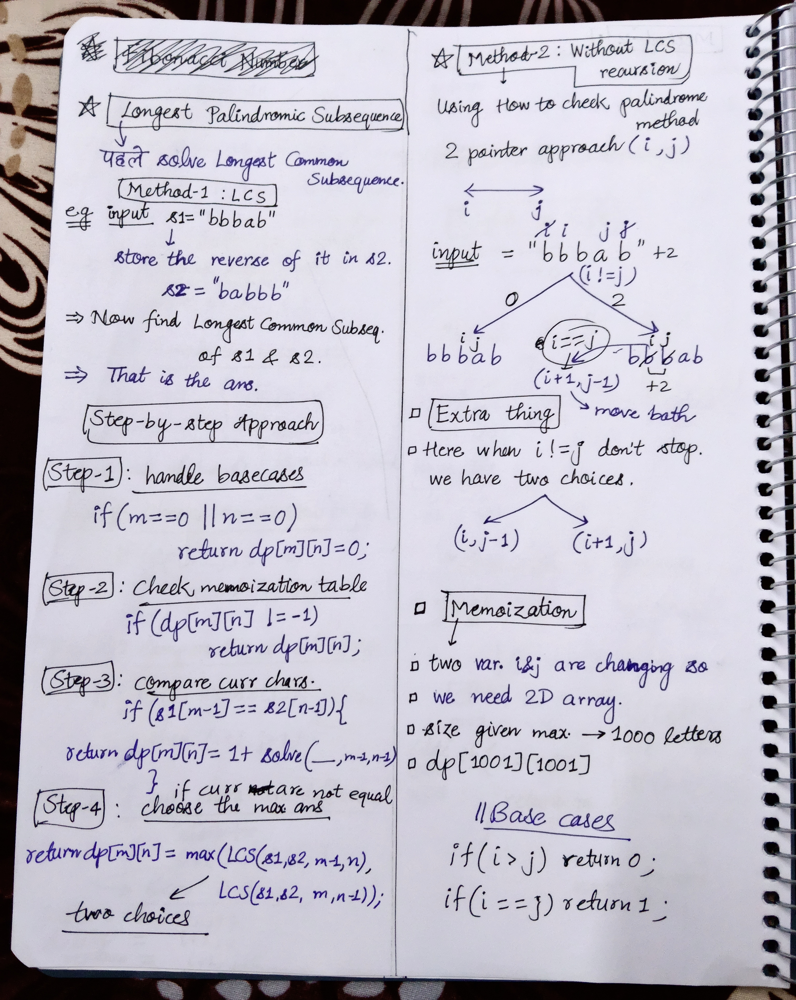

<h2><a href="https://leetcode.com/problems/longest-palindromic-subsequence">516. Longest Palindromic Subsequence</a></h2><h3>Medium</h3><hr><p>Given a string <code>s</code>, find <em>the longest palindromic <strong>subsequence</strong>&#39;s length in</em> <code>s</code>.</p>

<p>A <strong>subsequence</strong> is a sequence that can be derived from another sequence by deleting some or no elements without changing the order of the remaining elements.</p>

<p>&nbsp;</p>
<p><strong class="example">Example 1:</strong></p>

<pre>
<strong>Input:</strong> s = &quot;bbbab&quot;
<strong>Output:</strong> 4
<strong>Explanation:</strong> One possible longest palindromic subsequence is &quot;bbbb&quot;.
</pre>

<p><strong class="example">Example 2:</strong></p>

<pre>
<strong>Input:</strong> s = &quot;cbbd&quot;
<strong>Output:</strong> 2
<strong>Explanation:</strong> One possible longest palindromic subsequence is &quot;bb&quot;.
</pre>

<p>&nbsp;</p>
<p><strong>Constraints:</strong></p>

<ul>
	<li><code>1 &lt;= s.length &lt;= 1000</code></li>
	<li><code>s</code> consists only of lowercase English letters.</li>
</ul>


<!-- AUTO-GENERATED-SOLUTION-START -->
---

## 🧠 Visual Solution & Intuition



---

## 💻 C++ Solution

[View Original C++ File](./0516-longest-palindromic-subsequence.cpp)

```cpp
class Solution {
public:
    //Method-3 : Without Using LCS(Palindrome Find Approach)
    int dp[1001][1001] ;
    int solve(string& s, int i, int j){
        //1.) base cases
        if(i > j) return 0 ;
        if(i == j) return 1 ;
        
        //2.) check memoization table
        if(dp[i][j] != -1){
            return dp[i][j] ;
        }
        //3.) check curr chars.
        if(s[i] == s[j]){
            return dp[i][j] = 2 + solve(s, i+1, j-1) ;
        }

        //4.) if curr chars. are not equal
        else{
            // two choices and choose max.
            return dp[i][j] = max(solve(s, i+1, j), solve(s, i, j-1)) ;
        }
    }
    int longestPalindromeSubseq(string s) {
        
        memset(dp, -1, sizeof(dp)) ; //fill memoization table with -1

        return solve(s, 0, s.length()-1 ) ;
        
    }
};
```

<!-- AUTO-GENERATED-SOLUTION-END -->
