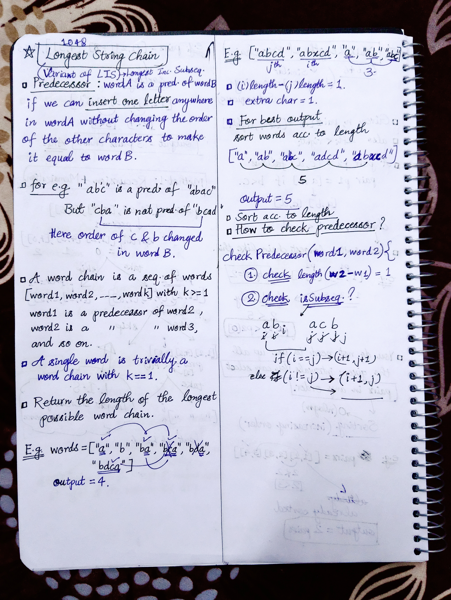
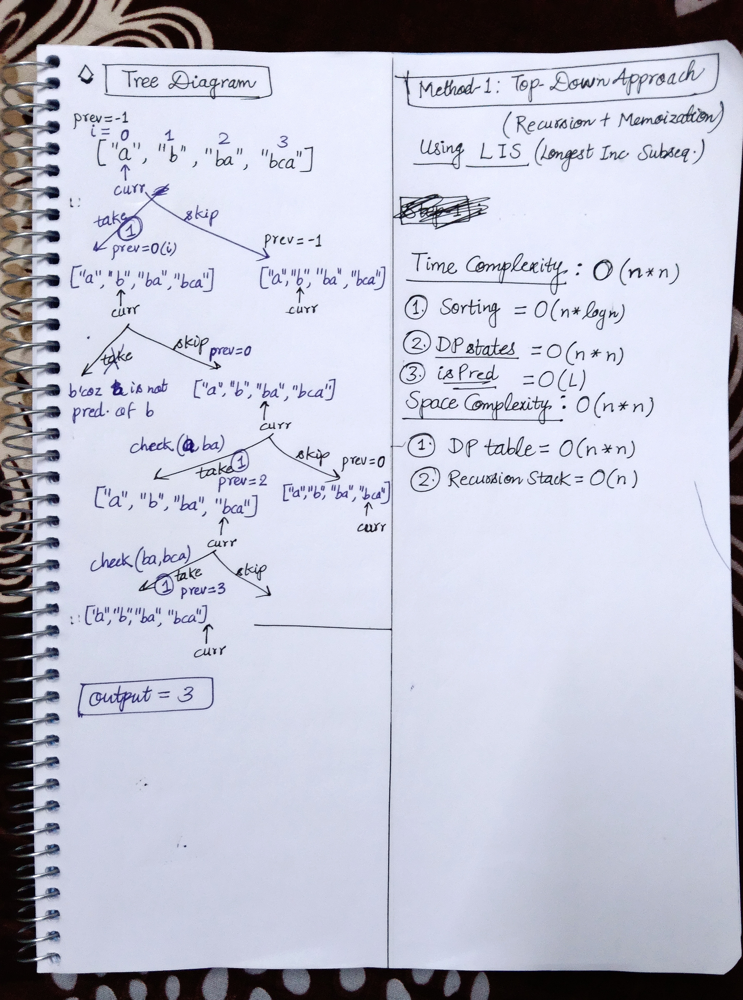

<h2><a href="https://leetcode.com/problems/longest-string-chain">1048. Longest String Chain</a></h2><h3>Medium</h3><hr><p>You are given an array of <code>words</code> where each word consists of lowercase English letters.</p>

<p><code>word<sub>A</sub></code> is a <strong>predecessor</strong> of <code>word<sub>B</sub></code> if and only if we can insert <strong>exactly one</strong> letter anywhere in <code>word<sub>A</sub></code> <strong>without changing the order of the other characters</strong> to make it equal to <code>word<sub>B</sub></code>.</p>

<ul>
	<li>For example, <code>&quot;abc&quot;</code> is a <strong>predecessor</strong> of <code>&quot;ab<u>a</u>c&quot;</code>, while <code>&quot;cba&quot;</code> is not a <strong>predecessor</strong> of <code>&quot;bcad&quot;</code>.</li>
</ul>

<p>A <strong>word chain</strong><em> </em>is a sequence of words <code>[word<sub>1</sub>, word<sub>2</sub>, ..., word<sub>k</sub>]</code> with <code>k &gt;= 1</code>, where <code>word<sub>1</sub></code> is a <strong>predecessor</strong> of <code>word<sub>2</sub></code>, <code>word<sub>2</sub></code> is a <strong>predecessor</strong> of <code>word<sub>3</sub></code>, and so on. A single word is trivially a <strong>word chain</strong> with <code>k == 1</code>.</p>

<p>Return <em>the <strong>length</strong> of the <strong>longest possible word chain</strong> with words chosen from the given list of </em><code>words</code>.</p>

<p>&nbsp;</p>
<p><strong class="example">Example 1:</strong></p>

<pre>
<strong>Input:</strong> words = [&quot;a&quot;,&quot;b&quot;,&quot;ba&quot;,&quot;bca&quot;,&quot;bda&quot;,&quot;bdca&quot;]
<strong>Output:</strong> 4
<strong>Explanation</strong>: One of the longest word chains is [&quot;a&quot;,&quot;<u>b</u>a&quot;,&quot;b<u>d</u>a&quot;,&quot;bd<u>c</u>a&quot;].
</pre>

<p><strong class="example">Example 2:</strong></p>

<pre>
<strong>Input:</strong> words = [&quot;xbc&quot;,&quot;pcxbcf&quot;,&quot;xb&quot;,&quot;cxbc&quot;,&quot;pcxbc&quot;]
<strong>Output:</strong> 5
<strong>Explanation:</strong> All the words can be put in a word chain [&quot;xb&quot;, &quot;xb<u>c</u>&quot;, &quot;<u>c</u>xbc&quot;, &quot;<u>p</u>cxbc&quot;, &quot;pcxbc<u>f</u>&quot;].
</pre>

<p><strong class="example">Example 3:</strong></p>

<pre>
<strong>Input:</strong> words = [&quot;abcd&quot;,&quot;dbqca&quot;]
<strong>Output:</strong> 1
<strong>Explanation:</strong> The trivial word chain [&quot;abcd&quot;] is one of the longest word chains.
[&quot;abcd&quot;,&quot;dbqca&quot;] is not a valid word chain because the ordering of the letters is changed.
</pre>

<p>&nbsp;</p>
<p><strong>Constraints:</strong></p>

<ul>
	<li><code>1 &lt;= words.length &lt;= 1000</code></li>
	<li><code>1 &lt;= words[i].length &lt;= 16</code></li>
	<li><code>words[i]</code> only consists of lowercase English letters.</li>
</ul>


<!-- AUTO-GENERATED-SOLUTION-START -->
---

## 🧠 Visual Solution & Intuition

### Part 1



### Part 2



---

## ⏱️ Complexity Analysis

```text
Time Complexity = O(n * n)
Space Complexity = O(n * n)
```

---

## 💻 C++ Solution

[View Original C++ File](./1048-longest-string-chain.cpp)

```cpp
class Solution {
public:
    //Method-1 : Top-Down Approach(Recursion + Memoization)
    
    //Time Complexity = O(n * n)
    //Space Complexity = O(n * n)
    int n ; 
    int dp[1001][1001] ;
    
    bool isPred(string& prev_w, string& curr_w){
        int M = prev_w.length() ;
        int N = curr_w.length() ;

        //base-case
        if(M >= N || N-M != 1){
            return false ;
        }

        int i = 0, j = 0 ;

        while(i < M && j < N){
            if(prev_w[i] == curr_w[j]){
                i++ ;
            }
            j++ ;
        }

        return i == M ; //then it is a predecessor

    }
    int LIS(vector<string>& words, int prev_i, int curr_i){
        //1.) handle base case
        if(curr_i == n) return 0 ;

        //2.) check memoization table
        if(prev_i != -1 && dp[prev_i][curr_i] != -1){
            return dp[prev_i][curr_i] ;
        }

        int take = 0 , skip = 0 ;

        if(prev_i == -1 || isPred(words[prev_i], words[curr_i]) ){
            take = 1 + LIS(words, curr_i, curr_i +1) ;
        }

        skip = LIS(words, prev_i, curr_i +1) ; //if not taken move curr by 1
        
        if(prev_i != -1){
            dp[prev_i][curr_i] = max(take, skip) ;
        }
        return max(take, skip) ;


    }
    //comparator defining
    static bool myFunction(const string& word1, const string& word2){
        return word1.length() < word2.length() ;
    }
    int longestStrChain(vector<string>& words) {
        n = words.size() ;

        memset(dp, -1, sizeof(dp)) ;

        //Sort words according the length
        sort(begin(words), end(words), myFunction) ;


        //function call to LIS
        return LIS(words, -1, 0) ;
    }
};
```

<!-- AUTO-GENERATED-SOLUTION-END -->
