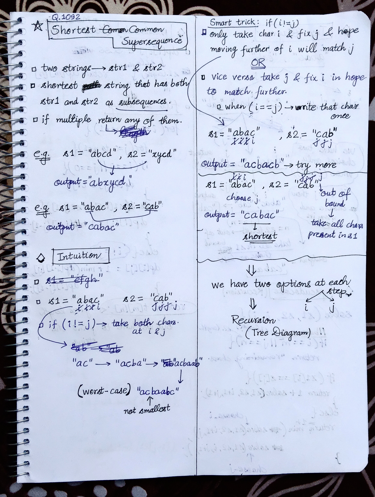
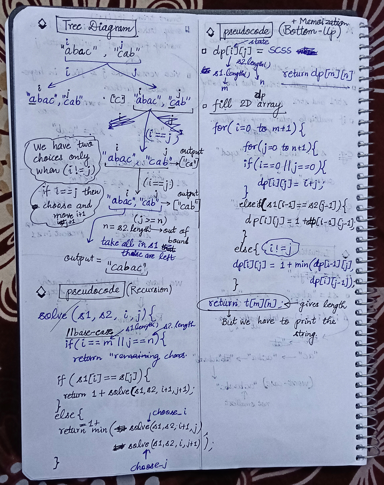
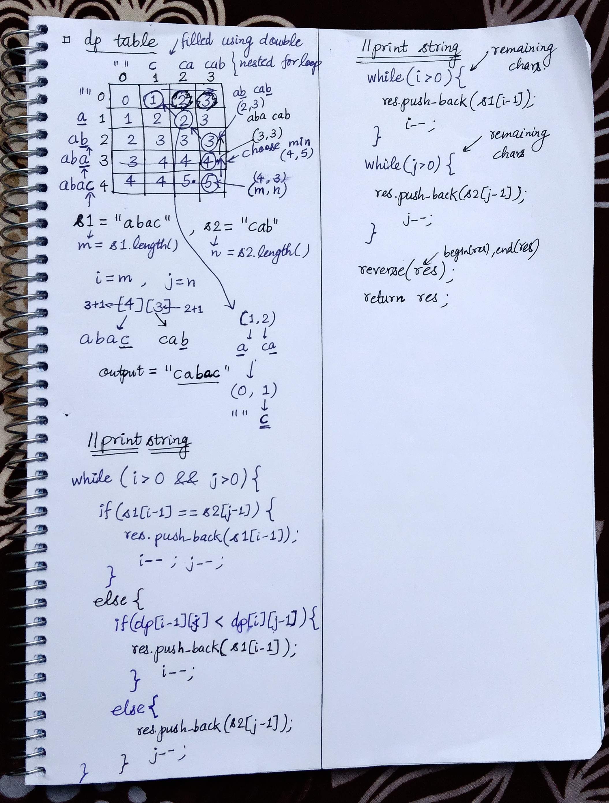

<h2><a href="https://leetcode.com/problems/shortest-common-supersequence">1092. Shortest Common Supersequence </a></h2><h3>Hard</h3><hr><p>Given two strings <code>str1</code> and <code>str2</code>, return <em>the shortest string that has both </em><code>str1</code><em> and </em><code>str2</code><em> as <strong>subsequences</strong></em>. If there are multiple valid strings, return <strong>any</strong> of them.</p>

<p>A string <code>s</code> is a <strong>subsequence</strong> of string <code>t</code> if deleting some number of characters from <code>t</code> (possibly <code>0</code>) results in the string <code>s</code>.</p>

<p>&nbsp;</p>
<p><strong class="example">Example 1:</strong></p>

<pre>
<strong>Input:</strong> str1 = &quot;abac&quot;, str2 = &quot;cab&quot;
<strong>Output:</strong> &quot;cabac&quot;
<strong>Explanation:</strong> 
str1 = &quot;abac&quot; is a subsequence of &quot;cabac&quot; because we can delete the first &quot;c&quot;.
str2 = &quot;cab&quot; is a subsequence of &quot;cabac&quot; because we can delete the last &quot;ac&quot;.
The answer provided is the shortest such string that satisfies these properties.
</pre>

<p><strong class="example">Example 2:</strong></p>

<pre>
<strong>Input:</strong> str1 = &quot;aaaaaaaa&quot;, str2 = &quot;aaaaaaaa&quot;
<strong>Output:</strong> &quot;aaaaaaaa&quot;
</pre>

<p>&nbsp;</p>
<p><strong>Constraints:</strong></p>

<ul>
	<li><code>1 &lt;= str1.length, str2.length &lt;= 1000</code></li>
	<li><code>str1</code> and <code>str2</code> consist of lowercase English letters.</li>
</ul>


<!-- AUTO-GENERATED-SOLUTION-START -->
---

## 🧠 Visual Solution & Intuition

### Part 1



### Part 2



### Part 3



---

## ⏱️ Complexity Analysis

```text
Time Complexity = O(m * n) => O(m * n) + O(m+n) + O(m+n)
Space Complexity = O(m * n) => O(m * n) + O(m+n)
```

---

## 💻 C++ Solution

[View Original C++ File](./1092-shortest-common-supersequence.cpp)

```cpp
class Solution {
public:
    //Method-1 : Bottom-UP Aproach

    //Time Complexity = O(m * n) => O(m * n) + O(m+n) + O(m+n)
    //1.) Dp table : O(m+1 x n+1)
    //2.) Backtracking to build SCS => O(m+n)
    //3.) Reverse the result = O(m+n)

    //Space Complexity = O(m * n) => O(m * n) + O(m+n)
    //1.) Dp table : O(m+1 x n+1)
    //2.) Result string : O(m+n)

    string shortestCommonSupersequence(string s1, string s2) {
        int m = s1.length() ;
        int n = s2.length() ;

        vector<vector<int>> dp(m+1, vector<int>(n+1) ) ; //dp table 2D

        //fill dp table
        for(int i=0 ; i<m+1 ; i++){
            for(int j=0 ; j<n+1 ; j++){
                if(i == 0 || j == 0){
                    dp[i][j] = i+j ;
                }
                else if(s1[i-1] == s2[j-1]){
                    dp[i][j] = 1 + dp[i-1][j-1] ;
                }
                else{ //s1[i-1] != s2[j-1]
                    dp[i][j] = 1 + min(dp[i-1][j], dp[i][j-1]) ;
                }
            }
        }

        //string to store result
        string result = "" ;
        int i = m, j = n ;
        while(i > 0 && j > 0){
            if(s1[i-1] == s2[j-1]){
                result.push_back(s1[i-1]) ;
                i-- ; j-- ;
            }

            else{
                if(dp[i-1][j] < dp[i][j-1]){
                    result.push_back(s1[i-1]) ;
                    i-- ;
                }
                else{
                    result.push_back(s2[j-1]) ;
                    j-- ;
                }
            }
        }

        //add remaining chars when anyone i or j is out of bound
        while(i > 0){
            result.push_back(s1[i-1]) ;
            i-- ;
        }

        while(j > 0){
            result.push_back(s2[j-1]) ;
            j-- ;
        }

        //we have stored result in reverse so again reverse 
        reverse(begin(result), end(result)) ;

        return result ;
    }
};
```

<!-- AUTO-GENERATED-SOLUTION-END -->
