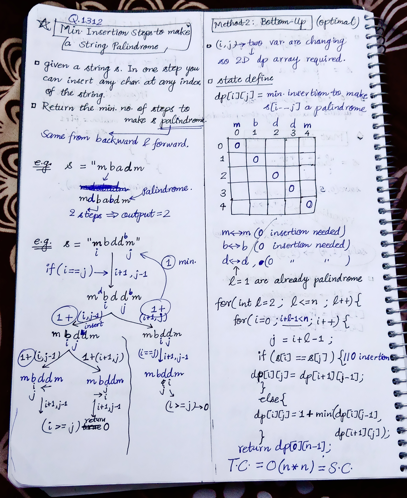
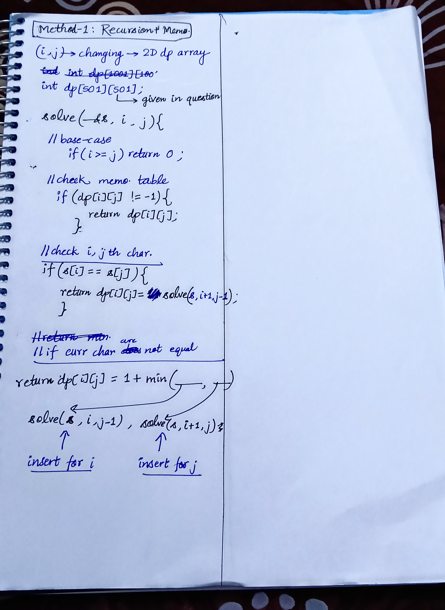

<h2><a href="https://leetcode.com/problems/minimum-insertion-steps-to-make-a-string-palindrome">1312. Minimum Insertion Steps to Make a String Palindrome</a></h2><h3>Hard</h3><hr><p>Given a string <code>s</code>. In one step you can insert any character at any index of the string.</p>

<p>Return <em>the minimum number of steps</em> to make <code>s</code>&nbsp;palindrome.</p>

<p>A&nbsp;<b>Palindrome String</b>&nbsp;is one that reads the same backward as well as forward.</p>

<p>&nbsp;</p>
<p><strong class="example">Example 1:</strong></p>

<pre>
<strong>Input:</strong> s = &quot;zzazz&quot;
<strong>Output:</strong> 0
<strong>Explanation:</strong> The string &quot;zzazz&quot; is already palindrome we do not need any insertions.
</pre>

<p><strong class="example">Example 2:</strong></p>

<pre>
<strong>Input:</strong> s = &quot;mbadm&quot;
<strong>Output:</strong> 2
<strong>Explanation:</strong> String can be &quot;mbdadbm&quot; or &quot;mdbabdm&quot;.
</pre>

<p><strong class="example">Example 3:</strong></p>

<pre>
<strong>Input:</strong> s = &quot;leetcode&quot;
<strong>Output:</strong> 5
<strong>Explanation:</strong> Inserting 5 characters the string becomes &quot;leetcodocteel&quot;.
</pre>

<p>&nbsp;</p>
<p><strong>Constraints:</strong></p>

<ul>
	<li><code>1 &lt;= s.length &lt;= 500</code></li>
	<li><code>s</code> consists of lowercase English letters.</li>
</ul>


<!-- AUTO-GENERATED-SOLUTION-START -->
---

## 🧠 Visual Solution & Intuition

### Part 1



### Part 2



---

## ⏱️ Complexity Analysis

```text
Time Complexity = O(n * n) =>
Space Complexity = O(n * n) =>
```

---

## 💻 C++ Solution

[View Original C++ File](./1312-minimum-insertion-steps-to-make-a-string-palindrome.cpp)

```cpp
class Solution {
public:
    //Method-1 : Recursion + Memoization
    
    //Time Complexity = O(n * n) =>
    // in solve i = 0,1,2,3,...n-1 =>states : n + n-1 + n-2 + ... = n(n+1)/2 => O(n*n)
    //Space Complexity = O(n * n) =>
    //1.) dp table = O(n * n)
    //2.) recursion stack = O(n)
    int dp[501][501] ;

    int solve(string& s, int i, int j){
        //base-case
        if(i >= j){ //out of bound
            return 0 ; 
        }

        //check memoization table
        if(dp[i][j] != -1){ //means solved before
            return dp[i][j] ; 
        }

        //check i, jth char.
        if(s[i] == s[j]){ //no insertion needed 
            return dp[i][j] = solve(s, i+1, j-1) ; //move both i, j
        }
        //if i, jth char. are not equal then two choices
        int insert_for_i = solve(s, i, j-1) ;

        int insert_for_j = solve(s, i+1, j) ;

        //return min of both
        return dp[i][j] = 1 + min(insert_for_i, insert_for_j) ;
    }
    int minInsertions(string s) {
        int n = s.length() ;

        memset(dp, -1, sizeof(dp)) ; //fill dp array with -1
        
        return solve(s, 0, n-1) ;

    }
};
```

<!-- AUTO-GENERATED-SOLUTION-END -->
