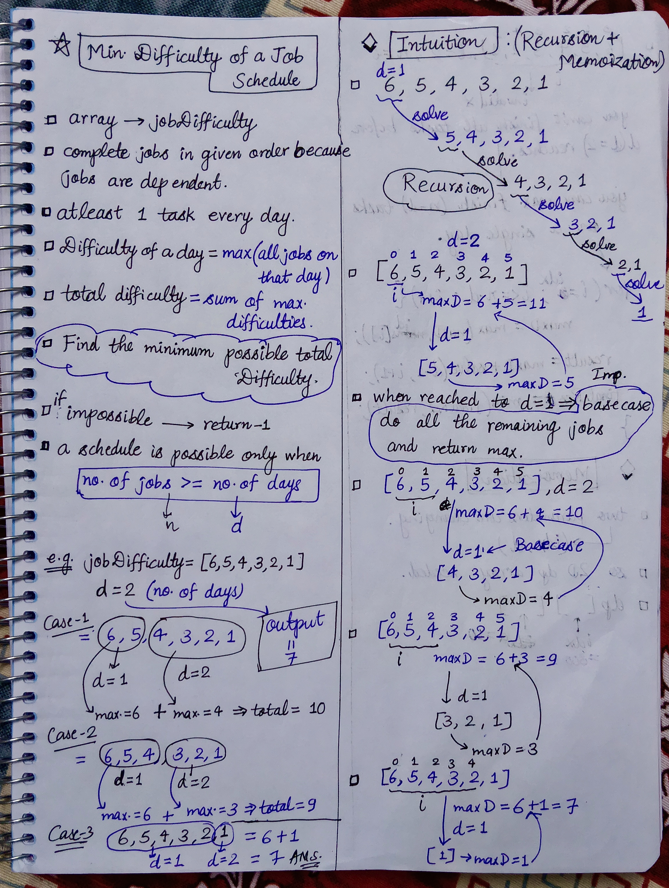
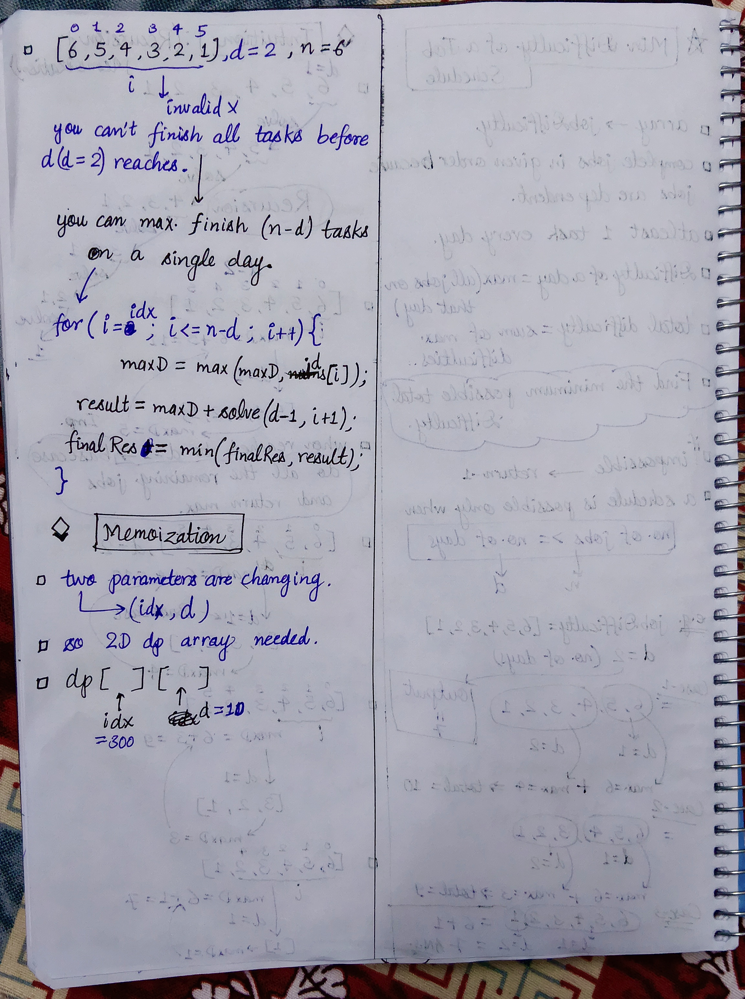

<h2><a href="https://leetcode.com/problems/minimum-difficulty-of-a-job-schedule">1335. Minimum Difficulty of a Job Schedule</a></h2><h3>Hard</h3><hr><p>You want to schedule a list of jobs in <code>d</code> days. Jobs are dependent (i.e To work on the <code>i<sup>th</sup></code> job, you have to finish all the jobs <code>j</code> where <code>0 &lt;= j &lt; i</code>).</p>

<p>You have to finish <strong>at least</strong> one task every day. The difficulty of a job schedule is the sum of difficulties of each day of the <code>d</code> days. The difficulty of a day is the maximum difficulty of a job done on that day.</p>

<p>You are given an integer array <code>jobDifficulty</code> and an integer <code>d</code>. The difficulty of the <code>i<sup>th</sup></code> job is <code>jobDifficulty[i]</code>.</p>

<p>Return <em>the minimum difficulty of a job schedule</em>. If you cannot find a schedule for the jobs return <code>-1</code>.</p>

<p>&nbsp;</p>
<p><strong class="example">Example 1:</strong></p>

<pre>
<strong>Input:</strong> jobDifficulty = [6,5,4,3,2,1], d = 2
<strong>Output:</strong> 7
<strong>Explanation:</strong> First day you can finish the first 5 jobs, total difficulty = 6.
Second day you can finish the last job, total difficulty = 1.
The difficulty of the schedule = 6 + 1 = 7 
</pre>

<p><strong class="example">Example 2:</strong></p>

<pre>
<strong>Input:</strong> jobDifficulty = [9,9,9], d = 4
<strong>Output:</strong> -1
<strong>Explanation:</strong> If you finish a job per day you will still have a free day. you cannot find a schedule for the given jobs.
</pre>

<p><strong class="example">Example 3:</strong></p>

<pre>
<strong>Input:</strong> jobDifficulty = [1,1,1], d = 3
<strong>Output:</strong> 3
<strong>Explanation:</strong> The schedule is one job per day. total difficulty will be 3.
</pre>

<p>&nbsp;</p>
<p><strong>Constraints:</strong></p>

<ul>
	<li><code>1 &lt;= jobDifficulty.length &lt;= 300</code></li>
	<li><code>0 &lt;= jobDifficulty[i] &lt;= 1000</code></li>
	<li><code>1 &lt;= d &lt;= 10</code></li>
</ul>


<!-- AUTO-GENERATED-SOLUTION-START -->
---

## 🧠 Visual Solution & Intuition

### Part 1



### Part 2



---

## ⏱️ Complexity Analysis

```text
Space Complexity = O(n * d) =>
```

---

## 💻 C++ Solution

[View Original C++ File](./1335-minimum-difficulty-of-a-job-schedule.cpp)

```cpp
class Solution {
public:
    //Method : Top-Down Approach(Recursion + Memoization)
    
    //Time-Complexity = O(n*n * d) => n = number of jobs, d = days
    // There are O(n * d) Dp states
    // for each state, the for loop can run up to O(n) times.


    //Space Complexity = O(n * d) =>
    // Dp table : O(n * d)

    int dp[301][11] ; //memoization table
    int solve(vector<int>& jd, int n, int idx, int d){
        //base-case
        if(d == 1){
            int maxD = jd[idx] ;

            for(int i=idx ; i<n ; i++){
                maxD = max(maxD, jd[i]) ;
            }

            return maxD ;
        }

        //check memoization table
        if(dp[idx][d] != -1){ //means solved before
            return dp[idx][d] ;
        }

        int maxD = jd[idx] ;
        int finalRes = INT_MAX ; //because this should be min so we initialize with just opposite 


        //start with 1 task on one day, then ....
        //atmost finish n-d tasks on single day

        for(int i=idx ; i <= n-d ; i++){
            maxD = max(maxD, jd[i]) ;

            int result = maxD + solve(jd, n, i+1, d-1) ;

            finalRes = min(finalRes, result) ;
        }


        //finally return the min finalRes
        return dp[idx][d] = finalRes ;


    }
    int minDifficulty(vector<int>& jd, int d) {
        
        int n = jd.size() ;

        memset(dp, -1, sizeof(dp)) ;//fill with -1

        //edge-case : if impossible to schedule then return -1
        if(n < d){
            return -1 ;
        }

        else{ //if we can solve then
            return solve(jd, n, 0, d) ;
        }
    }
};
```

<!-- AUTO-GENERATED-SOLUTION-END -->
