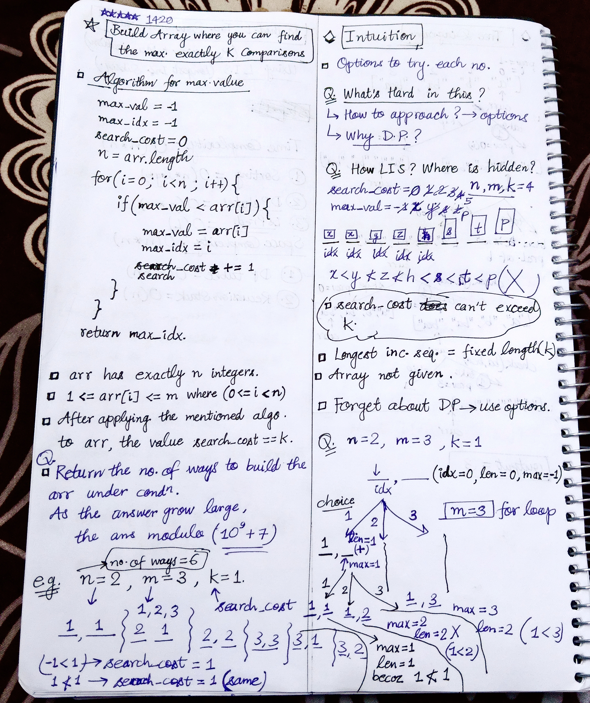
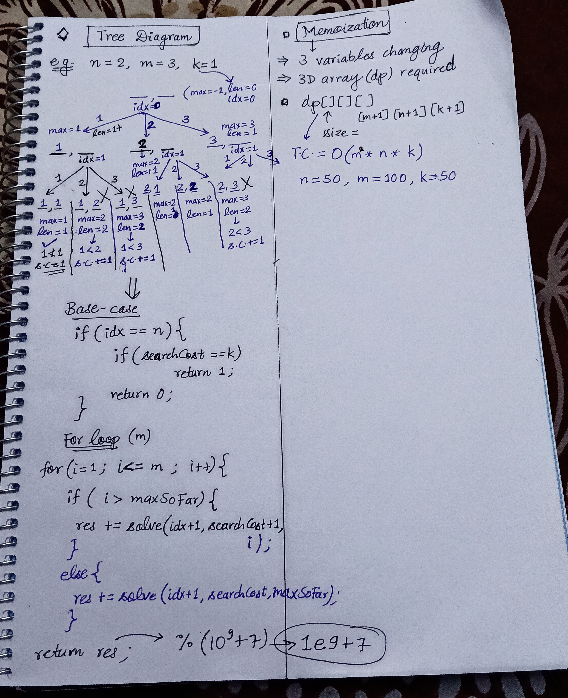

<h2><a href="https://leetcode.com/problems/build-array-where-you-can-find-the-maximum-exactly-k-comparisons">1420. Build Array Where You Can Find The Maximum Exactly K Comparisons</a></h2><h3>Hard</h3><hr><p>You are given three integers <code>n</code>, <code>m</code> and <code>k</code>. Consider the following algorithm to find the maximum element of an array of positive integers:</p>

<p>You should build the array arr which has the following properties:</p>

<ul>
	<li><code>arr</code> has exactly <code>n</code> integers.</li>
	<li><code>1 &lt;= arr[i] &lt;= m</code> where <code>(0 &lt;= i &lt; n)</code>.</li>
	<li>After applying the mentioned algorithm to <code>arr</code>, the value <code>search_cost</code> is equal to <code>k</code>.</li>
</ul>

<p>Return <em>the number of ways</em> to build the array <code>arr</code> under the mentioned conditions. As the answer may grow large, the answer <strong>must be</strong> computed modulo <code>10<sup>9</sup> + 7</code>.</p>

<p>&nbsp;</p>
<p><strong class="example">Example 1:</strong></p>

<pre>
<strong>Input:</strong> n = 2, m = 3, k = 1
<strong>Output:</strong> 6
<strong>Explanation:</strong> The possible arrays are [1, 1], [2, 1], [2, 2], [3, 1], [3, 2] [3, 3]
</pre>

<p><strong class="example">Example 2:</strong></p>

<pre>
<strong>Input:</strong> n = 5, m = 2, k = 3
<strong>Output:</strong> 0
<strong>Explanation:</strong> There are no possible arrays that satisfy the mentioned conditions.
</pre>

<p><strong class="example">Example 3:</strong></p>

<pre>
<strong>Input:</strong> n = 9, m = 1, k = 1
<strong>Output:</strong> 1
<strong>Explanation:</strong> The only possible array is [1, 1, 1, 1, 1, 1, 1, 1, 1]
</pre>

<p>&nbsp;</p>
<p><strong>Constraints:</strong></p>

<ul>
	<li><code>1 &lt;= n &lt;= 50</code></li>
	<li><code>1 &lt;= m &lt;= 100</code></li>
	<li><code>0 &lt;= k &lt;= n</code></li>
</ul>


<!-- AUTO-GENERATED-SOLUTION-START -->
---

## 🧠 Visual Solution & Intuition

### Part 1



### Part 2



---

## ⏱️ Complexity Analysis

```text
Time Complexity = O(n * m * m * k)
Space Complexity = O(n * m * k)
```

---

## 💻 C++ Solution

[View Original C++ File](./1420-build-array-where-you-can-find-the-maximum-exactly-k-comparisons.cpp)

```cpp
class Solution {
public:
    //Method-1 : Top-Down Approach(Recursion + Memoization)
    //Time Complexity = O(n * m * m * k)
    //Space Complexity = O(n * m * k)
    int N, M, K ;
    int dp[51][51][101] ;
    int MOD = 1e9 + 7 ;

    int solve(int idx, int searchCost, int maxSoFar){
        //base-case
        if(idx == N){
            if(searchCost == K){
                return 1 ;
            }
            return 0 ;
        }
        
        //check memoization array
        if(dp[idx][searchCost][maxSoFar] != -1){
            return dp[idx][searchCost][maxSoFar] ;
        }

        long long result = 0 ;

        //for loop till m : try options from 1 to m
        for(int i=1 ; i<= M ; i++){
            if(i > maxSoFar){
                result = (result + solve(idx+1, searchCost+1, i)) % MOD ;
            }
            else{
                result = (result + solve(idx+1, searchCost, maxSoFar)) % MOD ;
            }
        }

        //Return the result 
        return dp[idx][searchCost][maxSoFar] = result % MOD ;


    }
    int numOfArrays(int n, int m, int k) {
        N = n ;
        M = m ;
        K = k ;
        
        memset(dp, -1, sizeof(dp)) ; //fill memoization array with -1
        return solve(0, 0, 0) ;
    }
};
```

<!-- AUTO-GENERATED-SOLUTION-END -->
