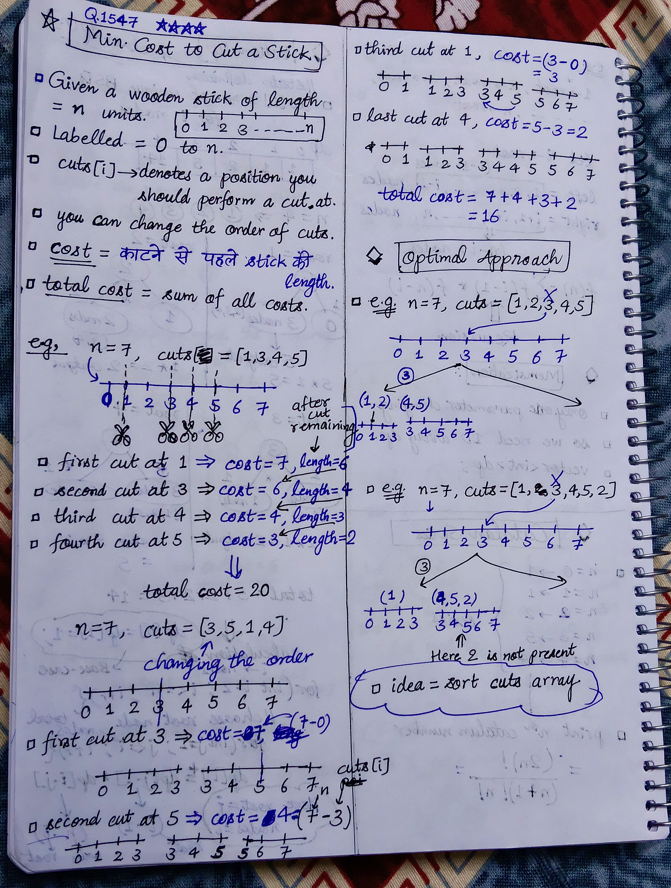
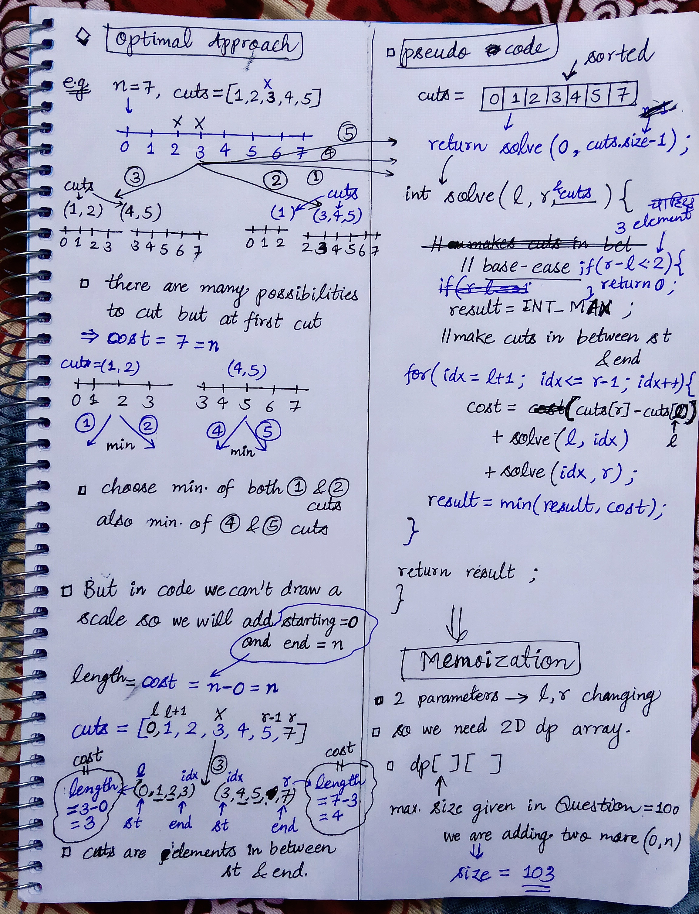

<h2><a href="https://leetcode.com/problems/minimum-cost-to-cut-a-stick">1547. Minimum Cost to Cut a Stick</a></h2><h3>Hard</h3><hr><p>Given a wooden stick of length <code>n</code> units. The stick is labelled from <code>0</code> to <code>n</code>. For example, a stick of length <strong>6</strong> is labelled as follows:</p>

<p>Given an integer array <code>cuts</code> where <code>cuts[i]</code> denotes a position you should perform a cut at.</p>

<p>You should perform the cuts in order, you can change the order of the cuts as you wish.</p>

<p>The cost of one cut is the length of the stick to be cut, the total cost is the sum of costs of all cuts. When you cut a stick, it will be split into two smaller sticks (i.e. the sum of their lengths is the length of the stick before the cut). Please refer to the first example for a better explanation.</p>

<p>Return <em>the minimum total cost</em> of the cuts.</p>

<p>&nbsp;</p>
<p><strong class="example">Example 1:</strong></p>

<pre>
<strong>Input:</strong> n = 7, cuts = [1,3,4,5]
<strong>Output:</strong> 16
<strong>Explanation:</strong> Using cuts order = [1, 3, 4, 5] as in the input leads to the following scenario:

The first cut is done to a rod of length 7 so the cost is 7. The second cut is done to a rod of length 6 (i.e. the second part of the first cut), the third is done to a rod of length 4 and the last cut is to a rod of length 3. The total cost is 7 + 6 + 4 + 3 = 20.
Rearranging the cuts to be [3, 5, 1, 4] for example will lead to a scenario with total cost = 16 (as shown in the example photo 7 + 4 + 3 + 2 = 16).</pre>

<p><strong class="example">Example 2:</strong></p>

<pre>
<strong>Input:</strong> n = 9, cuts = [5,6,1,4,2]
<strong>Output:</strong> 22
<strong>Explanation:</strong> If you try the given cuts ordering the cost will be 25.
There are much ordering with total cost &lt;= 25, for example, the order [4, 6, 5, 2, 1] has total cost = 22 which is the minimum possible.
</pre>

<p>&nbsp;</p>
<p><strong>Constraints:</strong></p>

<ul>
	<li><code>2 &lt;= n &lt;= 10<sup>6</sup></code></li>
	<li><code>1 &lt;= cuts.length &lt;= min(n - 1, 100)</code></li>
	<li><code>1 &lt;= cuts[i] &lt;= n - 1</code></li>
	<li>All the integers in <code>cuts</code> array are <strong>distinct</strong>.</li>
</ul>


<!-- AUTO-GENERATED-SOLUTION-START -->
---

## 🧠 Visual Solution & Intuition

### Part 1



### Part 2



---

## ⏱️ Complexity Analysis

```text
Time Complexity = O(m^3) => m = k + 2 => k = no. of cuts = size of cuts array
Space Complexity = O(m^2)
```

---

## 💻 C++ Solution

[View Original C++ File](./1547-minimum-cost-to-cut-a-stick.cpp)

```cpp
class Solution {
public:

    //Method-1 : Top-Down Approach(Recursion + Memoization)

    // Time Complexity = O(m^3) => m = k + 2 => k = no. of cuts = size of cuts array
    // Space Complexity = O(m^2)
    int dp[103][103] ; //memoization array

    int solve(int l, int r, vector<int>& cuts){
        //base-case : when length < 2 => we can't cut => cause for cutting we need 3 elements => (0, elem, r) ;
        if(r - l < 2){
            return 0 ;
        }

        //check memoization table 
        if(dp[l][r] != -1){
            return dp[l][r] ;
        }

        int result = INT_MAX ;

        //make cuts in between st & end
        for(int idx = l+1 ; idx <= r-1 ; idx++){
            int cost = (cuts[r] - cuts[l]) + solve(l, idx, cuts) + solve(idx, r, cuts) ;
            //solve left part + solve right part

            //update result with each iteration
            result = min(result, cost) ;
        }


        return dp[l][r] = result ;
    }
    int minCost(int n, vector<int>& cuts) {
        //First sort the cuts array
        sort(begin(cuts), end(cuts)) ;

        //add two extra elements in cuts array (0, n)
        cuts.insert(begin(cuts), 0) ;
        cuts.push_back(n) ;

        memset(dp, -1, sizeof(dp)) ; //fill dp table with -1

        //func. call to solve
        return solve(0, cuts.size()-1, cuts) ;
    }
};
```

<!-- AUTO-GENERATED-SOLUTION-END -->
