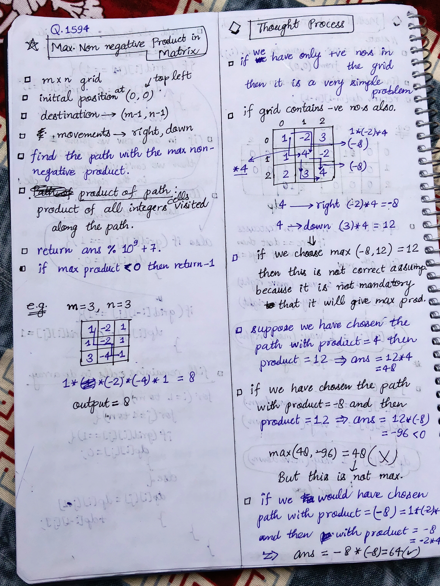
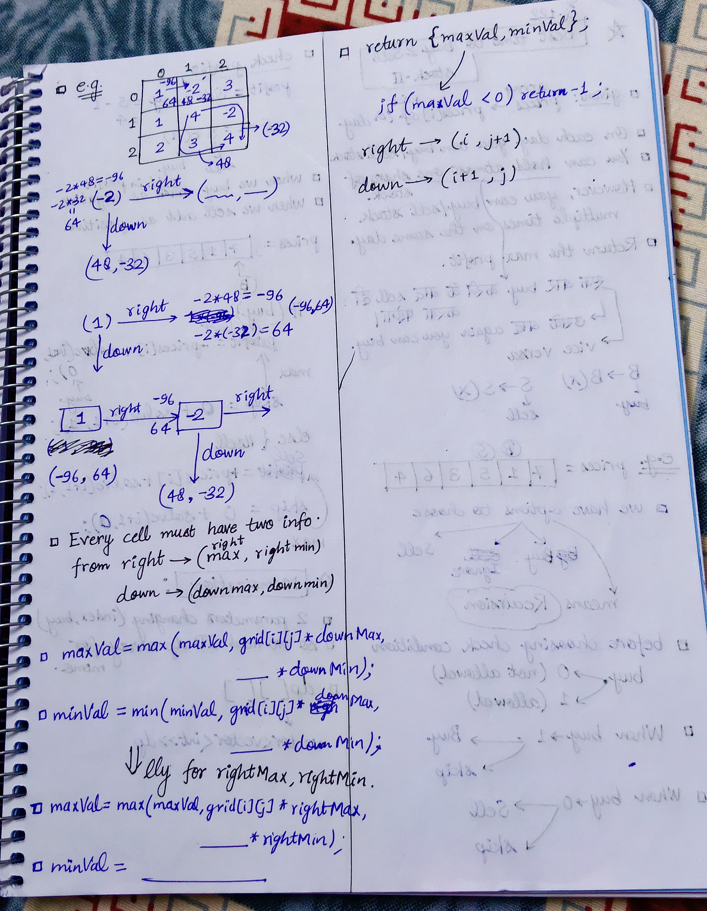

<h2><a href="https://leetcode.com/problems/maximum-non-negative-product-in-a-matrix">1716. Maximum Non Negative Product in a Matrix</a></h2><h3>Medium</h3><hr><p>You are given a <code>m x n</code> matrix <code>grid</code>. Initially, you are located at the top-left corner <code>(0, 0)</code>, and in each step, you can only <strong>move right or down</strong> in the matrix.</p>

<p>Among all possible paths starting from the top-left corner <code>(0, 0)</code> and ending in the bottom-right corner <code>(m - 1, n - 1)</code>, find the path with the <strong>maximum non-negative product</strong>. The product of a path is the product of all integers in the grid cells visited along the path.</p>

<p>Return the <em>maximum non-negative product <strong>modulo</strong> </em><code>10<sup>9</sup> + 7</code>. <em>If the maximum product is <strong>negative</strong>, return </em><code>-1</code>.</p>

<p>Notice that the modulo is performed after getting the maximum product.</p>

<p>&nbsp;</p>
<p><strong class="example">Example 1:</strong></p>

<pre>
<strong>Input:</strong> grid = [[-1,-2,-3],[-2,-3,-3],[-3,-3,-2]]
<strong>Output:</strong> -1
<strong>Explanation:</strong> It is not possible to get non-negative product in the path from (0, 0) to (2, 2), so return -1.
</pre>

<p><strong class="example">Example 2:</strong></p>

<pre>
<strong>Input:</strong> grid = [[1,-2,1],[1,-2,1],[3,-4,1]]
<strong>Output:</strong> 8
<strong>Explanation:</strong> Maximum non-negative product is shown (1 * 1 * -2 * -4 * 1 = 8).
</pre>

<p><strong class="example">Example 3:</strong></p>

<pre>
<strong>Input:</strong> grid = [[1,3],[0,-4]]
<strong>Output:</strong> 0
<strong>Explanation:</strong> Maximum non-negative product is shown (1 * 0 * -4 = 0).
</pre>

<p>&nbsp;</p>
<p><strong>Constraints:</strong></p>

<ul>
	<li><code>m == grid.length</code></li>
	<li><code>n == grid[i].length</code></li>
	<li><code>1 &lt;= m, n &lt;= 15</code></li>
	<li><code>-4 &lt;= grid[i][j] &lt;= 4</code></li>
</ul>


<!-- AUTO-GENERATED-SOLUTION-START -->
---

## 🧠 Visual Solution & Intuition

### Part 1



### Part 2



---

## ⏱️ Complexity Analysis

```text
Time Complexity = O(m * n)
Space Complexity = O(m * n)
```

---

## 💻 C++ Solution

[View Original C++ File](./1594-maximum-non-negative-product-in-a-matrix.cpp)

```cpp
class Solution {
public:
    //Method-1 : Top-Down Approach (Recursion + Memoization )
    
    //Time Complexity = O(m * n)
    //Space Complexity = O(m * n)
    int m , n ;
    int MOD = 1e9 + 7 ; //10^9 + 7

    typedef long long ll ;
    
    //Memoization 2d vector of pairs
    vector<vector<pair<ll, ll>>> dp ;

    pair<ll, ll> solve(int i, int j, vector<vector<int>>& grid){
        //base-case
        if(i == m-1 && j == n-1){
            return {grid[i][j], grid[i][j]} ;
        }

        ll maxVal = LLONG_MIN ;
        ll minVal = LLONG_MAX ;
        
        //check memoization 2d vector if solved before 
        if(dp[i][j] != make_pair(LLONG_MIN, LLONG_MAX) ){ //means solved before
            return dp[i][j] ;//don't solve again just return that solution
        }
        //check in Down
        if(i+1 < m){
            auto [downMax, downMin] = solve(i+1, j, grid) ;

            maxVal = max( {maxVal, grid[i][j]*downMax, grid[i][j]*downMin} ) ;
            minVal = min( {minVal, grid[i][j]*downMax, grid[i][j]*downMin} ) ;
        }

        //check for right
        if(j+1 < n){
            auto [rightMax, rightMin] = solve(i, j+1, grid) ;

            maxVal = max( {maxVal, grid[i][j]*rightMax, grid[i][j]*rightMin} ) ;
            minVal = min( {minVal, grid[i][j]*rightMax, grid[i][j]*rightMin} ) ;
        }
        
        //return the pair {maxVal, minVal} 

        return dp[i][j] = {maxVal, minVal} ;
    }
    int maxProductPath(vector<vector<int>>& grid) {
        m = grid.size() ;
        n = grid[0].size() ;

        //initialization of 2d memoization vector of pairs
        dp = vector<vector<pair<ll, ll>>>(m, vector<pair<ll, ll>>(n, {LLONG_MIN, LLONG_MAX} )) ; //LLONG_MIN = maxVal, LLONG_MIN = minVal ;

        //func. call to solve
        auto [maxProd, minProd] = solve(0, 0, grid) ;

        if(maxProd < 0){
            return -1 ;
        }
        else{
            return maxProd % MOD ;
        }
    }
};
```

<!-- AUTO-GENERATED-SOLUTION-END -->
