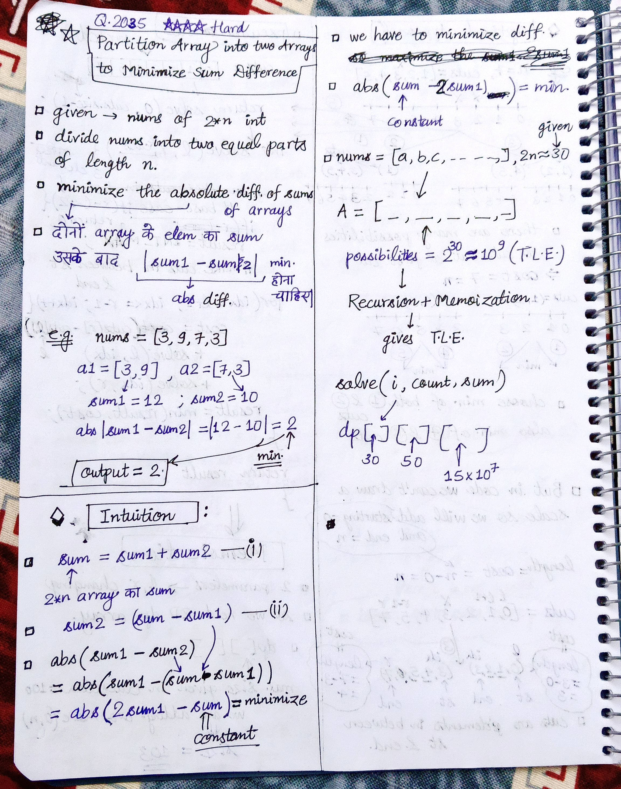
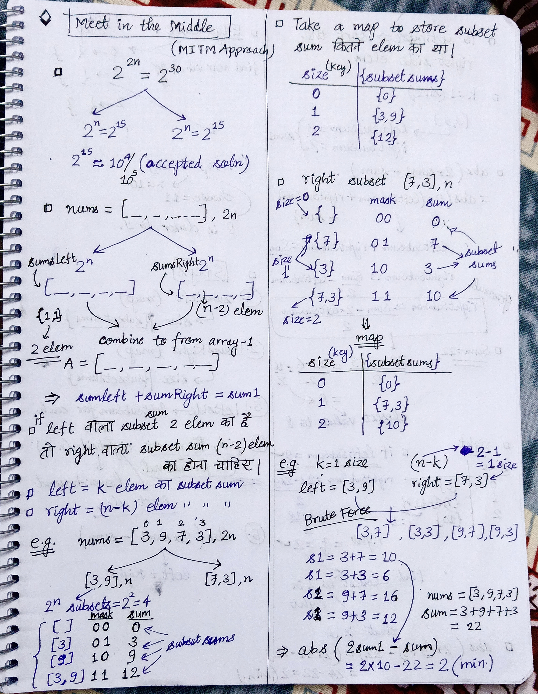
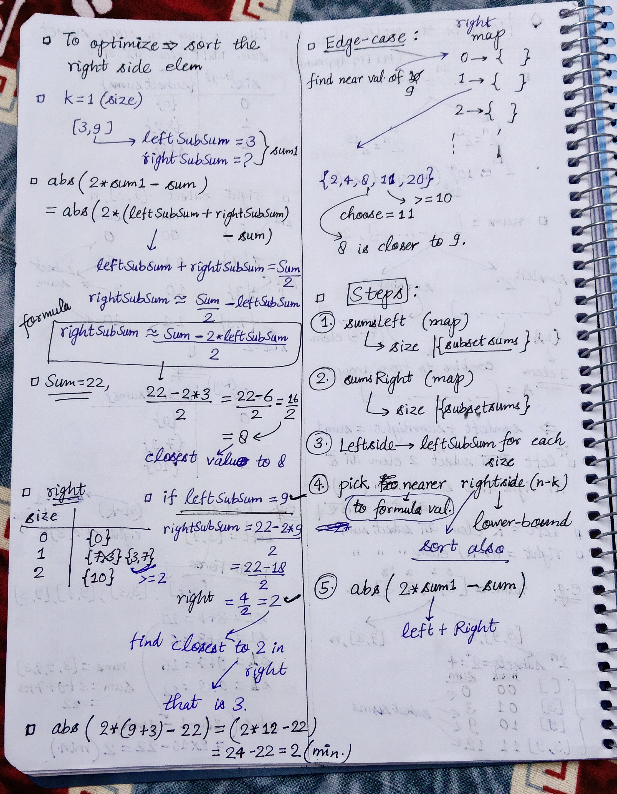

<h2><a href="https://leetcode.com/problems/partition-array-into-two-arrays-to-minimize-sum-difference">2035. Partition Array Into Two Arrays to Minimize Sum Difference</a></h2><h3>Hard</h3><hr><p>You are given an integer array <code>nums</code> of <code>2 * n</code> integers. You need to partition <code>nums</code> into <strong>two</strong> arrays of length <code>n</code> to <strong>minimize the absolute difference</strong> of the <strong>sums</strong> of the arrays. To partition <code>nums</code>, put each element of <code>nums</code> into <strong>one</strong> of the two arrays.</p>

<p>Return <em>the <strong>minimum</strong> possible absolute difference</em>.</p>

<p>&nbsp;</p>
<p><strong class="example">Example 1:</strong></p>

<pre>
<strong>Input:</strong> nums = [3,9,7,3]
<strong>Output:</strong> 2
<strong>Explanation:</strong> One optimal partition is: [3,9] and [7,3].
The absolute difference between the sums of the arrays is abs((3 + 9) - (7 + 3)) = 2.
</pre>

<p><strong class="example">Example 2:</strong></p>

<pre>
<strong>Input:</strong> nums = [-36,36]
<strong>Output:</strong> 72
<strong>Explanation:</strong> One optimal partition is: [-36] and [36].
The absolute difference between the sums of the arrays is abs((-36) - (36)) = 72.
</pre>

<p><strong class="example">Example 3:</strong></p>

<pre>
<strong>Input:</strong> nums = [2,-1,0,4,-2,-9]
<strong>Output:</strong> 0
<strong>Explanation:</strong> One optimal partition is: [2,4,-9] and [-1,0,-2].
The absolute difference between the sums of the arrays is abs((2 + 4 + -9) - (-1 + 0 + -2)) = 0.
</pre>

<p>&nbsp;</p>
<p><strong>Constraints:</strong></p>

<ul>
	<li><code>1 &lt;= n &lt;= 15</code></li>
	<li><code>nums.length == 2 * n</code></li>
	<li><code>-10<sup>7</sup> &lt;= nums[i] &lt;= 10<sup>7</sup></code></li>
</ul>


<!-- AUTO-GENERATED-SOLUTION-START -->
---

## 🧠 Visual Solution & Intuition

### Part 1



### Part 2



### Part 3



---

## ⏱️ Complexity Analysis

```text
Time Complexity = O(n * 2^n) =>
Space Complexity = O(2^n) =>
```

---

## 💻 C++ Solution

[View Original C++ File](./2035-partition-array-into-two-arrays-to-minimize-sum-difference.cpp)

```cpp
class Solution {
public:
    //This is the hardest problem to me till now
    //Don't jump directly to this problem
    //Strengthen your basics first

    //Method : MITM(Meet in the Middle) Approach

    //Time Complexity = O(n * 2^n) =>
    // sumsLeft map : There are 2^n masks and n operations per mask => O(n* 2^n)
    // sumsRight map : There are 2^n masks and n operations per mask => O(n* 2^n)
    //lower_bound checks :  O(log 2ⁿ) = O(n)


    //Space Complexity = O(2^n) =>
    // sumsLeft map : store 2^n subsets => O(2^n)
    // sumsRight map : store 2^n subsets => O(2^n)
    
    int minimumDifference(vector<int>& nums) {
        
        int N = nums.size() ;

        int Sum = accumulate(begin(nums), end(nums), 0) ; //Sum of nums array

        int n = N/2 ; 

        int n1 = n ; //leftSide
        int n2 = n ; //rightSide

        //1.) make sumsLeft map : size -> {subsetSums}
        unordered_map<int, vector<int>> sumsLeft ;

        for(int mask=0 ; mask < (1 << n1) ; mask++){ // 1<<n1 = 2^n1
            int s = 0 ; //subset sum
            int count = 0 ; 
            
            for(int i=0 ; i<n1 ; i++){
                if(mask & (1 << i) ){
                    s += nums[i] ;
                    count++ ;
                }
            }

            sumsLeft[count].push_back(s) ;
        }

        //2.) make sumsRight map : size -> {subsetSums}
        unordered_map<int, vector<int>> sumsRight ;
        
        for(int mask=0 ; mask < (1 << n1) ; mask++){ // 1<<n1 = 2^n1
            int s = 0 ; //subset sum
            int count = 0 ; 
            
            for(int i=0 ; i<n1 ; i++){
                if(mask & (1 << i) ){
                    s += nums[n1 + i] ;
                    count++ ;
                }
            }

            sumsRight[count].push_back(s) ;
        }

        //3.) Sort the right subset also
        for(int count = 0 ; count <= n2 ; count++){
            //sumsRight[count] => vector of subset sum having subset of size count
            sort(begin(sumsRight[count]), end(sumsRight[count]) ) ;
        }

        //4.) find abs(2 *sum1 - Sum) = minValue
        int minValue = INT_MAX ;

        //check for every k size in leftside then in rightSide n-k size
        for(int k=0 ; k<n1 ; k++){
            int m = n-k ;

            //check in map sumsLeft
            for(int leftSubSum : sumsLeft[k] ){
                int needRight = (Sum - 2*leftSubSum) / 2 ;
                
                //with formula value of needRight check in map using lower_bound
                int low = lower_bound(begin(sumsRight[m]), end(sumsRight[m]), needRight) - begin(sumsRight[m]) ; //index value 

                //check if low is out of bound
                if(low < sumsRight[m].size() ){
                    int rightSubSum = sumsRight[m][low] ;

                    minValue = min(minValue, abs(2*(leftSubSum + rightSubSum) - Sum) ) ;
                }

                if(low-1 < sumsRight[m].size()){
                    int rightSubSum = sumsRight[m][low-1] ;

                    minValue = min(minValue, abs(2*(leftSubSum + rightSubSum) - Sum) ) ;
                }
            }
        }


        //finally return the minimum value
        return minValue ;
        
    }
};
```

<!-- AUTO-GENERATED-SOLUTION-END -->
