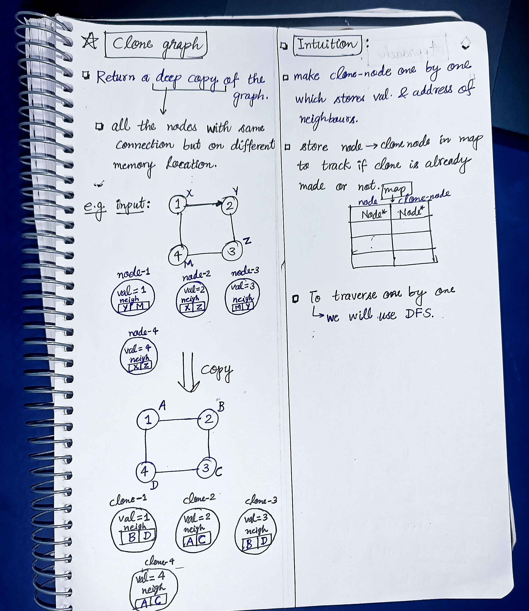
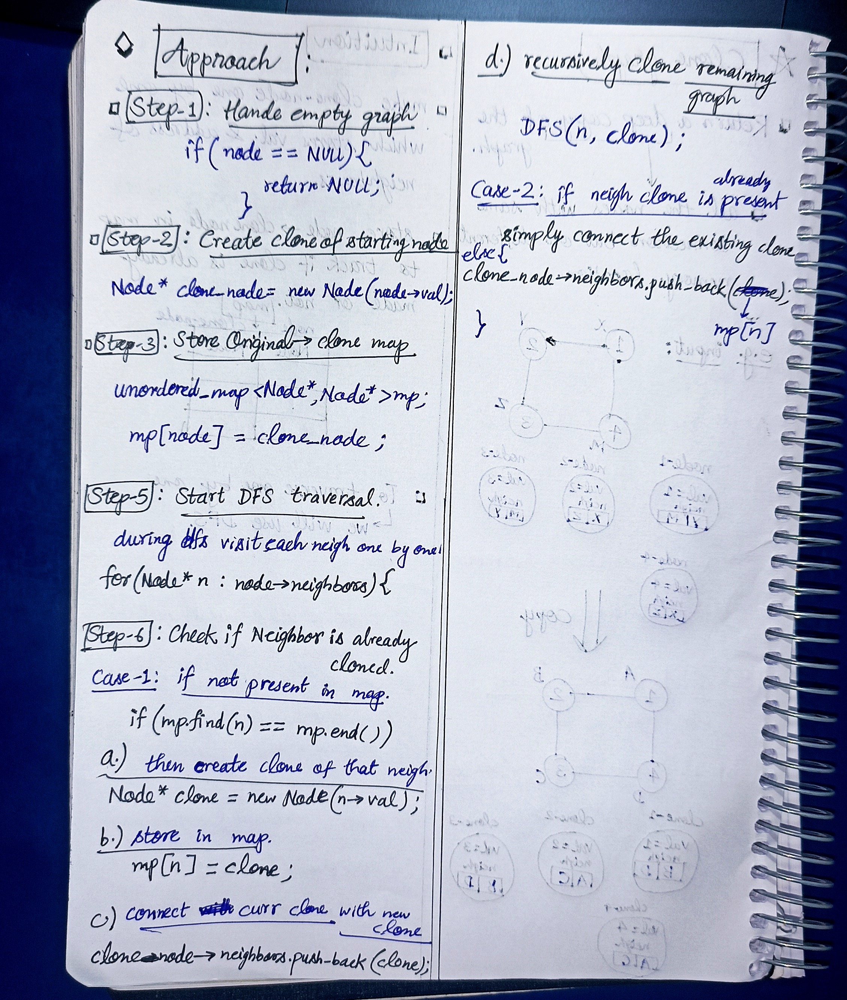

<h2><a href="https://leetcode.com/problems/clone-graph">133. Clone Graph</a></h2><h3>Medium</h3><hr><p>Given a reference of a node in a <strong><a href="https://en.wikipedia.org/wiki/Connectivity_(graph_theory)#Connected_graph" target="_blank">connected</a></strong> undirected graph.</p>

<p>Return a <a href="https://en.wikipedia.org/wiki/Object_copying#Deep_copy" target="_blank"><strong>deep copy</strong></a> (clone) of the graph.</p>

<p>Each node in the graph contains a value (<code>int</code>) and a list (<code>List[Node]</code>) of its neighbors.</p>

<pre>
class Node {
    public int val;
    public List&lt;Node&gt; neighbors;
}
</pre>

<p>&nbsp;</p>

<p><strong>Test case format:</strong></p>

<p>For simplicity, each node&#39;s value is the same as the node&#39;s index (1-indexed). For example, the first node with <code>val == 1</code>, the second node with <code>val == 2</code>, and so on. The graph is represented in the test case using an adjacency list.</p>

<p><b>An adjacency list</b> is a collection of unordered <b>lists</b> used to represent a finite graph. Each list describes the set of neighbors of a node in the graph.</p>

<p>The given node will always be the first node with <code>val = 1</code>. You must return the <strong>copy of the given node</strong> as a reference to the cloned graph.</p>

<p>&nbsp;</p>
<p><strong class="example">Example 1:</strong></p>

<pre>
<strong>Input:</strong> adjList = [[2,4],[1,3],[2,4],[1,3]]
<strong>Output:</strong> [[2,4],[1,3],[2,4],[1,3]]
<strong>Explanation:</strong> There are 4 nodes in the graph.
1st node (val = 1)&#39;s neighbors are 2nd node (val = 2) and 4th node (val = 4).
2nd node (val = 2)&#39;s neighbors are 1st node (val = 1) and 3rd node (val = 3).
3rd node (val = 3)&#39;s neighbors are 2nd node (val = 2) and 4th node (val = 4).
4th node (val = 4)&#39;s neighbors are 1st node (val = 1) and 3rd node (val = 3).
</pre>

<p><strong class="example">Example 2:</strong></p>

<pre>
<strong>Input:</strong> adjList = [[]]
<strong>Output:</strong> [[]]
<strong>Explanation:</strong> Note that the input contains one empty list. The graph consists of only one node with val = 1 and it does not have any neighbors.
</pre>

<p><strong class="example">Example 3:</strong></p>

<pre>
<strong>Input:</strong> adjList = []
<strong>Output:</strong> []
<strong>Explanation:</strong> This an empty graph, it does not have any nodes.
</pre>

<p>&nbsp;</p>
<p><strong>Constraints:</strong></p>

<ul>
	<li>The number of nodes in the graph is in the range <code>[0, 100]</code>.</li>
	<li><code>1 &lt;= Node.val &lt;= 100</code></li>
	<li><code>Node.val</code> is unique for each node.</li>
	<li>There are no repeated edges and no self-loops in the graph.</li>
	<li>The Graph is connected and all nodes can be visited starting from the given node.</li>
</ul>


<!-- AUTO-GENERATED-SOLUTION-START -->
---

## 🧠 Visual Solution & Intuition

### Part 1



### Part 2



---

## ⏱️ Complexity Analysis

```text
Time Complexity = O(V + E)
Space Complexity = O(V + E)
```

---

## 💻 C++ Solution

[View Original C++ File](./0133-clone-graph.cpp)

```cpp
/*
// Definition for a Node.
class Node {
public:
    int val;
    vector<Node*> neighbors;
    Node() {
        val = 0;
        neighbors = vector<Node*>();
    }
    Node(int _val) {
        val = _val;
        neighbors = vector<Node*>();
    }
    Node(int _val, vector<Node*> _neighbors) {
        val = _val;
        neighbors = _neighbors;
    }
};
*/

class Solution {
public:
    //Time Complexity = O(V + E)
    //Space Complexity = O(V + E)


    //map to store node : clone-node
    unordered_map<Node* , Node*> mp ; //global so that don't need to pass in arguments.

    void DFS(Node* node, Node* clone_node){
        //5.)start traversal in neigh one by one
        for(Node* n : node->neighbors){
            //6.) check if neighbor is already cloned
            if(mp.find(n) == mp.end() ){ //clone not present in map
                Node* clone = new Node(n->val) ; //make a new clone
                mp[n] = clone ; //push in map
                clone_node->neighbors.push_back(clone) ; //connect curr clone with new clone
                DFS(n, clone) ; //recursively clone remaining graph
            }
            else{ //if clone already present in map
                clone_node->neighbors.push_back(mp[n]) ;//simply connect with existing clone
            }
        }
    }
    Node* cloneGraph(Node* node) {
        //1.) Handle empty graph
        if(node == NULL){
            return NULL ;
        }

        //2.) Create clone of starting node
        Node* clone_node = new Node(node->val) ;

        //3.) Store original -> clone map
        mp[node] = clone_node ;

        //func. call to DFS
        DFS(node, clone_node) ;


        return clone_node ;//very important to return the clone_node of clone graph.
    }
};
```

<!-- AUTO-GENERATED-SOLUTION-END -->
