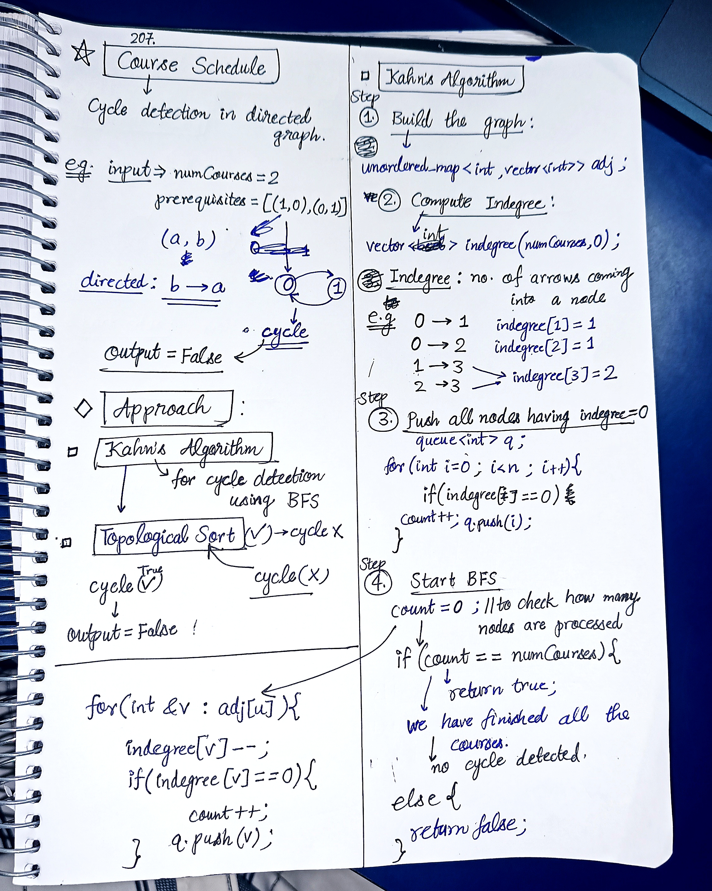

<h2><a href="https://leetcode.com/problems/course-schedule">207. Course Schedule</a></h2><h3>Medium</h3><hr><p>There are a total of <code>numCourses</code> courses you have to take, labeled from <code>0</code> to <code>numCourses - 1</code>. You are given an array <code>prerequisites</code> where <code>prerequisites[i] = [a<sub>i</sub>, b<sub>i</sub>]</code> indicates that you <strong>must</strong> take course <code>b<sub>i</sub></code> first if you want to take course <code>a<sub>i</sub></code>.</p>

<ul>
	<li>For example, the pair <code>[0, 1]</code>, indicates that to take course <code>0</code> you have to first take course <code>1</code>.</li>
</ul>

<p>Return <code>true</code> if you can finish all courses. Otherwise, return <code>false</code>.</p>

<p>&nbsp;</p>
<p><strong class="example">Example 1:</strong></p>

<pre>
<strong>Input:</strong> numCourses = 2, prerequisites = [[1,0]]
<strong>Output:</strong> true
<strong>Explanation:</strong> There are a total of 2 courses to take. 
To take course 1 you should have finished course 0. So it is possible.
</pre>

<p><strong class="example">Example 2:</strong></p>

<pre>
<strong>Input:</strong> numCourses = 2, prerequisites = [[1,0],[0,1]]
<strong>Output:</strong> false
<strong>Explanation:</strong> There are a total of 2 courses to take. 
To take course 1 you should have finished course 0, and to take course 0 you should also have finished course 1. So it is impossible.
</pre>

<p>&nbsp;</p>
<p><strong>Constraints:</strong></p>

<ul>
	<li><code>1 &lt;= numCourses &lt;= 2000</code></li>
	<li><code>0 &lt;= prerequisites.length &lt;= 5000</code></li>
	<li><code>prerequisites[i].length == 2</code></li>
	<li><code>0 &lt;= a<sub>i</sub>, b<sub>i</sub> &lt; numCourses</code></li>
	<li>All the pairs prerequisites[i] are <strong>unique</strong>.</li>
</ul>


<!-- AUTO-GENERATED-SOLUTION-START -->
---

## 🧠 Visual Solution & Intuition



---

## ⏱️ Complexity Analysis

```text
Time Complexity = O(V + E)
Space Complexity = O(V + E)
```

---

## 💻 C++ Solution

[View Original C++ File](./0207-course-schedule.cpp)

```cpp
class Solution {
public:
    //Time Complexity = O(V + E)
    //Space Complexity = O(V + E)
    bool topologicalSortCheck(unordered_map<int, vector<int>>& adj, int n,vector<int>& indegree ){
        //queue to use BFS
        queue<int> q ;

        int count = 0 ;

        //3.) push all nodes having indegree = 0
        for(int i=0 ; i<n ; i++){
            if(indegree[i] == 0){
                count++ ;
                q.push(i) ;
            }
        }

        //4.) Start BFS
        while(!q.empty()){
            int u = q.front() ;
            q.pop() ;

            //traverse in neighs of u
            for(int &v : adj[u]){
                indegree[v]-- ; //decrease indegree of neighs

                if(indegree[v] == 0){
                    count++ ;
                    q.push(v) ;
                }
                
            }
        }

        //check count
        if(count == n){ //n = numCourses => means all courses are visited => no cycle detected
            return true ;
        }

        else{  //count != n => all courses can't be visited => cycle detected
            return false ;
        }
    }
    bool canFinish(int numCourses, vector<vector<int>>& prerequisites) {
        //1.) Build the graph
        unordered_map<int, vector<int>> adj ;

        //2.) Compute indegree
        vector<int> indegree(numCourses,0) ;

        for(auto& vec : prerequisites){
            int a = vec[0] ;
            int b = vec[1] ;

            //direction : b ----> a
            adj[b].push_back(a) ;

            indegree[a]++ ; //cause arrow coming into a
        }

        //Detect cycle using topological sort
        return topologicalSortCheck(adj, numCourses, indegree) ;
    }
};
```

<!-- AUTO-GENERATED-SOLUTION-END -->
