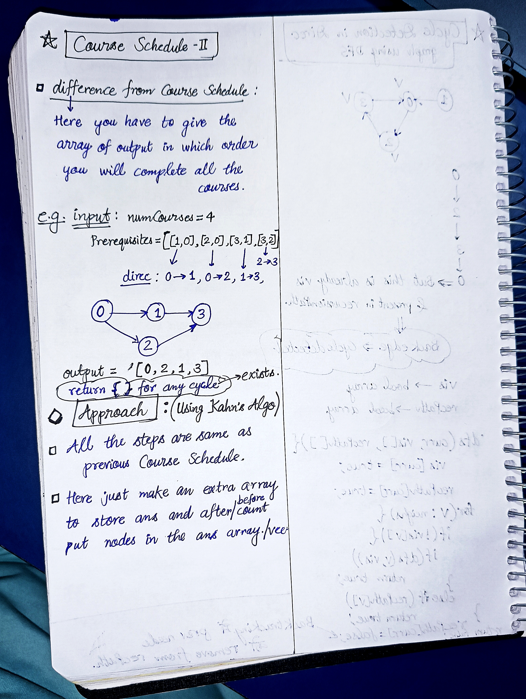

<h2><a href="https://leetcode.com/problems/course-schedule-ii">210. Course Schedule II</a></h2><h3>Medium</h3><hr><p>There are a total of <code>numCourses</code> courses you have to take, labeled from <code>0</code> to <code>numCourses - 1</code>. You are given an array <code>prerequisites</code> where <code>prerequisites[i] = [a<sub>i</sub>, b<sub>i</sub>]</code> indicates that you <strong>must</strong> take course <code>b<sub>i</sub></code> first if you want to take course <code>a<sub>i</sub></code>.</p>

<ul>
	<li>For example, the pair <code>[0, 1]</code>, indicates that to take course <code>0</code> you have to first take course <code>1</code>.</li>
</ul>

<p>Return <em>the ordering of courses you should take to finish all courses</em>. If there are many valid answers, return <strong>any</strong> of them. If it is impossible to finish all courses, return <strong>an empty array</strong>.</p>

<p>&nbsp;</p>
<p><strong class="example">Example 1:</strong></p>

<pre>
<strong>Input:</strong> numCourses = 2, prerequisites = [[1,0]]
<strong>Output:</strong> [0,1]
<strong>Explanation:</strong> There are a total of 2 courses to take. To take course 1 you should have finished course 0. So the correct course order is [0,1].
</pre>

<p><strong class="example">Example 2:</strong></p>

<pre>
<strong>Input:</strong> numCourses = 4, prerequisites = [[1,0],[2,0],[3,1],[3,2]]
<strong>Output:</strong> [0,2,1,3]
<strong>Explanation:</strong> There are a total of 4 courses to take. To take course 3 you should have finished both courses 1 and 2. Both courses 1 and 2 should be taken after you finished course 0.
So one correct course order is [0,1,2,3]. Another correct ordering is [0,2,1,3].
</pre>

<p><strong class="example">Example 3:</strong></p>

<pre>
<strong>Input:</strong> numCourses = 1, prerequisites = []
<strong>Output:</strong> [0]
</pre>

<p>&nbsp;</p>
<p><strong>Constraints:</strong></p>

<ul>
	<li><code>1 &lt;= numCourses &lt;= 2000</code></li>
	<li><code>0 &lt;= prerequisites.length &lt;= numCourses * (numCourses - 1)</code></li>
	<li><code>prerequisites[i].length == 2</code></li>
	<li><code>0 &lt;= a<sub>i</sub>, b<sub>i</sub> &lt; numCourses</code></li>
	<li><code>a<sub>i</sub> != b<sub>i</sub></code></li>
	<li>All the pairs <code>[a<sub>i</sub>, b<sub>i</sub>]</code> are <strong>distinct</strong>.</li>
</ul>


<!-- AUTO-GENERATED-SOLUTION-START -->
---

## 🧠 Visual Solution & Intuition



---

## ⏱️ Complexity Analysis

```text
Time Complexity = O(V + E)
Space Complexity = O(V + E)
```

---

## 💻 C++ Solution

[View Original C++ File](./0210-course-schedule-ii.cpp)

```cpp
class Solution {
public:
    //Time Complexity = O(V + E)
    //Space Complexity = O(V + E)
    vector<int> topologicalSort(unordered_map<int, vector<int>>& adj, int n, vector<int>& indegree){

        queue<int> q ; //queue for BFS
        vector<int> ans ; //to store ans 
        int count = 0 ;

        //push all nodes in queue having indegree == 0
        for(int i=0 ; i<n ; i++){
            if(indegree[i] == 0){
                ans.push_back(i) ;
                count++ ;
                q.push(i) ;
            }
        }

        //4.) Start BFS
        while(!q.empty() ){
            int u = q.front() ;
            q.pop() ;
            //traverse in neighbours
            for(int &v : adj[u]){
                
                indegree[v]-- ; //decrease indegree of neighbours

                if(indegree[v] == 0){
                    ans.push_back(v) ;
                    count++ ;
                    q.push(v) ;
                }
            }
        }

        //if count == n(numCourses) => then completed all the courses.
        if(count == n){
            return ans ;
        }

        else{ //count != n => cycle detected.
            return {} ; //empty array
        }

    }
    vector<int> findOrder(int numCourses, vector<vector<int>>& prerequisites) {
        //Step-1 : Build the graph
        unordered_map<int, vector<int>> adj ;

        //Step-2 : Compute Indegree
        vector<int> indegree(numCourses,0) ;

        // Build adjacency list and calculate indegree of each course
        for(auto &vec : prerequisites){
            int a = vec[0] ;
            int b = vec[1] ;

            //direction : b----->a
            adj[b].push_back(a) ;

            indegree[a]++ ; //inc. indegree of 'a' cause arrow coming into a

        }

        //Detect cycle using topological sort
        return topologicalSort(adj, numCourses, indegree) ;
    }
};
```

<!-- AUTO-GENERATED-SOLUTION-END -->
